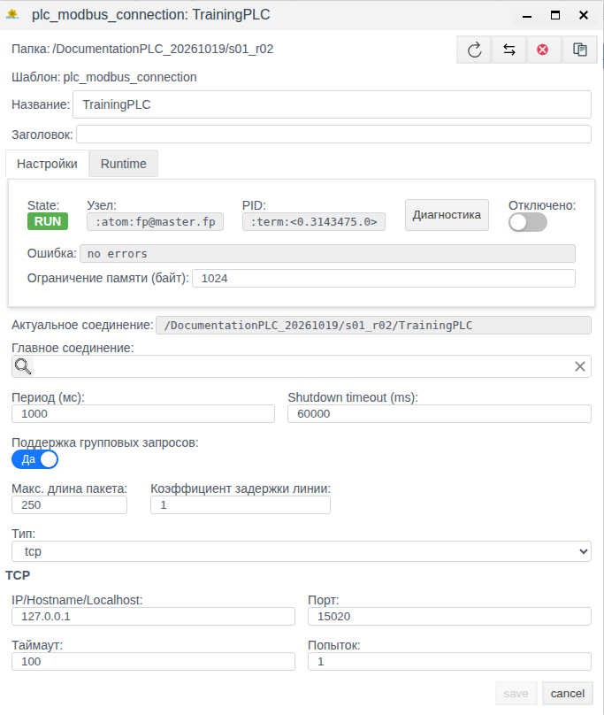

# PLC-соединения в Faceplate: выбор протокола и настройка связи

Руководство для интеграторов: выбор драйвера, настройка соединения и проверка обмена через Студию Faceplate. Примеры проверены 19 октября 2026 года в проекте релиза 4.0.7.

## Назначение и принцип работы

PLC-соединение организует обмен с контроллером, модулем ввода-вывода, счётчиком, шлюзом или промышленным сервером. В соединении выбирают драйвер и задают параметры связи; адреса отдельных сигналов задают в привязках.

| Понятие | Что определяет |
|---|---|
| Протокол | Правила обмена данными с источником |
| Драйвер | Поддержку выбранного протокола в Faceplate |
| Соединение | Параметры конкретного канала: адрес, транспорт и настройки обмена |
| Привязка | Адрес данных устройства, направление обмена и связанное поле тега |
| Тег | Объект проекта, в поле которого поступает значение для дальнейшего использования |

В примере данные проходят цепочку: учебный регистр → Modbus TCP → соединение **TrainingPLC** → привязка **Register1** → поле **value** тега **PLCValue**.

Клиент инициирует обмен с устройством или сервером. Сервер предоставляет данные внешним клиентам и принимает их запросы. Роль определяется выбранным драйвером: общего переключателя между клиентом и сервером для всех соединений нет.

Общий порядок работы: подготовить источник и тег, создать соединение в дереве проекта, настроить привязку, проверить состояние в списке драйверов PLC, затем проверить фактическое значение тега. Само создание соединения не создаёт сигналы автоматически.

Соединение и привязка решают разные задачи. Соединение хранит настройки канала и управляет его выполнением. Внутри него создают привязки отдельных сигналов. Все привязки этого соединения используют его канал и общие параметры обмена; адрес и поле назначения каждого сигнала задаются отдельно.

Тег принадлежит проекту Faceplate и служит точкой использования данных. В нашем примере источник содержит число 1000, соединение обеспечивает обмен с источником, привязка выбирает нужный регистр, а тег принимает результат в поле **value**. Поэтому при настройке нужно определить и источник данных, и место, куда они должны поступать.

Такое разделение помогает при сопровождении. Если меняется адрес устройства или общий период обмена, проверяют соединение. Если неверно читается отдельный сигнал, проверяют его привязку и целевое поле тега. Само наличие числа в теге оценивают вместе с состоянием канала и подтверждением нового чтения.

## Выбор протокола

Выбирайте драйвер по интерфейсу, который предоставляет устройство или промежуточный сервер. До настройки уточните протокол и его вариант, роль Faceplate, параметры доступа и карту данных. Наличие драйвера не подтверждает совместимость с любой моделью устройства.

В проверенной установке доступны следующие 15 типов. В первом столбце приведены точные значения фильтра **Тип соединения:**.

| Тип в списке | Назначение | Роль Faceplate |
|---|---|---|
| dcon | Модули ввода-вывода с протоколом DCON | Опрос устройства |
| [ethernet_ip](./plc_ethernet_ip_connection_ru.md) | Обмен с поддерживаемыми контроллерами по EtherNet/IP | Клиент |
| [opcda](./plc_opcda_connection_ru.md) | Подключение к источнику данных OPC DA | Клиент |
| [opcua_client](./old_plc_opcua_client_connection_ru.md) | Получение данных от OPC UA-сервера | Клиент |
| [opcua_server](./old_plc_opcua_server_connection_ru.md) | Предоставление данных Faceplate внешним OPC UA-клиентам | Сервер |
| [s7](./old_plc_s7_connection_ru.md) | Обмен с поддерживаемыми контроллерами Siemens S7 | Клиент |
| [snmp](./plc_snmp_connection_ru.md) | Получение параметров от SNMP-агента; в проверенной реализации используется v2c | Опрос устройства |
| [iec101_client](./plc_iec101_client_connection_ru.md) | Телемеханика IEC 60870-5-101 | Клиент |
| [iec101_server](./plc_iec101_server_connection_ru.md) | Предоставление данных по IEC 60870-5-101 | Сервер |
| [iec104_client](./plc_iec104_client_connection_ru.md) | Телемеханика IEC 60870-5-104 по TCP | Клиент |
| [iec104_server](./plc_iec104_server_connection_ru.md) | Предоставление данных по IEC 60870-5-104 | Сервер |
| iec62056 | Обмен с приборами учёта по IEC 62056 | Опрос прибора |
| [mbus](./plc_mbus_connection_ru.md) | Обмен с приборами учёта M-Bus | Опрос прибора |
| mercury230 | Обмен со счётчиками Меркурий 230 | Опрос прибора |
| [modbus](./plc_modbus_connection_ru.md) | Обмен с PLC, модулями и шлюзами Modbus | Клиент / опрос устройства |

Ссылки в таблице ведут к отдельным справкам по протоколам. Преобразования значений описаны в [инструкции по Transformation](./transformation_ru.md), окно **Диагностика** — в документе [«Диагностика объектов Runtime»](../diagnostics/diagnostics.md), резервирование каналов и служб — в [инструкции по резервированию ресурсов](../Redundancy/Redundancy_ru.md).

Для Modbus форма предлагает **tcp**, **rtu-tcp** и **rtu-serial**. Здесь используется только **tcp**. IEC 101 относится к последовательной телемеханике; IEC 104 — к обмену по TCP. Подробная адресация, транспорт и безопасность каждого драйвера рассматриваются отдельно.

Для учебного сценария выбран Modbus TCP: у подготовленного источника известны сетевой адрес, порт и один регистр с постоянным значением. На таком примере можно последовательно проверить создание соединения, выбор данных, связь с тегом и получение результата. Роль устройства на стенде выполняет учебный Modbus TCP-сервер; использование примера не требует физического контроллера насосной станции.

Общий порядок настройки относится к PLC-соединениям: выбрать поддерживаемый драйвер, задать канал, настроить привязки и проверить данные. В этом сценарии конкретные поля канала и адресации показаны для Modbus TCP. Для другого драйвера сохраняется порядок работы, а параметры подключения и адрес сигнала берутся из его формы и документации устройства. Выбор Modbus для примера не определяет протокол вашего проекта.

## Подготовка и учебные объекты

Перед началом обеспечьте:

- Доступ к Студии и права создания, изменения и удаления объектов в учебной папке.
- Активную папку проекта и доступный узел выполнения обмена.
- Работающий источник Modbus TCP с известными адресом, портом и картой регистров.
- Подготовленный числовой тег с полем значения, доступным для просмотра через форму объекта.

Доступ к источнику требуется с узла, выполняющего обмен Faceplate. Адрес 127.0.0.1 в примере относится к этому узлу. Для удалённого PLC укажите его фактический адрес.

| Объект или параметр | Исходное состояние | Кто подготавливает |
|---|---|---|
| Учебная папка проекта | Доступна для записи, выполнение разрешено | Подготавливается до примера |
| Учебный Modbus TCP-сервер | 127.0.0.1, порт 15020; запущен на узле обмена | Подготавливается до примера |
| Регистр источника | Unit 1, holding register с PDU-адресом 0, значение 1000 | Подготавливается до примера |
| PLCValue | Числовой тег; целочисленное поле value с начальным значением 0 | Подготавливается до примера |
| TrainingPLC | Соединения ещё нет | Создаётся в первом сценарии |
| Register1 | Привязки ещё нет | Создаётся в первом сценарии |

Число 1000 — учебное значение в отсчётах регистра, без пересчёта в физические единицы. Числовой тип тега подготовлен для стенда; его наличие не подразумевается в каждом новом проекте. В своём проекте используйте подходящий числовой тег и его реальное поле значения.

Тег можно проверить через **Меню → Общий вид**: откройте учебную папку, затем **PLCValue**. До создания привязки поле **value** должно показывать 0. Закройте форму кнопкой **cancel**.

Здесь используется одна привязка для проверки чтения. Остальные возможности привязок и преобразований рассматриваются отдельно.

## Основные настройки

**Период (мс)** задаёт период циклической части обмена. Для Modbus-примера это период опроса. Если опрос заканчивается раньше периода, соединение ожидает оставшееся время; если длится дольше, следующий цикл начинается без дополнительной паузы. Период не гарантирует появление нового значения на экране ровно через указанное число миллисекунд.

**Таймаут** в TCP-настройках Modbus относится к ожиданию ответа устройства. **Shutdown timeout (ms)** относится к штатному завершению рабочего процесса соединения. Эти параметры решают разные задачи.

**Поддержка групповых запросов** разрешает объединение чтений, если его поддерживает драйвер. При **Нет** поля размера пакета и коэффициента недоступны для изменения. **Макс. длина пакета** и **Коэффициент задержки линии** влияют на формирование групп; коэффициент не задаёт отдельную паузу между запросами и не заменяет настройку повторов. Единицы и допустимый размер групп зависят от протокола.

Изменение исполняемых параметров соединения приводит к перезапуску его выполнения. После сохранения проверяйте состояние и значение тега. Точные исходные значения и пределы полей приведены в справочнике.

## Подключить PLC насосной станции

Задача первого сценария — создать **TrainingPLC** и получить 1000 отсчётов в подготовленном теге. Сценарий выполняется независимо от второго; его исходные объекты перечислены в разделе «Подготовка и учебные объекты».

### Создать объект соединения и настроить канал

На этом этапе создаётся объект, который будет выполнять обмен с источником. В **Общем виде** выбирают место соединения в проекте, затем тип драйвера. Выбор **plc_modbus_connection** определяет состав протокольных настроек; имя **TrainingPLC** позволяет находить этот конкретный канал среди других соединений.

Параметры канала отвечают на вопрос, куда обращаться. В Modbus TCP это **Тип**, **IP/Hostname/Localhost** и **Порт**. Для стенда они указывают на подготовленный сервер 127.0.0.1:15020. Перед повторением примера на другом узле проверьте, что источник доступен именно с узла выполнения Faceplate.

Общие параметры отвечают на вопрос, как выполнять обмен. **Период (мс)** задаёт цикл, **Отключено** управляет выполнением соединения, а настройки группирования определяют возможность объединять чтения. Адрес регистра и тег назначения на этом этапе ещё не выбираются: они появятся в привязке.

После ввода значения в поле **Порт** нажмите **Tab**, затем сохраняйте форму. При повторном открытии проверьте сохранённый порт: он определяет фактический адрес подключения.

1. В **Меню** выберите **Общий вид**.
2. Откройте подготовленную учебную папку.
3. Нажмите **Создать**.
4. Откройте группу **plc** двойным щелчком.
5. Выберите **plc_modbus_connection**.
6. Нажмите **Ok**.
7. В поле **Название** введите **TrainingPLC**.
8. Проверьте значение **tcp** в поле **Тип**.
9. Введите **127.0.0.1** в **IP/Hostname/Localhost**.
10. Введите **15020** в **Порт**.
11. Сверьте остальные параметры с таблицей.

| Поле | Значение первого сценария |
|---|---|
| Период (мс) | 1000 |
| Shutdown timeout (ms) | 60000 |
| Таймаут | 100 |
| Попыток | 1 |
| Поддержка групповых запросов | Да |
| Макс. длина пакета | 250 |
| Коэффициент задержки линии | 1 |
| Отключено | Выключено |
| Главное соединение | Пусто |

12. Нажмите **save**.
13. Выделите созданное **TrainingPLC**.
14. Нажмите **Редактировать**.
15. Проверьте сохранённые адрес, порт и параметры.
16. Закройте форму кнопкой **cancel**.

После сохранения соединение может показывать **RUN** ещё до создания привязки. Для подтверждения получения данных требуется проверка тега в конце сценария.

### Связать данные устройства с тегом проекта

После создания канала нужно определить, какие данные передавать в проект. Для этого внутри **TrainingPLC** создаётся привязка **Register1**. Она связывает конкретные данные устройства с конкретным полем тега **PLCValue**. Создание одного соединения без такой связи не задаёт, какое значение должно появиться в проекте.

У привязки есть две стороны. На стороне Faceplate выбираются тег и поле **value**. На стороне устройства задаются адрес и представление данных. В примере **Адрес slave** выбирает устройство с идентификатором 1, а **Область**, **Чтение** и **Адрес** выбирают его holding register. Поэтому одинаковое число 1 в полях **Адрес slave** и **Адрес** обозначает разные параметры.

**Доступ: R** задаёт чтение из источника в тег. **Размер**, **Порядок байт** и **Формат** определяют, как интерпретировать полученные данные. Даже при работающем канале ошибочная адресация или формат могут дать неверный результат. В этом примере они согласованы с одним 16-битным беззнаковым регистром; преобразование в физические единицы не выполняется.

1. Откройте **TrainingPLC** двойным щелчком в **Общем виде**.
2. Нажмите **Создать**.
3. Введите **Register1** в **Название**.
4. Нажмите кнопку выбора с лупой у поля **тег**.
5. Откройте учебную папку в окне выбора.
6. Выделите **PLCValue**.
7. Нажмите **ОК**.
8. В соседнем списке поля выберите **value**.
9. Проверьте **R** в **Доступ**.
10. Установите **1** в **Адрес**.
11. Выберите **unsigned-integer** в **Формат**.
12. Сверьте остальные параметры с таблицей.

| Поле | Значение | Смысл в примере |
|---|---|---|
| Адрес slave | 1 | Идентификатор учебного устройства |
| Область | HR | Holding register |
| Чтение | 03 | Чтение выбранной области |
| Адрес | 1 | Соответствует PDU-адресу 0 учебного источника |
| Размер | word | Учебное 16-битное значение |
| Порядок байт | 21 | Порядок, проверенный на данном источнике |
| Формат | unsigned-integer | Беззнаковое целое |
| Смещение | 0 | Дополнительное смещение не используется |

13. Проверьте, что **Трансформация** пуста.
14. Нажмите **save**.
15. Откройте **Register1** повторно и проверьте сохранённые поля.
16. Закройте форму кнопкой **cancel**.

В новой форме **Адрес** первоначально равен 0; для учебного источника его необходимо изменить на 1. Размер, формат и порядок байтов в таблице относятся к данному регистру. Для своего устройства используйте его карту данных. Поле **Запись** может оставаться видимым при **R**; направление обмена в этом примере задаётся полем **Доступ**.

### Проверить соединение и поступление данных

Проверка состоит из двух частей. Сначала найдите нужное соединение в списке драйверов PLC и убедитесь, что выполнение разрешено, процесс работает и выбран ожидаемый канал. Это общая проверка соединения, независимо от того, какой сигнал вы собираетесь использовать.

Затем проверьте путь конкретного сигнала: дочернюю привязку, её целевой тег и поле **value**. В учебном примере исходное значение тега равно 0, а источник содержит 1000. Появление ожидаемых 1000 после настройки привязки подтверждает результат чтения. **RUN** без проверки сигнала подтверждает только запущенное выполнение, а оставшееся прежнее число не подтверждает новый обмен.

После проверки у вас должны быть три связанных объекта: соединение **TrainingPLC**, привязка **Register1** и тег **PLCValue**. Соединение обеспечивает канал, привязка описывает один сигнал, тег предоставляет его значение проекту. При дальнейшем расширении обмена сигналы описываются своими привязками внутри подходящего соединения.

1. В **Меню** откройте список драйверов PLC.
2. В **Поиск по пути** введите фрагмент пути учебной папки длиной не менее трёх символов.
3. Раскройте список **Тип соединения:**.
4. Установите флажок **modbus**.
5. Закройте список типов.
6. Нажмите **Найти**.
7. Нажмите крайнюю левую кнопку с круговой стрелкой для обновления.
8. Проверьте строку **TrainingPLC** по таблице.

| Где смотреть | Ожидаемый результат |
|---|---|
| Режим | Вкл. |
| Статус | OK |
| Состояние | RUN |
| Актуальное соединение | Путь к TrainingPLC в выбранной учебной папке |
| Список привязок после двойного щелчка по соединению | Одна Register1, RUN/OK |

9. В **Меню** выберите **Общий вид**.
10. Откройте **PLCValue** в учебной папке.
11. Проверьте **value: 1000**.
12. Закройте форму кнопкой **cancel**.

Исходное поле было равно 0, а после настройки привязки показывает 1000. Источник содержит 1000 отсчётов; преобразований нет, поэтому ожидаемое сохранённое и отображаемое значение также равно 1000. Это подтверждает чтение в условиях стенда. Проверяйте результат после успешного цикла и обновления формы; время самой проверки не является измерением задержки обмена.

Если выбран фильтр **modbus**, состав столбцов списка может измениться: появляются протокольные поля. Пустые ячейки полей привязки у строки самого соединения не означают ошибку настройки.

## Восстановить чтение после изменений

Задача второго сценария — изменить параметры существующего **TrainingPLC**, проверить диагностику и восстановить чтение. Начинайте после успешного первого сценария: соединение включено, тег показывает 1000, привязка остаётся **R**, преобразований нет.

| Объект или параметр | Исходное состояние | Изменение в сценарии |
|---|---|---|
| TrainingPLC | Включено, RUN/OK; период 1000 мс | Период 500 мс; отключение и повторное включение |
| Групповые запросы | Да; пакет 250; коэффициент 1 | Нет, затем Да; пакет 250; коэффициент 2 |
| Register1 и PLCValue | R-привязка без преобразований; value показывает 1000 | Контроль отображения при STOP и после включения |
| Источник | Unit 1, HR/PDU 0 = 1000 | Остаётся без изменений |

### Изменить параметры опроса

Здесь изменяется существующий канал, поэтому заново выбирать регистр и тег не требуется. В примере период уменьшается с 1000 до 500 мс, затем проверяются два режима группирования. Это параметры всего соединения; у привязки остаются прежние адрес, направление чтения и поле назначения.

После сохранения сначала проверьте, что форма показывает новые параметры, затем — что выполнение и чтение восстановились. Сохранённая настройка, запущенный процесс и полученное значение являются разными результатами проверки. Период 500 мс используется для демонстрации изменения; пригодность такого периода для реального оборудования определяется условиями проекта.

1. В **Общем виде** выделите **TrainingPLC**.
2. Нажмите **Редактировать**.
3. Установите **500** в **Период (мс)**.
4. Переключите **Поддержка групповых запросов** на **Нет**.
5. Нажмите **save**.
6. Откройте соединение повторно.
7. Проверьте сохранённые **500** и **Нет**: поля пакета и коэффициента недоступны.
8. Закройте форму кнопкой **cancel**.
9. Откройте тег и проверьте отображение **1000**.
10. Закройте форму тега.
11. Откройте настройки **TrainingPLC**.
12. Переключите **Поддержка групповых запросов** на **Да**.
13. Проверьте **250** в **Макс. длина пакета**.
14. Установите **2** в **Коэффициент задержки линии**.
15. Нажмите **save**.
16. Откройте соединение повторно и проверьте сохранённые значения.
17. Закройте форму соединения кнопкой **cancel**.
18. Откройте тег и проверьте **1000**.
19. Закройте форму тега кнопкой **cancel**.

Один регистр позволяет проверить работу обоих режимов и сохранение настроек. Выигрыш производительности группирования этим примером не измеряется. Отображаемое прежнее 1000 после изменения настроек само по себе недостаточно для доказательства нового чтения; отдельная проверка восстановления приведена ниже.

### Проверить диагностику

Откройте **Диагностика** у сохранённого **TrainingPLC**, нажмите **Start** и просмотрите **Logs**; для подробного вывода выберите **debug**. Работа с окном описана в документе [«Диагностика объектов Runtime»](../diagnostics/diagnostics.md).

**Start** и **Stop** в этом окне управляют только записью журнала. Обмен останавливается флагом **Отключено** в настройках соединения; после **Stop** соединение продолжает работать.

### Отключить и проверить повторное чтение

Отключение применяется к выполнению соединения целиком. В учебной настройке это прекращает обмен единственной привязки **Register1**. На этом этапе параметры адресации остаются сохранёнными, а тег продолжает существовать как объект проекта.

Сначала подтвердите остановку по **STOP** и отсутствию процесса, затем посмотрите отображение поля тега. После включения подтвердите запуск процесса, состояние канала и ожидаемые данные. Такая последовательность объясняет, почему значение тега проверяется вместе с состоянием соединения: отображение при остановке и первое полученное значение после запуска имеют разный смысл.

1. В форме **TrainingPLC** включите **Отключено**.
2. Нажмите **save**.
3. Откройте соединение повторно.
4. Дождитесь **State: STOP** и **PID: no process**.
5. Нажмите **Диагностика** и проверьте, что окно открывается у сохранённого STOP-соединения.
6. Закройте окно диагностики.
7. Закройте форму соединения.
8. Откройте **PLCValue**.
9. Зафиксируйте отображаемое значение после полной остановки.

В проверенной учебной форме отображалось **0**. Повторное открытие также показало 0; ввод того же числа не активировал **save**, поэтому ручного сохранения не потребовалось. Это отображение после остановки, а не новое показание источника. Для другого типа тега отображение при отсутствии обмена может отличаться.

10. Закройте тег кнопкой **cancel**.
11. Откройте настройки **TrainingPLC**.
12. Выключите **Отключено**.
13. Нажмите **save**.
14. Откройте соединение повторно и проверьте **RUN**, наличие **PID** и **no errors**.
15. Закройте форму соединения кнопкой **cancel**.
16. Откройте тег и проверьте новое отображение **1000**.
17. Закройте форму тега кнопкой **cancel**.
18. В списке драйверов PLC проверьте **Вкл. / OK / RUN**.

| Этап | Процесс соединения | Отображение value в учебной форме |
|---|---|---|
| До отключения | RUN, PID присутствует | 1000 |
| После полной остановки | STOP, no process | 0 в проверенном типе |
| После включения и успешного обмена | RUN, новый PID; OK | Снова 1000 |

Источник всё время содержит 1000, а привязка остаётся **R**. Переход отображения после остановки к 1000 после включения подтверждает восстановление чтения на стенде. Сопоставляйте состояние и изменение значения; оставшееся старое значение не подтверждает новый обмен.

### Завершить учебную настройку

Выполните процедуру удаления из следующего раздела для **TrainingPLC**. Перед подтверждением проверьте его дочернюю **Register1** и перекрёстную ссылку **PLCValue**. Завершение сценария подтверждается отсутствием соединения после поиска и обновления списка.

## Управление соединением

| Задача | Где выполнить | Как проверить результат |
|---|---|---|
| Найти соединение | Меню → список драйверов PLC; Поиск по пути, Тип соединения:, Найти | В списке есть нужный объект; путь соответствует проекту |
| Обновить список | Крайняя левая кнопка с круговой стрелкой | Повторно прочитаны строки и состояния |
| Изменить настройки | Общий вид; выделить объект → Редактировать | Повторное открытие подтверждает сохранённые поля; обмен проверен отдельно |
| Отключить или включить | Переключатель Отключено в форме | STOP/no process либо восстановленные RUN/OK и чтение |
| Проверить входящие ссылки | Перекрёстная ссылка в форме объекта | Видны использующие его объекты |

Пустой результат кнопки **Зависимости** не подтверждает отсутствие всех ссылок на объект. В учебной проверке он был пустым, тогда как **Перекрёстная ссылка** тега показывала **Register1**.

### Удалить учебное соединение

> [!WARNING]
> Удаление завершает обмен и в данном примере удаляет дочернюю привязку. Выполняйте процедуру только для учебного соединения, работу которого вы завершили.

1. Откройте **PLCValue**.
2. Нажмите **Перекрёстная ссылка** — значок встречных стрелок вверху формы.
3. Проверьте строку **Register1** и её принадлежность **TrainingPLC**.
4. Закройте окно ссылок.
5. Закройте форму тега кнопкой **cancel**.
6. В учебной папке выделите только **TrainingPLC**.
7. Нажмите **Удалить**.
8. Проверьте количество **1** в диалоге **delete items: 1**.
9. Нажмите **yes**.
10. Обновите содержимое папки.
11. Проверьте, что в ней остался тег, а соединение отсутствует.
12. Откройте **Перекрёстная ссылка** тега и проверьте отсутствие прежней **Register1**.
13. Найдите удалённое соединение по его пути в списке драйверов PLC.
14. Обновите список и проверьте отсутствие строк.

В проверенном примере отдельного подтверждения удаления дочерней привязки не было; отдельно удалять **Register1** не потребовалось. Тег сохранился и продолжал отображать 1000. После удаления соединения это остаточное отображение, а не продолжающееся чтение.

Резервирование, копирование и перенос выходят за практическую часть руководства.

## Справочник настроек и состояний

### Общие поля соединения

Значения ниже относятся к проверенной форме и сборке. Пределы числовых полей приведены по настройкам формы; поведение конкретного протокола уточняется отдельно.

| Поле | Ввод и исходное значение | Назначение и пределы |
|---|---|---|
| Название | Задаётся пользователем; новая форма пустая | Имя объекта; при пустом имени сохранение недоступно |
| Заголовок | Необязателен; пусто | Дополнительное отображаемое описание |
| Период (мс) | 1000 | Период циклов; 1–3600000 мс |
| Shutdown timeout (ms) | 60000 | Ожидание завершения процесса; 10–3600000 мс |
| Поддержка групповых запросов | В новой форме Да | Разрешение группирования при поддержке драйвером |
| Макс. длина пакета | 250 | Предел группы; 1–10000 в единицах драйвера; поле активно при группировании |
| Коэффициент задержки линии | 1 в новой форме; в сценарии 2 установлен 2 | Расчёт группирования; 1–10; поле активно при группировании |
| Отключено | В новой форме выключено | Управление выполнением соединения |
| Главное соединение | Необязательная ссылка; пусто | Основное соединение того же типа для резервирования; в примерах не задаётся |
| Ограничение памяти (байт) | До сохранения поле пусто; после сохранения 1024 | Лимит кучи рабочего процесса. В этой сборке число интерпретируется в МиБ: 1024 соответствует 1 ГиБ; подпись «байт» с этим не совпадает. В примерах поле не меняется |
| Актуальное соединение | Заполняет система | Путь канала, выбранного при успешном подключении; до подключения путь может отсутствовать |
| Узел, PID | Заполняет система | Узел выполнения и идентификатор рабочего процесса |
| Ошибка | Заполняет система | Диагностическое сообщение; при успешной проверке no errors |

### Общие поля PLC-привязки

Адресация и дополнительные поля зависят от выбранного драйвера; они описаны в отдельных справках по протоколам.

| Поле | Назначение |
|---|---|
| Name / Название | Имя привязки в дереве проекта |
| Title / Заголовок | Описание привязки |
| State / Состояние | Состояние выполнения привязки: STOP или RUN |
| Off / Отключено | Отключение привязки без удаления объекта |
| Tag / Тег и поле | Объект проекта и его поле для чтения или записи |
| Transformation / Трансформация | Преобразование значения при обмене |
| Access / Доступ | Направление обмена: R — чтение, W — запись, RW — чтение и запись |

### Трансформация данных

Преобразование значения настраивается в поле **Трансформация** PLC-привязки. Методы и параметры описаны в отдельной [инструкции по Transformation](./transformation_ru.md). В учебном сценарии преобразование не используется.

### Поля Modbus TCP

| Поле | Значение формы / примера | Что означает |
|---|---|---|
| Тип | tcp | В примере TCP; другие варианты формы: rtu-tcp, rtu-serial |
| IP/Hostname/Localhost | В форме показан 127.0.0.1 | Адрес источника со стороны узла обмена; задайте фактический адрес |
| Порт | Исходно 502; на стенде 15020 | TCP-порт источника |
| Таймаут | 100 | Ожидание ответа, мс; минимальное значение формы 1 |
| Попыток | 1 | Параметр числа попыток обмена; диапазон формы 1–50 |

### Состояния и диагностические элементы

| Элемент | Как читать |
|---|---|
| Режим Вкл. / Откл. | Разрешение выполнения соединения |
| State / Состояние RUN | Выполнение запущено; получение нужных данных подтверждается значением тега |
| State / Состояние STOP | Выполнение остановлено; причину проверяют по настройкам, Runtime и ошибке |
| Статус OK / ОШИБКА | Результат обмена в списке; при ошибке смотрите сообщение |
| no process / no node | В форме нет текущего рабочего процесса / узла |
| shutdown после отключения | В проверке появлялось с отметкой времени после включения Отключено; сопоставляйте с выполненным действием |

## Диагностика

Проверяйте три уровня: разрешено ли выполнение, работает ли канал, поступает ли нужное значение. Окно **Диагностика** доступно и у сохранённого соединения в **STOP**.

Работа с окном описана в документе [«Диагностика объектов Runtime»](../diagnostics/diagnostics.md).

| Симптом | Где проверить | Возможная причина | Действие | Проверка восстановления |
|---|---|---|---|---|
| STOP, no process | Отключено; активность папки и узла выполнения | Соединение отключено или выполнение не разрешено | Восстановить разрешение выполнения в нужной учебной конфигурации | RUN, PID присутствует; подтверждено новое чтение |
| Ошибка связи | Ошибка, Актуальное соединение, адрес и порт | Источник недоступен или параметры не совпадают | Сверить параметры с настройками источника, исправить соединение | OK и ожидаемое значение тега |
| RUN/OK, но нужное значение не появляется | Список привязок, тег и выбранное поле | Нет привязки, неверно выбрано поле, адрес или направление | Проверить R-привязку и её адресацию по карте данных | Появилось ожидаемое значение в правильном поле |
| Значение не равно ожидаемым 1000 | Адрес slave, Область, Адрес, Размер, Порядок байт, Формат | Настройки не соответствуют учебному регистру | Сверить поля с таблицей привязки | В учебном теге отображается 1000 |
| После остановки отображается 0 | Состояние соединения и форма тега | Особенность отображения учебного поля при прекращении обмена | Сопоставить значение с STOP; выполнить проверку включения | После включения отображается 1000 и RUN/OK |
| После удаления осталось 1000 | Наличие соединения и входящих ссылок тега | Остаточное отображение тега | Проверить отсутствие соединения и привязки | Подтверждено завершение обмена; старое число не принимается за новое чтение |
| Поиск не даёт нужной строки | Поиск по пути и Тип соединения: | Неверный фрагмент пути или оставленный фильтр | Уточнить путь длиной от трёх символов, проверить тип и нажать Найти/обновление | Нужный объект найден либо его удаление подтверждено |

## Ограничения

- Доступные типы зависят от установленных драйверов. Каталог в этом руководстве не заменяет проверку поддержки конкретного устройства.
- Практически проверен Modbus TCP с одной R-привязкой. Настройка остальных протоколов, RTU-транспортов, преобразований и команд записи рассматривается отдельно.
- Одинаковые общие поля не означают одинаковый алгоритм обмена и поддержку группирования у всех драйверов.
- Измерения задержки, нагрузки и эффективности группирования в учебных сценариях не выполнялись.
- Поле лимита памяти имеет несогласованную подпись единиц; интерпретация проверенной сборки указана рядом с полем в справочнике.
