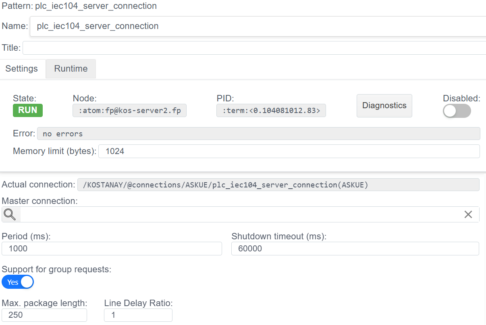
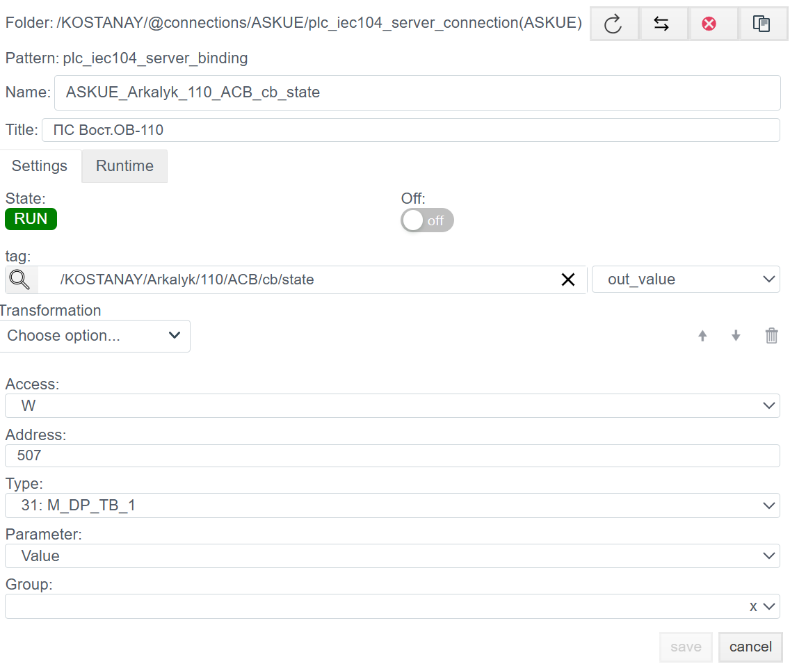
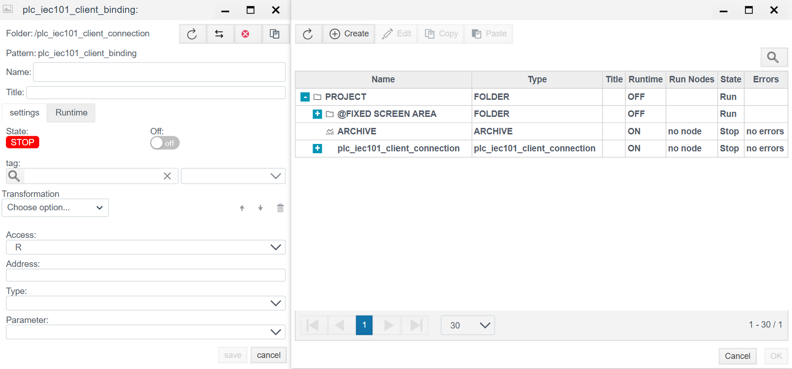
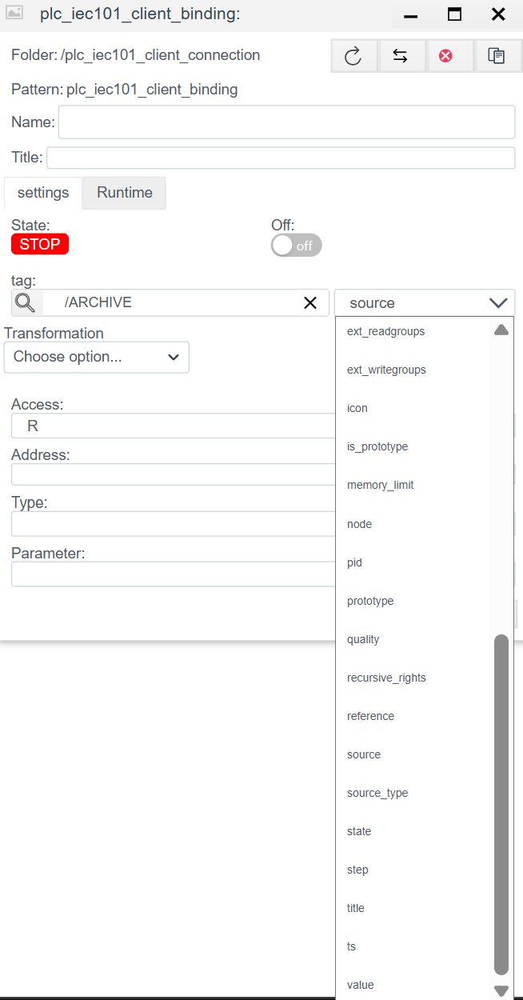
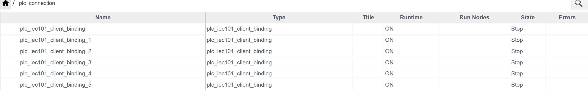
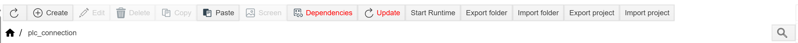

# PLC-соединения

## Назначение модуля

Модуль **PLC Connections** предназначен для настройки и управления соединениями между **Faceplate Runtime** и внешними устройствами/системами автоматизации:

- **PLC/RTU/IED** (контроллеры, терминалы, релейная защита)
- **Счётчики и измерители** (электросчётчики, теплосчётчики и т.д.)
- **OPC-серверы**
- Прочие источники технологических данных через промышленные протоколы

Через PLC-соединения система получает и/или отправляет:

- **Теги/сигналы** (AI/DI/DO/AO)
- **События и аварии**
- **Служебные статусы связи**
- **Команды управления** (если разрешено конфигурацией)

PLC-соединения применяются для:

1. **Сбора телеметрии** Чтение значений датчиков, состояний, измерений.

2. **Отправки команд** Дискретное управление, уставки, подтверждения и т.д.

3. **Интеграции со сторонними системами** OPC DA/UA, шлюзы, SCADA-системы, RTU-концентраторы.

4. **Мониторинга доступности** Диагностика канала связи, статусы подключения, статистика обмена.

---

## Клиентские и серверные соединения

### Клиентское соединение (Client connection)

**Client connection** означает, что **Faceplate инициирует подключение** к удалённой стороне:

- Faceplate выступает активной стороной и инициирует сеанс связи
- удалённая сторона принимает подключение и отвечает на запросы
- обмен данными выполняется по выбранному промышленному протоколу

**Примеры:**
- IEC-104 Client → подключение к серверу РЗА/RTU
- Modbus Client → опрос устройства по TCP/RTU
- OPC UA Client → чтение данных с OPC UA сервера

---

### Серверное соединение (Server connection)

**Server connection** означает, что **Faceplate слушает входящие подключения** (принимает соединение как сервер):

- внешнее устройство/система подключается к Faceplate
- Faceplate обслуживает входящие запросы/сеансы
- выдаёт данные или принимает команды

**Примеры:**
- IEC-104 Server → внешняя информационная система подключается к Faceplate
- OPC UA Server → клиенты читают значения из Faceplate

---

## Поддерживаемые типы PLC-соединений

Ниже перечислены типы, доступные в папке **/plc**.

### Клиентские соединения (поддерживаемые)

- **plc_iec101_client_connection** → [IEC-101 Client](./plc_iec101_client_connection_ru.md)
- **plc_iec104_client_connection** → [IEC-104 Client](./plc_iec104_client_connection_ru.md)
- **plc_opcua_client_connection** → [OPC UA Client](./plc_opcua_client_connection_ru.md)

---

### Серверные соединения (поддерживаемые)

- **plc_iec101_server_connection** → [IEC-101 Server](./plc_iec101_server_connection_ru.md)
- **plc_iec104_server_connection** → [IEC-104 Server](./plc_iec104_server_connection_ru.md)
- **plc_opcua_server_connection** → [OPC UA Server](./plc_opcua_server_connection_ru.md)

---

### Прочие клиентские соединения

- **plc_ethernet_ip_connection** → [EtherNet/IP](./plc_ethernet_ip_connection_ru.md)
- **plc_mbus_connection** → [M-Bus](./plc_mbus_connection_ru.md)
- **plc_modbus_connection** → [Modbus](./plc_modbus_connection_ru.md)
- **plc_opcda_connection** → [OPC DA](./plc_opcda_connection_ru.md)
- **plc_s7_connection** → [Siemens S7](./plc_s7_connection_ru.md)
- **plc_snmp_connection** → [SNMP](./plc_snmp_connection_ru.md)

---

## Общие параметры соединения (Settings)

Общие поля одинаковы для большинства соединений. Некоторые драйверы могут скрывать или не использовать отдельные поля.

| Поле | Назначение |
| :--- | :--- |
| **Name** | Системное имя соединения (уникальный идентификатор). |
| **Title** | Заголовок (человекочитаемое описание). |
| **State** | Состояние объекта (**STOP** / **RUN**). |
| **Period (ms)** | Базовый цикл обработки/опроса. |
| **Shutdown timeout (ms)** | Время ожидания корректной остановки обмена. |
| **Disabled** | Включение/отключение соединения без удаления объекта. |
| **Memory limit (bytes)** | Лимит памяти процесса соединения. |
| **Actual connection** | Текущее активное соединение (актуально для резервирования). Если резервное соединение не настроено, указывает на самого себя. |
| **Master connection** | Привязка к основному каналу при резервировании. |
| **Support for group requests** | Включает групповые запросы (если поддерживается протоколом). |
| **Max. package length** | Ограничение размера пакета (если используется драйвером). |
| **Line Delay Ratio** | Коэффициент задержки линии (если используется драйвером). |

> **Примечание:** Параметры **Support for group requests**, **Max. package length** и **Line Delay Ratio** не используются для некоторых типов соединений. В таких случаях их настройки рекомендуется оставить по умолчанию.

---

## Создание PLC-соединения
> Идентичны для всех PLC-соединений.

*Шаг 1.* В дереве проекта перейдите в директорию, где будет находиться PLC-соединение.
*Шаг 2.* Нажмите кнопку **«Создать»**.
*Шаг 3.* В дереве объектов откройте раздел **plc**.
*Шаг 4.* Убедитесь, что отображается список доступных типов соединений.

*Шаг 5.* Выберите необходимый тип соединения.
*Шаг 6.* Нажмите кнопку **«OK»**.

*Шаг 7.* Откроется окно конфигурации соединения.
> Специфичные параметры соединения зависят от типа протокола:
- [IEC-101 Client](./plc_iec101_client_connection_ru.md#1-настройка-соединения-connection)
- [IEC-104 Client](./plc_iec104_client_connection_ru.md#1-настройка-соединения-connection)
- [IEC-101 Server](./plc_iec101_server_connection_ru.md#1-настройка-соединения-connection)
- [IEC-104 Server](./plc_iec104_server_connection_ru.md#1-настройка-соединения-connection)
- [OPC UA Client](./plc_opcua_client_connection_ru.md#1-настройка-соединения-connection)
- [OPC UA Server](./plc_opcua_server_connection_ru.md#1-настройка-соединения-connection)
- [Modbus](./plc_modbus_connection_ru.md#1-настройка-соединения-connection)
- [EtherNet/IP](./plc_ethernet_ip_connection_ru.md#1-настройка-соединения-connection)
- [M-Bus](./plc_mbus_connection_ru.md#1-настройка-соединения-connection)
- [OPC DA](./plc_opcda_connection_ru.md#1-настройка-соединения-connection)
- [Siemens S7](./plc_s7_connection_ru.md#1-настройка-соединения-connection)
- [SNMP](./plc_snmp_connection_ru.md#1-настройка-соединения-connection)

*Шаг 8.* После конфигурации соединения нажмите кнопку **«Save»**.

---

## Общие поля PLC-привязки

Общие поля одинаковы для большинства привязок. Набор специфичных полей (адрес, тип данных и др.) зависит от конкретного протокола и описан в соответствующем разделе.

| Поле | Назначение |
| :--- | :--- |
| **Name** | Системное имя привязки в дереве проекта. |
| **Title** | Заголовок (человекочитаемое описание). |
| **State** | Состояние привязки (**STOP** / **RUN**). |
| **Off** | Включение/отключение привязки без удаления объекта. |
| **Tag** | Привязка к системному тегу (опционально). Если тег не выбран, значение остаётся в поле `value` самой привязки. Рядом с путём тега выбирается целевое поле объекта. |
| **Transformation** | Преобразование значения перед записью/чтением. Подробнее см. раздел [Трансформация](./transformation_ru.md). |
| **Access** | Режим доступа: **R** (чтение), **W** (запись), **RW** (чтение/запись). |

### Привязка к тегу

Привязка к тегу **опциональна**. Если тег не выбран, полученное значение остаётся в поле `value` самой привязки.

**Шаг 1:** Нажмите на иконку лупы в поле **Tag**.
> Откроется окно с деревом проекта. В нём можно выбрать объект вручную или через поиск.

**Шаг 2:** Выберите объект, в который необходимо записать или с которого необходимо считать данные.
> Выделите нужный объект нажатием ЛКМ, затем нажмите кнопку **OK** в правом нижнем углу.

**Шаг 3:** После выбора объекта станет активным выпадающий список полей (справа от пути объекта).
> Выберите необходимое поле объекта нажатием ЛКМ.

**Результат:**
В поле **Tag** будет указан полный путь к объекту и выбранное поле.

### Ошибки в привязке

После создания привязок в дереве проекта каждая привязка отображает поле **Errors**.

Если ошибок нет — поле будет пустым. Возможные значения:

| Ошибка | Описание |
| :--- | :--- |
| `unavailable address "<address>"` | Указанный адрес недоступен на устройстве. |
| `shutdown` | Соединение было остановлено. |
| `no connection` | Нет связи с устройством. |

---

## Создание PLC-привязки

> Шаги идентичны для всех PLC-соединений.

*Шаг 1.* После успешного создания PLC - соединения, двойным нажатием ЛКМ по соответствующему соединению, откроется окно настройки соединения.
*Шаг 2.* Нажмите кнопку **«Создать»**.

*Шаг 3.* Откроется окно конфигурации PLC-привязки.
> Специфичные параметры привязки зависят от типа соединения:
- [IEC-101 Client](./plc_iec101_client_connection_ru.md#настройка-переменных-binding)
- [IEC-104 Client](./plc_iec104_client_connection_ru.md#настройка-переменных-binding)
- [IEC-101 Server](./plc_iec101_server_connection_ru.md#настройка-переменных-binding)
- [IEC-104 Server](./plc_iec104_server_connection_ru.md#настройка-переменных-binding)
- [OPC UA Client](./plc_opcua_client_connection_ru.md#настройка-переменных-binding)
- [OPC UA Server](./plc_opcua_server_connection_ru.md#настройка-переменных-binding)
- [Modbus](./plc_modbus_connection_ru.md#настройка-переменных-binding)
- [EtherNet/IP](./plc_ethernet_ip_connection_ru.md#настройка-переменных-binding)
- [M-Bus](./plc_mbus_connection_ru.md#настройка-переменных-binding)
- [OPC DA](./plc_opcda_connection_ru.md#настройка-переменных-binding)
- [Siemens S7](./plc_s7_connection_ru.md#настройка-переменных-binding)
- [SNMP](./plc_snmp_connection_ru.md#настройка-переменных-binding)

*Шаг 4.* После конфигурации привязки, нажмите кнопку **«Save»**.

---
## Трансформация данных

Для преобразования значений, получаемых или отправляемых через PLC-привязки, 
используется механизм трансформации. Он позволяет применять формулы, маппинг 
и другие преобразования к данным на этапе обмена.

Подробнее см. в разделе [Трансформация](./transformation_ru.md).

---

## Диагностика (Diagnostics)

Для каждого PLC-соединения доступен инструмент диагностики обмена данными в режиме debug. 
Он позволяет в реальном времени анализировать ошибки, просматривать логи и контролировать 
состояние соединения.

Подробнее о работе с инструментом диагностики см. в разделе 
[Диагностика PLC-соединений](./diagnostics_ru.md).

---