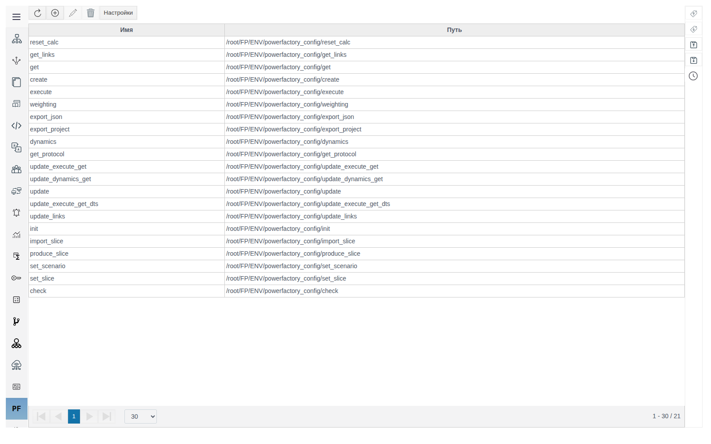
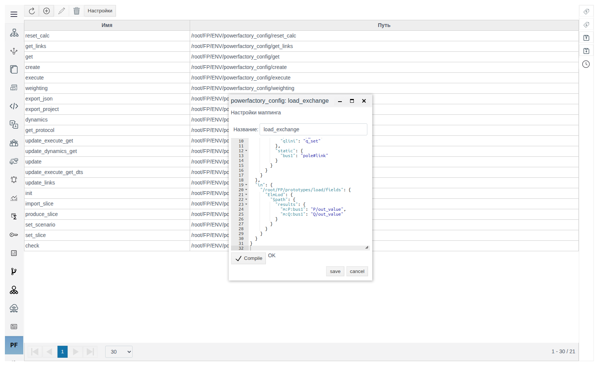
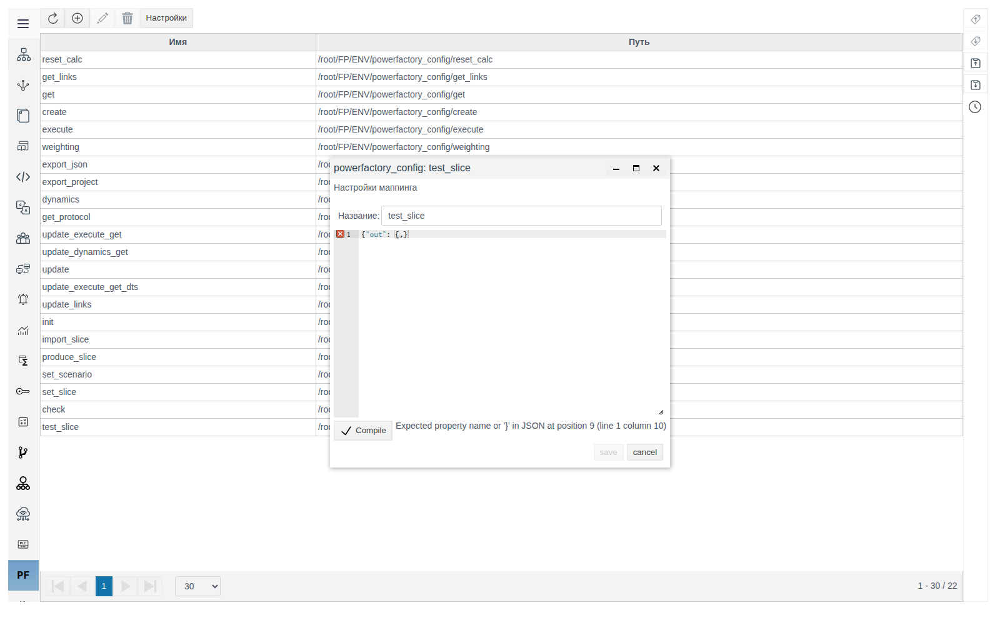
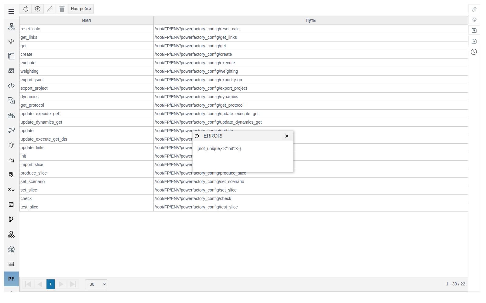
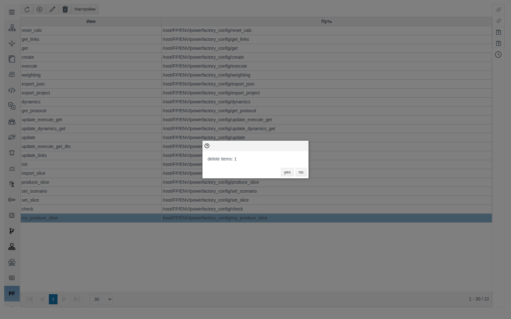
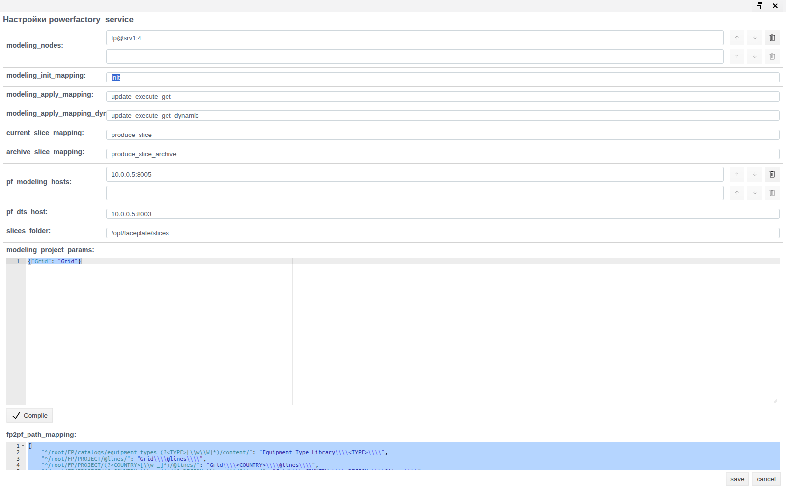
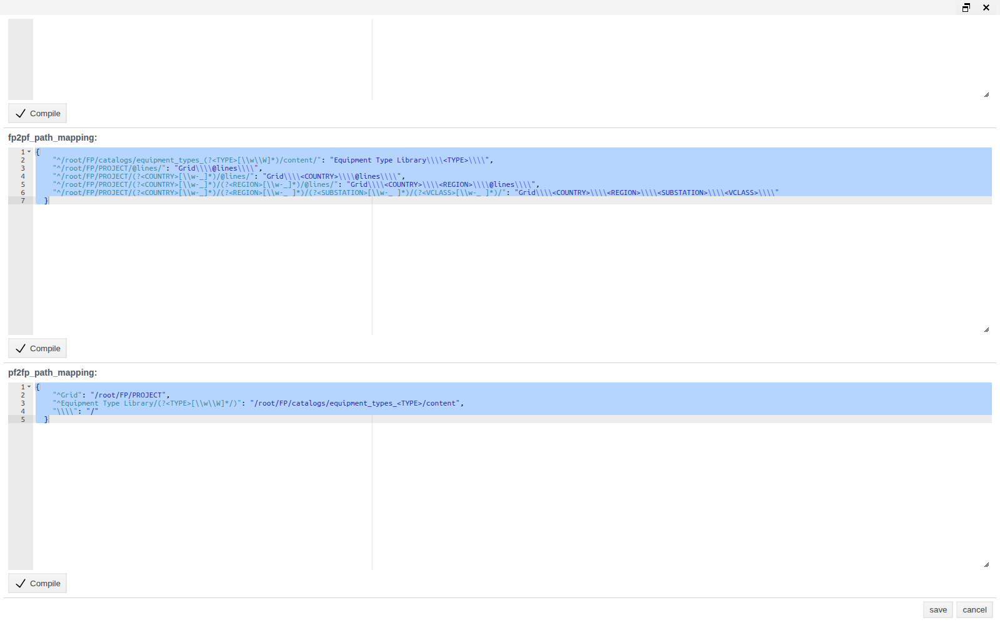

# Powerfactory Service

Документ для инженера-интегратора, который настраивает обмен данными проекта Faceplate с внешним сервисом расчётов DIgSILENT PowerFactory.

# Глоссарий

| Термин | Значение |
|---|---|
| Powerfactory Service | Раздел главного меню Studio (иконка **PF**): маппинги и настройки интеграции с PowerFactory |
| Маппинг | Именованный JSON, который описывает, какие поля объектов Faceplate передаются в PowerFactory и в какие поля записываются полученные значения |
| Хост PowerFactory | Адрес внешнего сервиса PowerFactory в виде `хост[:порт]`. Без порта используется 80 |
| Узел моделирования | Узел кластера Faceplate, на котором разрешено открывать сеансы моделирования |
| Срез | JSON-снимок состояния сети. Файлы срезов хранятся в папке на сервере Faceplate |
| DTS | Режим тренажёра диспетчера. Работает через отдельный хост PowerFactory |
| Преобразование путей | Правила, по которым путь объекта Faceplate превращается в путь объекта PowerFactory и обратно |

# Введение

Powerfactory Service связывает объекты проекта Faceplate с моделью сети в PowerFactory. Раздел состоит из двух частей:

| Часть | Где | Что задаёт |
|---|---|---|
| Маппинги | Таблица раздела | Какие поля каких объектов участвуют в обмене и с какими атрибутами PowerFactory они связаны |
| Настройки | Кнопка **Настройки** | Куда подключаться, где разрешено моделирование, какой маппинг использовать для каждой операции, как переводить пути |

Сквозной пример: маппинг `load_exchange` для нагрузок. Нагрузка в проекте — экземпляр [прототипа](../prototypes/prototypes.md) `load` с полями `p_set`, `q_set`, `pf_outserv`, ссылкой `pole` на узел и дочерними объектами `P` и `Q`. В PowerFactory ей соответствует класс `ElmLod`.

Понадобятся доступ к Studio (`http://<сервер>:9000/fp/studio`) с правом изменять проект и знание модели сети в PowerFactory: классы элементов и имена их атрибутов.

# Основная часть

## Раздел маппингов

Откройте **Powerfactory Service** в главном меню Studio. В таблице указаны **Имя** маппинга и его **Путь** в проекте.



Кнопки панели слева направо: обновить, создать, редактировать, удалить, **Настройки**. Редактировать и удалить доступны после выбора строки. Двойной щелчок по строке тоже открывает маппинг.

## Создание маппинга

1. Нажмите кнопку создания. Откроется окно **Настройки маппинга**.
2. В поле **Название** введите `load_exchange`. Под этим именем маппинг указывается в **Настройках**.
3. Напишите JSON маппинга в редакторе (формат описан в разделе [«Структура маппинга»](#структура-маппинга)).
4. Нажмите **Compile**. Рядом появится `OK`, и станет доступна кнопка **save**.
5. Сохраните.



> **Важно.** Редактор принимает текст только по кнопке **Compile**. У нового маппинга **save** недоступна до **Compile**. У существующего маппинга **save** включается и после правки одного **Названия**; если в редакторе при этом остался нескомпилированный текст, сохранится прежний JSON без предупреждения. Перед сохранением всегда нажимайте **Compile** и ждите `OK`.

### Ошибки

| Что видно | Причина | Что сделать |
|---|---|---|
| Красный крест у строки редактора и текст ошибки рядом с **Compile**, например `Expected property name or '}' in JSON at position 9 (line 1 column 10)` | Текст не является корректным JSON | Исправьте указанную строку и повторите **Compile** |
| Окно **ERROR!** с текстом `{not_unique,<<"имя">>}` | Маппинг с таким именем уже есть | Задайте другое **Название** |





## Изменение и удаление

Откройте маппинг двойным щелчком, внесите правки, нажмите **Compile**, сохраните. Переименование выполняется там же, в поле **Название**. После переименования замените старое имя в **Настройках**, если оно там указано.

Для удаления выберите одну или несколько строк и нажмите кнопку удаления. Окно подтверждения показывает только число строк (`delete items: 1`), без имён. Подтвердите кнопкой **yes**.



## Структура маппинга

Маппинг `load_exchange` целиком:

```json
{
  "links": [],
  "out": {
    "/root/FP/prototypes/load/fields": {
      "ElmLod": {
        "$path": {
          "params": {
            "outserv": "pf_outserv",
            "plini": "p_set",
            "qlini": "q_set"
          },
          "static": {
            "bus1": "pole#link"
          }
        }
      }
    }
  },
  "in": {
    "/root/FP/prototypes/load/fields": {
      "ElmLod": {
        "$path": {
          "results": {
            "m:P:bus1": "P/out_value",
            "m:Q:bus1": "Q/out_value"
          }
        }
      }
    }
  }
}
```

Уставки нагрузки и её узел подключения уходят в PowerFactory. Расчётные P и Q записываются в `out_value` дочерних объектов `P` и `Q` каждой нагрузки.

### Разделы верхнего уровня

| Ключ | Назначение |
|---|---|
| `out` | Что отправляется в PowerFactory. Правило для прототипа применяется только к экземплярам, у которых поле `pf_active` равно `true` |
| `out_all` | То же, что `out`, но для всех экземпляров прототипа независимо от `pf_active`. Если прототип описан и в `out`, правило из `out_all` для него не действует |
| `in` | Куда записываются значения, полученные из PowerFactory |
| `links` | Имена других маппингов. Их правила добавляются к текущему, так общие части не дублируются |

Все разделы необязательны: маппинг, который только читает результаты, может состоять из одного `in`.

### Уровни внутри раздела

| Уровень | В примере | Значение |
|---|---|---|
| Ключ | `/root/FP/prototypes/load/fields` | Поля прототипа: правило для всех его экземпляров. Ключ, начинающийся с `/root/FP/PROJECT` или `/root/FP/catalogs/<каталог>/content/`, задаёт правило для одного конкретного объекта |
| Класс PowerFactory | `ElmLod` | Класс элемента в модели PowerFactory. Для одного ключа указывайте один класс |
| `$path` | — | Подставляется путь объекта в PowerFactory по правилам преобразования путей из **Настроек** |
| Группа | `params`, `results`, `static` | Группа атрибутов в обмене с PowerFactory |
| Пара | `"plini": "p_set"` | Атрибут PowerFactory слева, поле Faceplate справа |

### Запись поля Faceplate

Формат правой части пары: `[поле-ссылка:][дочерний объект/]поле[#тип]`.

| Запись | Откуда берётся или куда пишется значение |
|---|---|
| `p_set` | Поле `p_set` самого объекта |
| `P/out_value` | Поле `out_value` дочернего объекта `P` |
| `pole:P/out_value` | Объект, на который ссылается поле `pole`; у него дочерний `P`, поле `out_value` |
| `pole#link` | Поле `pole` типа ссылка: передаётся путь объекта, переведённый в путь PowerFactory |

Типы после `#`: `link`, `int`, `float`, `json`, `string`.

## Настройки сервиса

Нажмите **Настройки**. Окно открывается на весь экран.



### Подключение и моделирование

| Поле | По умолчанию | Назначение |
|---|---|---|
| **pf_modeling_hosts** | пусто | Хосты PowerFactory для сеансов моделирования, `хост[:порт]`. Сеансы распределяются между хостами |
| **pf_dts_host** | пусто | Хост PowerFactory для режима DTS, `хост[:порт]` |
| **modeling_nodes** | пусто | Узлы моделирования в виде `узел[:N]`, например `fp@srv1:4`. `N` — максимум одновременных сеансов на узле, без `N` ограничения нет. На узле, которого нет в списке, сеанс моделирования не откроется |
| **modeling_project_params** | `{"Grid": "Grid"}` | Параметры проекта PowerFactory, которые передаются в запросах сеансов моделирования |

### Маппинги операций

В каждом поле указывается **Имя** маппинга из таблицы раздела. Сервис ищет маппинг по точному совпадению имени.

| Поле | По умолчанию | Когда используется |
|---|---|---|
| **modeling_init_mapping** | `init` | Запуск сеанса моделирования: какие данные проекта загрузить в сеанс |
| **modeling_apply_mapping** | `update_execute_get` | Расчёт в сеансе: что отправить в PowerFactory и куда записать результат |
| **modeling_apply_mapping_dynamic** | `update_execute_get_dynamic` | Динамический расчёт |
| **current_slice_mapping** | `produce_slice` | Загрузка среза из файла в **slices_folder** в объекты проекта |
| **archive_slice_mapping** | `produce_slice_archive` | Сервер это поле не использует |

Чтобы операция работала по маппингу из примера, укажите `load_exchange` в соответствующем поле и сохраните.

### Срезы и пути

| Поле | По умолчанию | Назначение |
|---|---|---|
| **slices_folder** | пусто | Абсолютный путь к папке срезов на сервере Faceplate, например `/opt/faceplate/slices`. Обязательное поле |
| **fp2pf_path_mapping** | правила для `/root/FP/PROJECT` и каталогов типов оборудования | Перевод путей Faceplate в пути PowerFactory |
| **pf2fp_path_mapping** | правила для `Grid` и `Equipment Type Library` | Обратный перевод |

### Работа с формой

- В списочных полях (**modeling_nodes**, **pf_modeling_hosts**) после ввода значения появляется пустая строка для следующего. Стрелки меняют порядок, корзина удаляет строку.
- Пока **slices_folder** пуст, **save** недоступна при любых других правках. Заполните папку срезов при первой настройке.
- JSON-поля внизу формы принимают правку только кнопкой **Compile** под полем. Без **Compile** сохранится прежнее значение этого поля.



### Преобразование путей

Каждое правило в **fp2pf_path_mapping** и **pf2fp_path_mapping** — пара «регулярное выражение — замена». Именованные группы `(?<ИМЯ>…)` подставляются в замену как `<ИМЯ>`. Правила применяются к пути по очереди.

Правило:

```json
"^/root/FP/PROJECT/(?<COUNTRY>[\\w-_]*)/(?<REGION>[\\w-_]*)/@lines/": "Grid\\\\<COUNTRY>\\\\<REGION>\\\\@lines\\\\"
```

переводит `/root/FP/PROJECT/KAZ/SEVER/@lines/L1` в `Grid\KAZ\SEVER\@lines\L1`.

Правила должны отражать структуру папок проекта. Если путь объекта после перевода не совпадает с путём в модели PowerFactory, его данные в обмен не попадут.

## Особенности интерфейса

| На экране | Где |
|---|---|
| Кнопки **save**, **cancel**, **Compile**, **yes**, **no** без перевода | Окна маппинга, настроек, подтверждения |
| Подпись `delete items: N` | Подтверждение удаления |
| Ошибки сервера в виде `{not_unique,<<"имя">>}` | Окно **ERROR!** |
| Длинное имя поля **modeling_apply_mapping_dynamic** обрезано | Окно настроек |
| Счётчик строк внизу таблицы не обновляется сразу после удаления | Таблица маппингов |

# Заключение

Порядок настройки интеграции:

1. В **Настройках** укажите **pf_modeling_hosts** и при необходимости **pf_dts_host**.
2. Перечислите в **modeling_nodes** узлы Faceplate, на которых разрешено моделирование, с лимитом сеансов.
3. Заполните **slices_folder**: без неё настройки не сохраняются.
4. Опишите в **fp2pf_path_mapping** и **pf2fp_path_mapping** соответствие структуры проекта и модели PowerFactory.
5. Напишите маппинги: для каждого прототипа укажите класс PowerFactory и пары «атрибут — поле» в `out` и `in`. Общие части вынесите в отдельный маппинг и подключайте через `links`.
6. Укажите имена маппингов в полях операций.
7. Перед каждым сохранением JSON нажимайте **Compile** и ждите `OK`.
