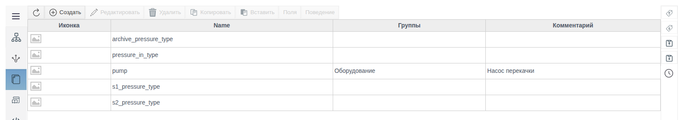
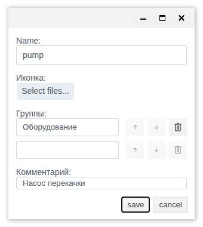
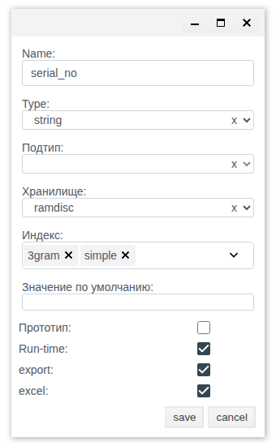
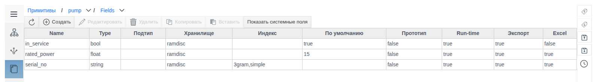
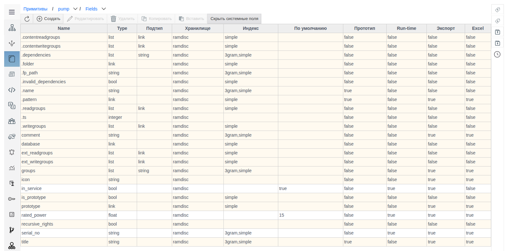
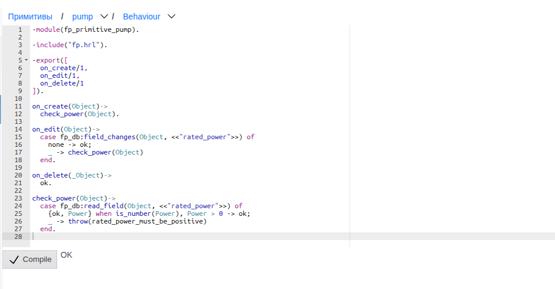
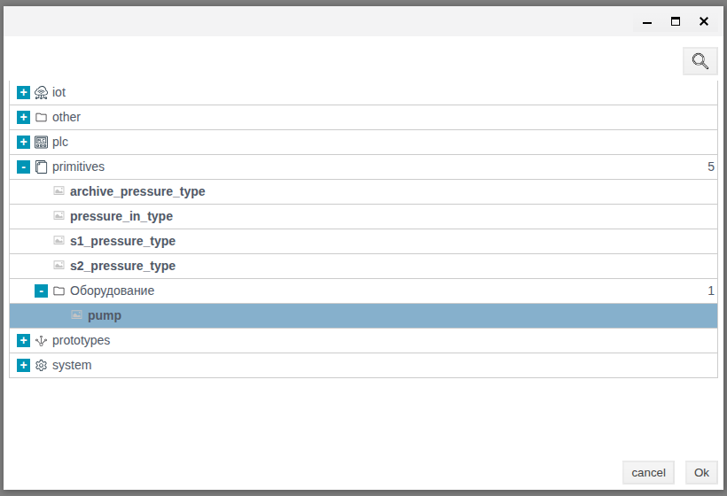
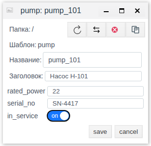
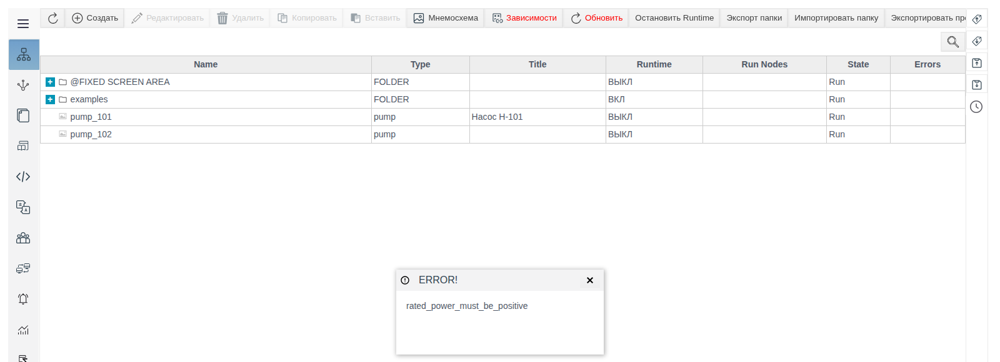

# Примитивы

Документ для инженера-интегратора. Проверено на FACEPLATE Studio 4.0.7.

# Глоссарий

| Термин | Значение |
|---|---|
| Примитив | Пользовательский тип объекта проекта: набор полей и поведение. Создаётся в разделе **Примитивы**. |
| Экземпляр | Объект в Общем виде, созданный из примитива. В колонке **Type** у него указано имя примитива. |
| Общий вид | Раздел Studio с деревом объектов проекта (см. [«Структура проекта»](../Project_strucure/FACEPLATE-start.md)). |
| Поле | Атрибут экземпляра: имя, тип, хранилище, индексы, значение по умолчанию. |
| Системное поле | Поле, которое есть у каждого объекта проекта. Показывается кнопкой **Показать системные поля** и не редактируется. |
| Run-time поле | Поле с флажком **Run-time**. Выводится в форме экземпляра. |
| Группа | Папка примитива в окне выбора типа (`primitives / <группа>`). |
| Поведение | Модуль на Erlang с функциями `on_create/1`, `on_edit/1`, `on_delete/1`. Сервер вызывает их при операциях с экземплярами. |
| Прототип | Шаблон из раздела **Прототипы** (см. [«Прототипы»](../prototypes/prototypes_ru.md)). Флажок **Прототип** у поля включает копирование его значения при синхронизации прототипа. |

# Введение

**Примитив** — собственный тип объекта проекта. Интегратор задаёт ему набор полей и, при необходимости, серверную логику (поведение) на Erlang. После сохранения примитив появляется в окне выбора типа при создании объекта в **Общем виде**, и из него создаются экземпляры — например, все насосы станции с одинаковым набором атрибутов и одинаковой проверкой значений.

Раздел находится в главном меню Studio: **Примитивы** (ниже **Прототипов**). У каждого примитива две вкладки:

* **Поля** — состав и параметры полей экземпляра;
* **Поведение** — код, который сервер выполняет при создании, изменении и удалении экземпляра.

Сквозной пример документа — примитив `pump` (насос) с полями номинальной мощности, заводского номера и признака «в работе» и с проверкой, что мощность больше нуля.

Понадобится доступ к Studio (`http://<сервер>:9000/fp/studio`) под учётной записью с правом изменять проект.

# Основная часть

## Список примитивов



Таблица показывает **Иконку**, **Name**, **Группы** и **Комментарий** каждого примитива. Панель инструментов: **Создать**, **Редактировать**, **Удалить**, **Копировать**, **Вставить**, **Поля**, **Поведение**. Кнопки **Поля** и **Поведение** доступны, когда выделен ровно один примитив. Двойной щелчок по строке открывает вкладку **Поля**.

Внутри примитива сверху находится навигационная строка `Примитивы / pump / Fields`. Через выпадающие списки в ней можно переключиться на другой примитив или на вкладку **Behaviour**, не возвращаясь к списку.

## Создание примитива

Нажмите **Создать**, заполните форму, затем нажмите **save**.



| Поле | Назначение |
|---|---|
| **Name** | Имя примитива. Это имя будет у типа экземпляров (колонка **Type** в Общем виде) и у модуля поведения. Обязательное. |
| **Иконка** | Картинка `.svg`, `.png`, `.jpg` или `.jpeg` (кнопка **Select files...**). Отображается в списке и в окне выбора типа. Без иконки показывается заглушка. |
| **Группы** | Папка, в которую примитив попадёт в окне выбора типа (`primitives / <группа>`). После заполнения строки появляется новая пустая строка. Кнопками ↑ ↓ меняется порядок, кнопкой корзины строка удаляется. |
| **Комментарий** | Произвольный текст для списка примитивов. |

Пример: **Name** — `pump`, **Группы** — `Оборудование`, **Комментарий** — `Насос перекачки`.

## Поля

Выделите примитив и нажмите **Поля**. Для нового примитива список пуст: показываются только собственные поля, а унаследованные скрыты.

### Создание поля

Нажмите **Создать**, заполните форму и нажмите **save**. Кнопка **save** становится активной, когда заполнены **Name** и **Type**.



| Параметр | Значения | Назначение и ограничения |
|---|---|---|
| **Name** | текст | Имя поля. Не может начинаться с цифры. |
| **Type** | `string`, `integer`, `float`, `bool`, `link`, `atom`, `term`, `list` | Тип значения. Обязательный. |
| **Подтип** | `string`, `integer`, `float`, `bool`, `link`, `atom`, `term` | Тип элементов списка. Доступен и обязателен только при **Type** = `list`. |
| **Хранилище** | `disc`, `ramdisc`, `ram` | Где хранится значение. По умолчанию `ramdisc`. |
| **Индекс** | см. ниже | Индексы для поиска и фильтрации по полю. Можно выбрать несколько. |
| **Значение по умолчанию** | текст | Подставляется в форму нового экземпляра. |
| **Прототип** | флажок | Значение поля копируется при синхронизации прототипа с его копиями. Нужен, если экземпляр примитива лежит внутри прототипа (см. [«Прототипы»](../prototypes/prototypes_ru.md), синхронизация). |
| **Run-time** | флажок | Поле выводится в форме создания и редактирования экземпляра в Общем виде. Без флажка поле в форме не показывается. |
| **export** | флажок | Поле попадает в экспорт папки или проекта. |
| **excel** | флажок | Поле участвует в выгрузке и загрузке `.xlsx`. |

Какие индексы можно выбрать, зависит от типа:

| Type | Доступные индексы |
|---|---|
| `string`, `list` с подтипом `string` | `simple`, `3gram` |
| `integer` | `simple`, `datetime` |
| `float` | нет: поле **Индекс** недоступно |
| остальные | `simple` |

Поля примера:

| Name | Type | Индекс | По умолчанию | Run-time | export | excel |
|---|---|---|---|---|---|---|
| `rated_power` | `float` | — | `15` | ✓ | ✓ | ✓ |
| `serial_no` | `string` | `simple`, `3gram` | — | ✓ | ✓ | ✓ |
| `in_service` | `bool` | — | `true` | ✓ | ✓ | — |



Тип изменяется сразу после сохранения поля, перезапуск не нужен.

### Системные поля

Кнопка **Показать системные поля** (повторное нажатие — **Скрыть системные поля**) добавляет в список поля, которые есть у каждого объекта проекта: `.name`, `.folder`, `.pattern`, `title`, `comment`, `groups`, `icon`, `prototype` и другие. Строки системных полей выделены цветом. Их параметры недоступны для изменения.



## Поведение

Поведение — модуль на Erlang, который сервер вызывает при операциях с экземплярами примитива. Модуль выполняется внутри транзакции:

| Функция | Когда вызывается |
|---|---|
| `on_create/1` | при создании экземпляра |
| `on_edit/1` | при изменении полей экземпляра |
| `on_delete/1` | при удалении экземпляра |

Каждая функция получает объект экземпляра и при успехе должна вернуть `ok`. Если функция выбросит исключение или упадёт, транзакция откатывается: объект не создаётся, не изменяется или не удаляется, а в Studio появляется окно **ERROR!** с текстом исключения.

### Написание и сохранение

Выделите примитив и нажмите **Поведение**. Для нового примитива в редакторе открыт шаблон: модуль с именем `fp_primitive_<имя примитива>` и тремя функциями, которые возвращают `ok`. Имя модуля в первой строке не меняйте.

Порядок сохранения:

1. Напишите код.
2. Нажмите **Compile** и дождитесь `OK` справа от кнопки.
3. Нажмите **save**.

> **Важно.** Форма берёт текст из редактора только при нажатии **Compile**. Если нажать **save** без **Compile**, сохранится предыдущая версия кода.

После **save** сервер сразу компилирует и подключает модуль. Новое поведение действует для следующих операций с экземплярами.

Пример для `pump`: проверка, что номинальная мощность больше нуля. При изменении экземпляра проверка выполняется, только если изменилось поле `rated_power`.

```erlang
-module(fp_primitive_pump).

-include("fp.hrl").

-export([
  on_create/1,
  on_edit/1,
  on_delete/1
]).

on_create(Object)->
  check_power(Object).

on_edit(Object)->
  case fp_db:field_changes(Object, <<"rated_power">>) of
    none -> ok;
    _ -> check_power(Object)
  end.

on_delete(_Object)->
  ok.

check_power(Object)->
  case fp_db:read_field(Object, <<"rated_power">>) of
    {ok, Power} when is_number(Power), Power > 0 -> ok;
    _ -> throw(rated_power_must_be_positive)
  end.
```



Функции, которые использует пример:

| Вызов | Результат |
|---|---|
| `fp_db:read_field(Object, <<"поле">>)` | `{ok, Значение}` |
| `fp_db:field_changes(Object, <<"поле">>)` | `none`, если поле в этой операции не менялось |
| `throw(Причина)` | откат операции; `Причина` выводится в окне **ERROR!** |

Для диагностики без отката используйте макросы `?LOGWARNING(Формат, Аргументы)` и `?LOGERROR(Формат, Аргументы)`: они пишут в журнал сервера.

### Ошибки компиляции

Если в коде есть ошибка, справа от **Compile** выводится её описание с номером строки и позицией, например `[{29,7},erl_parse,["syntax error before: ",[]]]`.


> **Внимание.** После ошибки компиляции кнопка **save** остаётся активной. Сохраняйте код только после ответа `OK`.

## Экземпляры в Общем виде

Откройте **Общий вид**, перейдите в нужную папку и нажмите **Создать**. В окне выбора типа раскройте **primitives** и группу примитива, выберите примитив и нажмите **Ok**.



Форма экземпляра содержит **Название** и **Заголовок**, а ниже — поля примитива с флажком **Run-time**, уже заполненные значениями по умолчанию. Элемент ввода зависит от типа поля: для `string` — текстовое поле, для `integer` и `float` — числовое, для `bool` — переключатель **on/off**, для `list` — список строк, для `link` — выбор объекта.



Экземпляр появляется в текущей папке. В колонке **Type** указано имя примитива, в колонке **Title** — **Заголовок**.

Проверка поведения примера:

| Действие | Результат |
|---|---|
| Создать `pump_101` с `rated_power` = `22` | экземпляр создан |
| Создать экземпляр с `rated_power` = `0` | окно **ERROR!** с текстом `rated_power_must_be_positive`, экземпляр не создан |
| Изменить у `pump_101` `rated_power` на `-1` | окно **ERROR!**, значение не сохранено |



## Изменение и удаление примитива

**Редактировать** открывает ту же форму, что и **Создать**. Поля и поведение меняются на своих вкладках.

> **Внимание.** **Удалить** удаляет примитив вместе со **всеми его экземплярами** в проекте. Подтверждение (`delete items: N`, кнопки **yes** / **no**) показывает только число удаляемых примитивов, а не экземпляров. Перед удалением найдите экземпляры по колонке **Type** в Общем виде.

# Заключение

Порядок работы с примитивом:

1. **Примитивы → Создать**: имя, группа, иконка.
2. **Поля**: добавьте поля. Поставьте **Run-time** для полей, которые заполняются в форме экземпляра, а **export** и **excel** — для полей, которые нужны в экспорте и в `.xlsx`.
3. **Поведение**, если нужна логика: напишите код, нажмите **Compile**, дождитесь `OK`, затем нажмите **save**.
4. **Общий вид → Создать → primitives**: создайте экземпляры.

Удаление примитива удаляет все его экземпляры.
