# JS-библиотеки

Документ для инженера-интегратора, который выносит общий код на JavaScript в отдельный объект проекта и подключает его из пользовательских скриптов.

# Содержание

- [Глоссарий](#глоссарий)
- [Введение](#введение)
- [Основная часть](#основная-часть)
    - [Создание библиотеки](#создание-библиотеки)
    - [Код библиотеки](#код-библиотеки)
    - [Compile и сохранение](#compile-и-сохранение)
    - [Подключение в скрипте](#подключение-в-скрипте)
    - [Библиотека, использующая другую библиотеку](#библиотека-использующая-другую-библиотеку)
    - [Изменение библиотеки](#изменение-библиотеки)
    - [Ошибка в пути](#ошибка-в-пути)
- [Заключение](#заключение)

# Глоссарий

| Термин | Значение |
|---|---|
| JS-библиотека | Объект проекта типа `js_library`. Хранит код на JavaScript, результат которого скрипт получает вызовом `require` |
| `require` | Функция, доступная в коде на JavaScript. По пути объекта возвращает результат кода JS-библиотеки |

# Введение

JS-библиотека — общий код на JavaScript для всего проекта: функции, константы, справочные таблицы, которые нужны в нескольких скриптах. Код пишется один раз в объекте `js_library`, а скрипты получают его через `await require('/папка/имя')`.

Библиотека — обычный объект в папке проекта в **Общем виде**. Сама по себе библиотека не выполняется: её код запускает скрипт, когда вызывает `require`.

Как создать библиотеку и подключить её, документ показывает на одном сквозном примере. В примере нескольким скриптам нужно переводить температуру из градусов Цельсия в градусы Фаренгейта, поэтому функция перевода вынесена в библиотеку `js_units`. Скрипт `js_lib_demo` подключает эту библиотеку и пишет результат в тег. Затем на основе `js_units` создаётся вторая библиотека, `js_limits`. В конце документа показано, как изменить библиотеку и что видно, если путь к ней указан неверно.

Все объекты примера лежат в папке `js_demo`:

| Объект | Тип | Назначение |
|---|---|---|
| `js_in`, `js_out` | примитив с полем `value` типа `float` | Вход и выход примера. Создаются заранее |
| `js_units` | `js_library` | Функции `c_to_f` (градусы Цельсия в градусы Фаренгейта) и `clamp` (ограничение диапазоном) |
| `js_lib_demo` | `user_script` | Читает `js_in`, пишет результат `c_to_f` в `js_out` |
| `js_limits` | `js_library` | Функция `f_limited`, которая использует `js_units` |

Как создать примитив, описано в документе [«Примитивы»](../../project_objects/primitives/primitives.md), пользовательский скрипт — в документе [«Пользовательские скрипты»](../user_script/user_script.md).

Понадобится доступ к Studio (`http://<сервер>:9000/fp/studio`) под учётной записью с правом изменять проект.

# Основная часть

## Создание библиотеки

Первая библиотека примера — `js_units`.

1. Откройте **Общий вид** в главном меню Studio.

   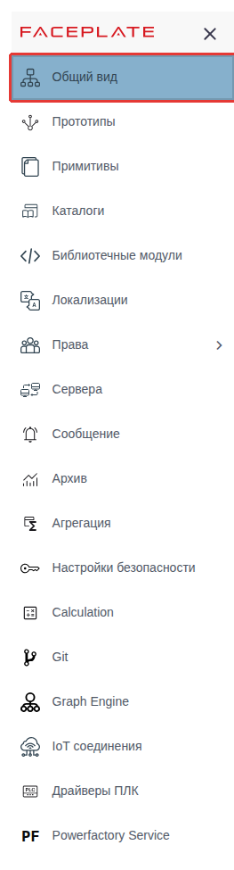

2. Перейдите в папку `js_demo` двойным щелчком и нажмите **Создать**.

   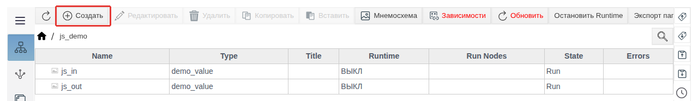

3. Раскройте **system**, выберите **js_library**, нажмите **Ok**.

   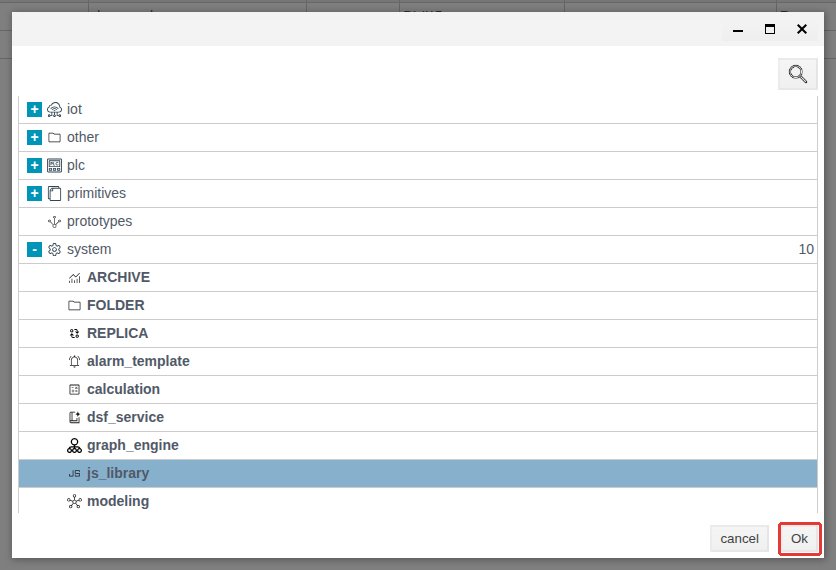

4. Откроется форма новой библиотеки. В **Название** введите `js_units`.

   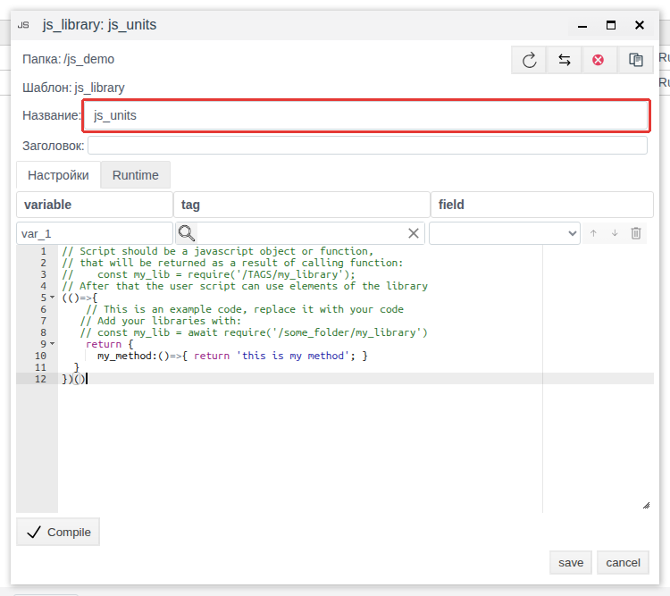

В редакторе формы — шаблон кода. Его нужно заменить кодом библиотеки.

## Код библиотеки

Код библиотеки — одно выражение на JavaScript. Его значение и возвращает `require`. Удобнее всего, как в шаблоне, написать функцию, которая сразу вызывается и возвращает объект с функциями. Замените шаблон кодом `js_units`:

```javascript
(() => {
    const K = 9 / 5;
    return {
        c_to_f: (c) => { return c * K + 32; },
        clamp: (v, min, max) => { return Math.min(Math.max(v, min), max); }
    };
})()
```

Первый `return` возвращает объект библиотеки, `return` внутри каждой функции — её результат. Константа `K` видна только внутри библиотеки, скрипту будут доступны `c_to_f` и `clamp`.

Значением библиотеки может быть и сам объект, например `({ k: 1.8 })`, или функция, например `(x) => x * 2`. Тогда `require` возвращает этот объект или эту функцию.

Таблица **variable / tag / field** над редактором в библиотеке не используется: в коде библиотеки переменной `VARS` нет. Значения тегов библиотека получает от скрипта через параметры своих функций, как `c` в `c_to_f`. Вкладка **Runtime** пустая.

## Compile и сохранение

Код введён, теперь его нужно проверить. Нажмите **Compile**: рядом с кнопкой появится `OK`.

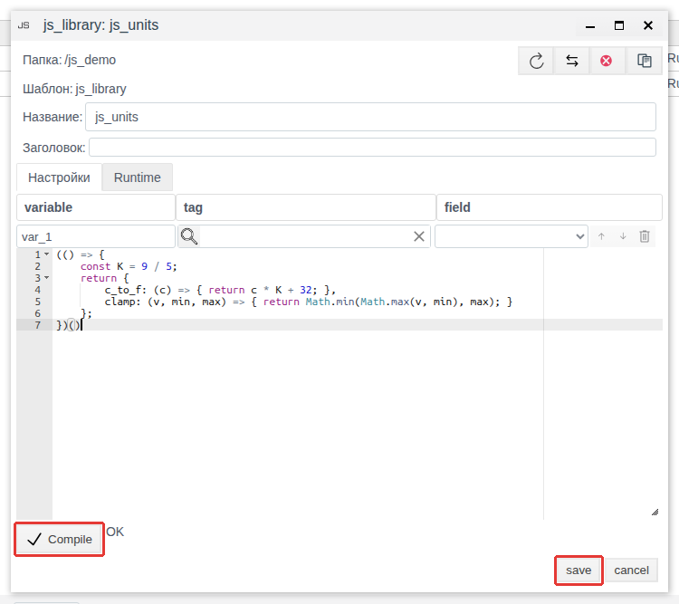

Если в коде ошибка, вместо `OK` выводится её текст, например `SyntaxError: Unexpected end of input` для незакрытой скобки. Исправьте код и снова нажмите **Compile**.

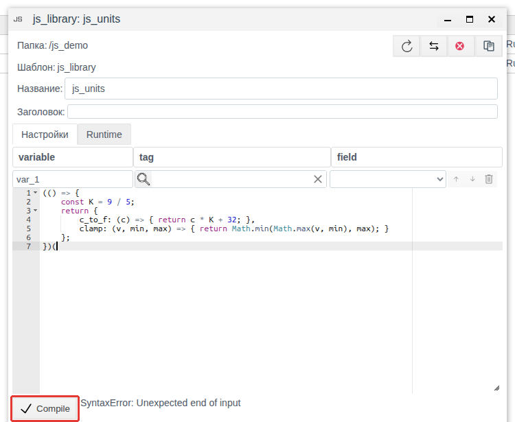

После `OK` нажмите **save**. Порядок всегда один: **Compile** → `OK` → **save**.

Библиотека `js_units` сохранена, но сама она ничего не делает, пока её не подключит скрипт.

## Подключение в скрипте

Подключим `js_units` в скрипте `js_lib_demo`. Скрипт берёт температуру из `js_in`, переводит её функцией `c_to_f` и записывает в `js_out`.

Создайте в папке `js_demo` пользовательский скрипт `js_lib_demo`. На вкладке **javascript** задайте переменную `t`: тег `/js_demo/js_in`, поле `value`. Включите **Выполнять при изменении значений** и введите код:

```javascript
async function(VARS, State) {
    const units = await require('/js_demo/js_units');
    await fp.api.set_value('/root/FP/PROJECT/js_demo/js_out', 'value', units.c_to_f(VARS.t));
    return { state: State };
}
```

Вызов `await require('/js_demo/js_units')` возвращает объект библиотеки, и функции из него вызываются как `units.c_to_f(...)`. Путь в `require` — от корня проекта, как в **Общем виде**. `fp.api.set_value(путь, поле, значение)` записывает значение в поле объекта, путь здесь полный, с префиксом `/root/FP/PROJECT`.

Нажмите **Compile**, дождитесь `OK` и сохраните.

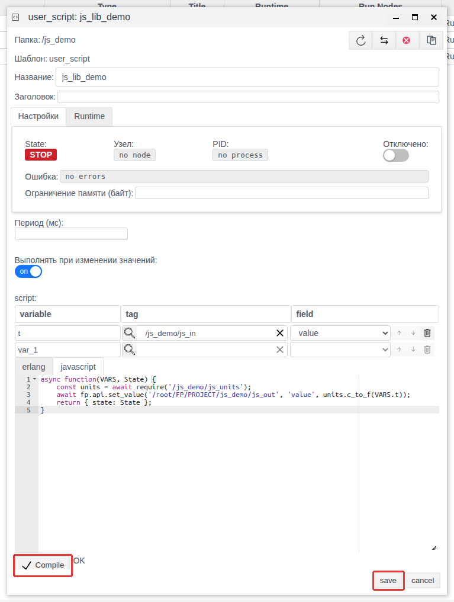

Теперь при `js_in` = `25` скрипт записывает в `js_out` значение `77`.

## Библиотека, использующая другую библиотеку

Функции `js_units` можно подключать не только в скриптах, но и в других библиотеках. Добавим к примеру библиотеку `js_limits`: она переводит температуру функцией `c_to_f` и ограничивает результат диапазоном от `-40` до `212` функцией `clamp`.

Создайте `js_limits` так же, как `js_units`, с кодом:

```javascript
(async () => {
    const units = await require('/js_demo/js_units');
    return {
        f_limited: (c) => { return units.clamp(units.c_to_f(c), -40, 212); }
    };
})()
```

Функция, которая вызывает `require`, объявлена асинхронной (`async`): внутри библиотеки `require` вызывается с `await`, как и в скрипте.

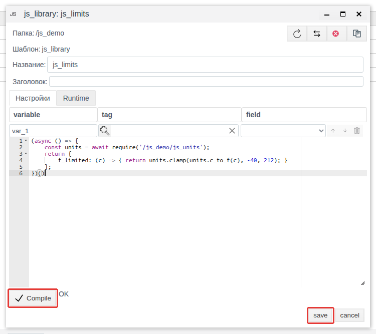

Скрипт подключает `js_limits` так же, как `js_units`: `const limits = await require('/js_demo/js_limits');`. При `js_in` = `150` вызов `limits.f_limited(VARS.t)` даёт `212`, при `js_in` = `-100` — `-40`.

Теперь в папке примера две библиотеки. В **Общем виде** они отмечены значком **JS**, в колонке **Runtime** у них `ВЫКЛ`. На снимке строки библиотек в красной рамке.

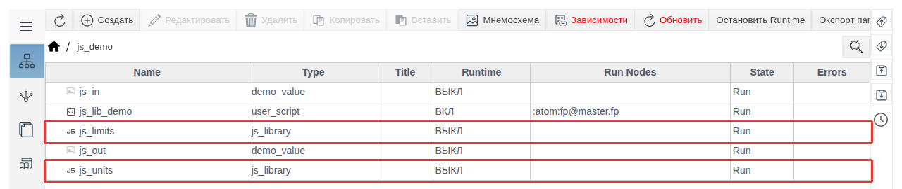

## Изменение библиотеки

Библиотеку можно менять, пока её используют скрипты. Запущенный скрипт загружает библиотеку при первом вызове `require` и дальше работает с этой версией. Новая версия попадает в скрипт после его перезапуска. После изменения библиотеки перезапустите каждый скрипт, который её использует:

- включите **Отключено**, сохраните, выключите **Отключено**, сохраните;
- или измените код скрипта, нажмите **Compile** и сохраните.

Пример: в `js_units` к результату `c_to_f` добавлено `+ 1000`. До перезапуска `js_lib_demo` при `js_in` = `30` пишет `86`, после перезапуска при `js_in` = `31` — `1087.8`.

## Ошибка в пути

Путь в `require` должен совпадать с путём библиотеки в **Общем виде**. Если по пути `require` нет объекта, скрипт останавливается и значения не записывает. На снимках — скрипт `js_path_demo`: такой же скрипт, как `js_lib_demo`, но в `require` вместо `/js_demo/js_units` указан путь `/js_demo/no_such_lib`.

В **Общем виде** строка скрипта выделена красным, в колонке **State** — `Stop`, в колонке **Errors** — `{badmatch,{error,{invalid_path,<<"/root/FP/PROJECT/js_demo/no_such_lib">>}}}`.

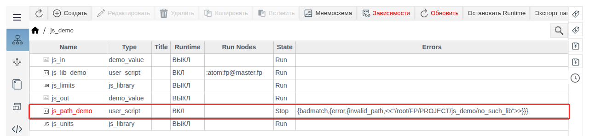

В форме скрипта **State** — `STOP`, тот же текст в поле **Ошибка**.

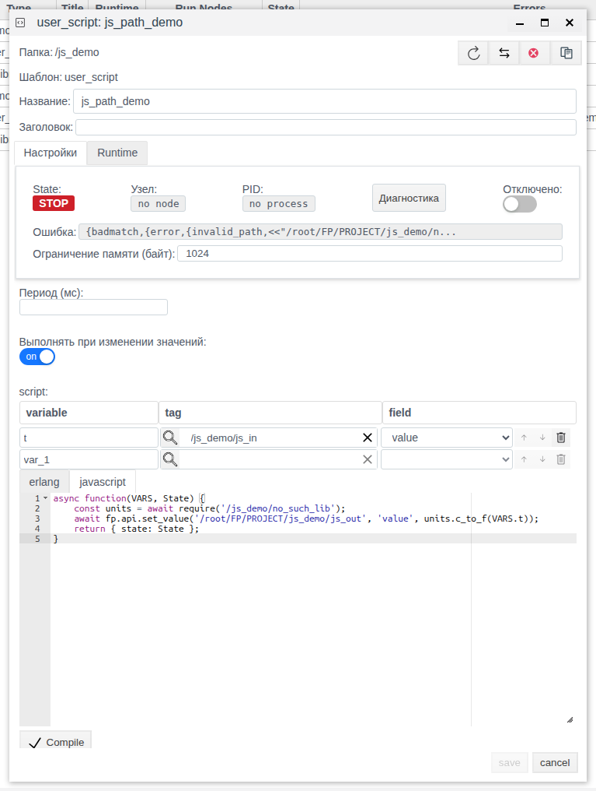

# Заключение

Порядок работы:

1. В папке проекта создайте **system** → **js_library**.
2. Напишите выражение, которое возвращает объект с функциями; если библиотека подключает другие, сделайте функцию `async`.
3. **Compile** → `OK` → сохраните.
4. В скрипте подключите библиотеку: `const lib = await require('/папка/имя');`.
5. После изменения библиотеки перезапустите скрипты, которые её используют.
