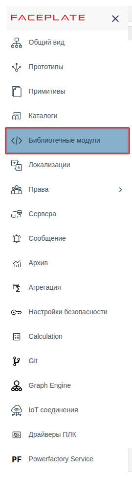
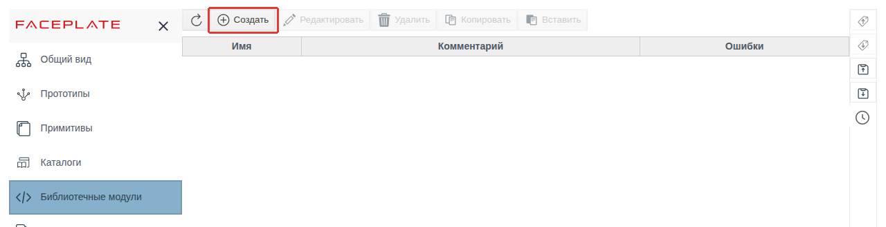
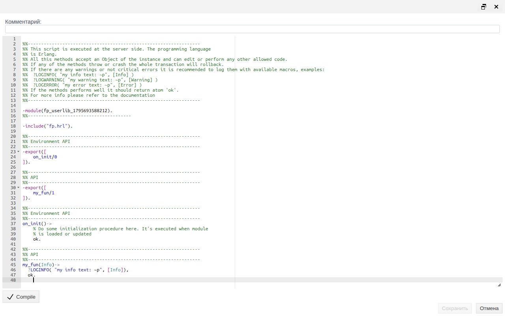
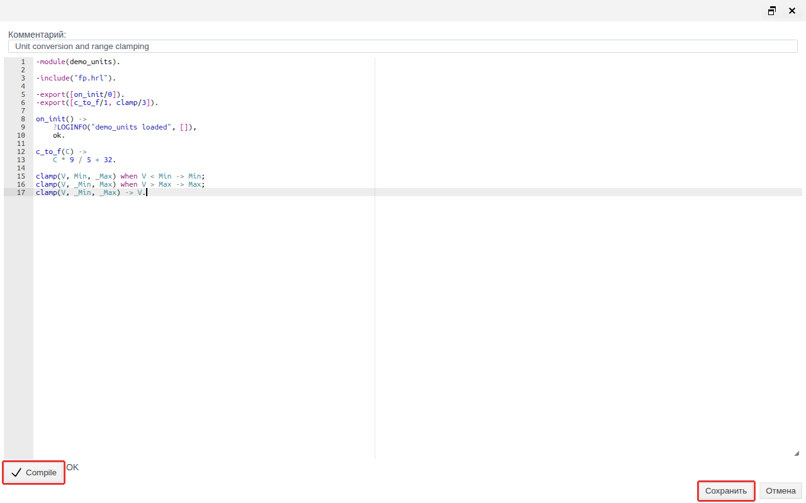
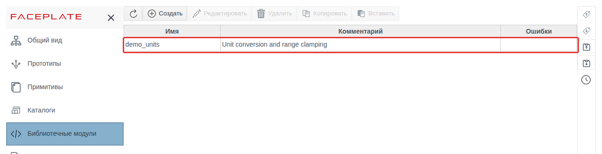
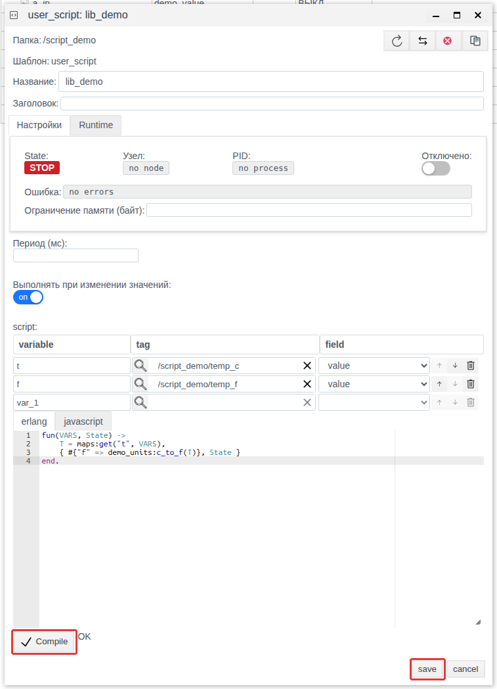
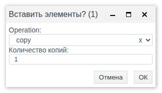
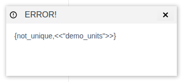

# Библиотечные модули

Документ для инженера-интегратора, который выносит общий код на Erlang в отдельный модуль и вызывает его из пользовательских скриптов проекта.

# Содержание

- [Глоссарий](#глоссарий)
- [Введение](#введение)
- [Основная часть](#основная-часть)
    - [Раздел «Библиотечные модули»](#раздел-библиотечные-модули)
    - [Создание модуля](#создание-модуля)
    - [Compile и сохранение](#compile-и-сохранение)
    - [Вызов из пользовательского скрипта](#вызов-из-пользовательского-скрипта)
    - [Изменение модуля](#изменение-модуля)
    - [Копирование](#копирование)
    - [Удаление](#удаление)
- [Заключение](#заключение)

# Глоссарий

| Термин | Значение |
|---|---|
| Библиотечный модуль | Модуль Erlang, который хранится в проекте и загружается на сервер FACEPLATE. Экспортированные функции модуля доступны из кода проекта как `модуль:функция(...)` |
| Раздел **Библиотечные модули** | Пункт главного меню Studio: список библиотечных модулей проекта и их редактор |

# Введение

Библиотечный модуль — общий код на Erlang для всего проекта: функции, которые нужны в нескольких скриптах. Код пишется один раз, а пользовательские скрипты вызывают его по имени модуля.

Модули хранятся не в папках проекта, а в отдельном разделе Studio — **Библиотечные модули**. После сохранения сервер загружает модуль сам, и его функции сразу доступны всем скриптам проекта.

Как создать модуль и вызвать его из скрипта, документ показывает на одном сквозном примере. В примере нескольким скриптам нужно переводить температуру из градусов Цельсия в градусы Фаренгейта, поэтому функция перевода вынесена в модуль `demo_units`. Скрипт `lib_demo` вызывает функцию модуля и пишет результат в тег. Затем модуль изменяется, копируется, и копия удаляется.

| Объект | Где находится | Назначение |
|---|---|---|
| `temp_c`, `temp_f` | папка `script_demo`, примитив с полем `value` типа `float` | Вход и выход примера. Создаются заранее |
| `demo_units` | раздел **Библиотечные модули** | Функции `c_to_f/1` (градусы Цельсия в градусы Фаренгейта) и `clamp/3` (ограничение значения диапазоном) |
| `lib_demo` | папка `script_demo`, `user_script` | Читает `temp_c`, пишет результат `demo_units:c_to_f/1` в `temp_f` |

Как создать примитив, описано в документе [«Примитивы»](../../project_objects/primitives/primitives.md), пользовательский скрипт — в документе [«Пользовательские скрипты»](../user_script/user_script.md).

Понадобится доступ к Studio (`http://<сервер>:9000/fp/studio`) под учётной записью с правом изменять проект.

# Основная часть

## Раздел «Библиотечные модули»

1. Откройте **Библиотечные модули** в главном меню Studio.

   

2. Откроется список модулей проекта. В примере он пока пуст. Нажмите **Создать**.

   

Остальные кнопки над списком — **Редактировать**, **Удалить**, **Копировать**, **Вставить** — работают с выделенной строкой. Открыть модуль можно и двойным щелчком по строке.

## Создание модуля

После **Создать** откроется редактор нового модуля с шаблоном: имя вида `fp_userlib_<число>`, подключённый `fp.hrl`, функции `on_init/0` и `my_fun/1`.



Замените шаблон кодом `demo_units` и заполните **Комментарий**, например `Unit conversion and range clamping`:

```erlang
-module(demo_units).

-include("fp.hrl").

-export([on_init/0]).
-export([c_to_f/1, clamp/3]).

on_init() ->
    ?LOGINFO("demo_units loaded", []),
    ok.

c_to_f(C) ->
    C * 9 / 5 + 32.

clamp(V, Min, _Max) when V < Min -> Min;
clamp(V, _Min, Max) when V > Max -> Max;
clamp(V, _Min, _Max) -> V.
```

| Элемент | Правило |
|---|---|
| `-module(имя).` | Обязателен. Задаёт имя модуля в списке и имя для вызова. Допустимы строчные латинские буквы, цифры, `_` |
| `-export([...])` | Из скриптов доступны только экспортированные функции |
| `on_init/0` | Функция инициализации модуля: в ней выполняют подготовку, нужную модулю для работы. Вызывается после того, как модуль скомпилирован и загружен: при старте сервера и в течение секунды после сохранения изменённого кода. Если при сохранении код не менялся, например изменён только **Комментарий**, `on_init/0` не вызывается. В примере `on_init/0` пишет в журнал сервера строку `demo_units loaded`. Ошибка внутри `on_init/0` пишется в журнал сервера и не мешает загрузке модуля. |
| `-include("fp.hrl").` | Основной заголовочный файл FACEPLATE с общими макросами платформы, среди них макросы журнала `?LOGINFO`, `?LOGWARNING`, `?LOGERROR`. Подключён в шаблоне нового модуля |

Имя модуля уникально: два модуля с одним именем в проекте не сохраняются. Имя не должно совпадать с именами модулей Erlang и FACEPLATE.

## Compile и сохранение

Код введён, теперь его нужно проверить. Нажмите **Compile**: рядом с кнопкой появится `OK`, и станет доступна кнопка **Сохранить**.



Если в коде ошибка, вместо `OK` выводится текст ошибки компилятора, а **Сохранить** остаётся недоступной. В тексте ищите пару `{строка,столбец}` и описание. Например, если после `C * 9 / 5 + 32` пропущена точка, в тексте будет `{15,1}` и `syntax error before: clamp` — ошибка перед строкой 15. Исправьте код и снова нажмите **Compile**.

После `OK` нажмите **Сохранить**. Порядок всегда один: **Compile** → `OK` → **Сохранить**.

После сохранения форма остаётся открытой, а **Сохранить** снова недоступна до следующего **Compile**. Модуль уже сохранён и появился в списке. Закройте форму кнопкой **Отмена** или крестиком в заголовке: сохранённое при этом не отменяется.



| Колонка | Значение |
|---|---|
| **Имя** | Имя модуля из строки `-module(...)`. Задаётся при сохранении, вручную не редактируется |
| **Комментарий** | Текст из поля **Комментарий** |

Модуль `demo_units` загружен на сервер, но его функции пока никто не вызывает.

## Вызов из пользовательского скрипта

Вызовем `demo_units` из скрипта `lib_demo`. Скрипт берёт температуру из `temp_c`, переводит её функцией `c_to_f/1` и записывает в `temp_f`.

Создайте в папке `script_demo` пользовательский скрипт `lib_demo`. На вкладке **erlang** задайте переменные `t` (тег `/script_demo/temp_c`, поле `value`) и `f` (тег `/script_demo/temp_f`, поле `value`). Включите **Выполнять при изменении значений** и введите код:

```erlang
fun(VARS, State) ->
    T = maps:get("t", VARS),
    { #{"f" => demo_units:c_to_f(T)}, State }
end.
```

Функция модуля вызывается полным именем `модуль:функция(аргументы)`, подключать модуль в скрипте не нужно.

Нажмите **Compile**, дождитесь `OK` и сохраните.



Теперь при `temp_c` = `25` скрипт записывает в `temp_f` значение `77`.

## Изменение модуля

Модуль можно менять, пока его вызывают скрипты. Откройте модуль, исправьте код, нажмите **Compile** и сохраните. Сервер загружает новую версию в течение нескольких секунд, и следующие вызовы из скриптов идут уже в неё. Перезапускать скрипты не нужно.

Пример: в `demo_units` к результату `c_to_f` добавлено `+ 1000`. Скрипт `lib_demo` не перезапускается, и при `temp_c` = `26` он сразу пишет в `temp_f` значение `1078.8`.

Если поменять имя в строке `-module(...)`, после сохранения сменится **Имя** в списке. Скрипты вызывают модуль по имени, поэтому вызовы в них нужно исправить на новое имя.

## Копирование

Копия — быстрый способ начать новый модуль с готового кода. Скопируем `demo_units`.

1. Выделите `demo_units`, нажмите **Копировать**, затем **Вставить**.
2. В окне **Вставить элементы?** оставьте **Operation** = `copy`, укажите **Количество копий** и нажмите **OK**.

   

Копия появляется в списке с именем `demo_units_1`, но код у неё прежний, с той же строкой `-module(demo_units)`. Откройте копию, замените имя в `-module(...)`, например на `demo_units_copy`, нажмите **Compile** и сохраните. После сохранения **Имя** в списке станет `demo_units_copy`.

Пока в копии прежнее имя, сохранить её нельзя: появляется окно **ERROR!** с текстом `{not_unique,<<"demo_units">>}`.



## Удаление

Копия `demo_units_copy` больше не нужна. Выделите её, нажмите **Удалить** и подтвердите кнопкой **yes**. В окне подтверждения показано число удаляемых модулей: `delete items: 1`.

Удалить сразу несколько модулей можно, выделив их Ctrl+щелчком.

# Заключение

Порядок работы:

1. В **Библиотечные модули** нажмите **Создать**.
2. Задайте уникальное имя в `-module(...)` и экспортируйте нужные функции.
3. **Compile** → `OK` → **Сохранить**.
4. Вызывайте функции из скриптов как `модуль:функция(...)`.
5. В копии модуля замените имя в `-module(...)`.
