# Пользовательские скрипты

Документ для инженера-интегратора, который пишет серверную логику проекта на Erlang или JavaScript: расчёт значений, счётчики, перенос данных между объектами.

# Содержание

- [Глоссарий](#глоссарий)
- [Введение](#введение)
- [Основная часть](#основная-часть)
    - [Создание скрипта](#создание-скрипта)
    - [Переменные](#переменные)
    - [Условия запуска](#условия-запуска)
    - [Код на Erlang](#код-на-erlang)
    - [Compile и сохранение](#compile-и-сохранение)
    - [Работающий скрипт](#работающий-скрипт)
    - [Ручной запуск](#ручной-запуск)
    - [Раздел «Скрипт»](#раздел-скрипт)
    - [Ошибки выполнения](#ошибки-выполнения)
    - [Код на JavaScript](#код-на-javascript)
    - [Удаление скрипта](#удаление-скрипта)
- [Заключение](#заключение)

# Глоссарий

| Термин | Значение |
|---|---|
| Пользовательский скрипт | Объект проекта типа `user_script`. Хранит функцию на Erlang или JavaScript и условия её запуска. Выполняется на сервере |
| Переменная | Имя, под которым функция видит поле объекта проекта. Задаётся тройкой «имя — объект (tag) — поле (field)» |
| `VARS` | Первый аргумент функции: значения всех переменных на момент запуска |
| `State` | Второй аргумент функции: значение, которое функция вернула в прошлый раз. Сбрасывается при перезапуске скрипта |
| Автозапуск | Режим **Выполнять при изменении значений**: скрипт запускается при изменении любой из своих переменных |
| Раздел **Скрипт** | Пункт главного меню Studio: сводная таблица всех пользовательских скриптов проекта |

# Введение

Пользовательский скрипт читает поля объектов проекта, вычисляет новые значения и записывает их в поля объектов. Скрипт — объект проекта: он создаётся в **Общем виде**, в папке рядом с объектами, с которыми работает, и выполняется на сервере, пока включён.

Простые формулы удобнее задавать в [Calculation](../calculation/calculation.md): там не нужен код функции, только выражение. Скрипт нужен, когда расчёту требуется больше:

| Подходит для Calculation | Реализуйте в User Script |
|---|---|
| Пересчёт единиц, масштабирование | Расчёты по истории и за окно времени, скорость изменения |
| Формулы от нескольких входов: сумма, разность, отношение, процент, мощность, КПД | Накопление и сумматоры, состояние между запусками |
| Пороговые признаки и статусы | Алармы, SQL, работа с интерфейсом |
| Простые условия: ограничение диапазона, запасное значение, защита от деления на ноль | Сложная логика и управление ходом выполнения |
| Выделение бита из слова, сопоставление целых кодов состояний | Разбор протоколов, библиотеки формул |

Как написать, запустить и проверить скрипт, документ показывает на одном сквозном примере. В примере скрипт `sum_script` в папке `us_demo` складывает значения объектов `a_in` и `b_in`, пишет сумму в `sum_out`, а число своих запусков — в `runs_out`. У всех четырёх объектов есть числовое поле `value` типа `float`; как завести такие объекты, описано в документе [«Примитивы»](../../project_objects/primitives/primitives.md).

Сначала скрипт пишется на Erlang: создаётся, получает переменные и условия запуска, проходит проверку и сохраняется. Затем он запускается вручную, находится в разделе **Скрипт** и показывает, как выглядит ошибка выполнения. В конце тот же расчёт написан на JavaScript, а лишний скрипт удаляется.

Понадобится доступ к Studio (`http://<сервер>:9000/fp/studio`) под учётной записью с правом изменять проект.

# Основная часть

## Создание скрипта

1. В **Общем виде** откройте папку `us_demo` и нажмите **Создать**.

    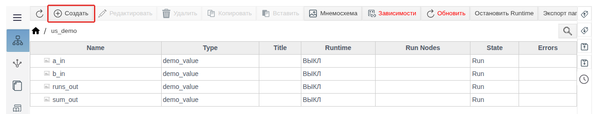

2. Раскройте группу `system`, выберите `user_script` и нажмите **Ok**.

    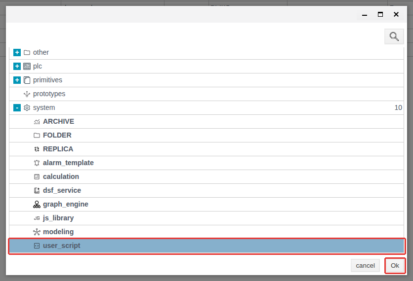

3. В открывшейся форме введите **Название** `sum_script`.

Форма скрипта состоит из трёх частей. Сверху — панель состояния: работает ли скрипт и где. Под ней — условия запуска: **Период (мс)** и **Выполнять при изменении значений**. Внизу — таблица переменных **script** и редактор кода с вкладками **erlang** и **javascript**. Новый скрипт ещё не работает: **State** `STOP`, в редакторе — шаблон с комментарием о том, как устроена функция. Заполнение начинается с переменных.

## Переменные

Функция скрипта не обращается к объектам проекта напрямую: она получает и записывает значения через переменные. Переменная связывает имя в коде с полем объекта. Таблица под заголовком **script** состоит из колонок **variable** — имя переменной в коде, **tag** — объект проекта и **field** — его поле.

Скрипту примера нужны четыре переменные: два входа и два выхода.

1. Введите имя `a` в **variable**.
2. Нажмите лупу в **tag**, откройте папку `us_demo`, выберите `a_in` и нажмите **ОК**. Выбрать можно только объект из дерева проекта.

    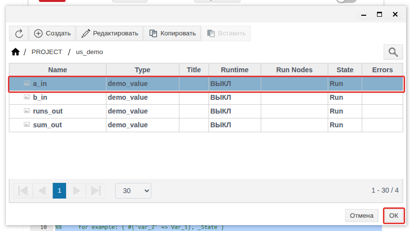

3. В **field** выберите `value`. Список содержит все поля объекта, включая системные.
4. Так же добавьте остальные строки:

| variable | tag | field |
|---|---|---|
| `a` | `/us_demo/a_in` | `value` |
| `b` | `/us_demo/b_in` | `value` |
| `sum` | `/us_demo/sum_out` | `value` |
| `runs` | `/us_demo/runs_out` | `value` |

После заполнения строки ниже появляется пустая строка `var_1`; незаполненная строка не мешает сохранению. Стрелками справа меняется порядок строк, корзиной строка удаляется.

Одна и та же переменная служит и для чтения, и для записи: `a` и `b` скрипт читает, в `sum` и `runs` — пишет.

## Условия запуска

Переменные заданы; теперь нужно решить, когда скрипт будет выполняться.

| Поле | Поведение |
|---|---|
| **Период (мс)** | Скрипт выполняется сразу после запуска и далее с этим периодом. Пусто — таймер не используется |
| **Выполнять при изменении значений** | Скрипт выполняется один раз после запуска и затем при каждом изменении значения любой своей переменной |

Режимы можно включить вместе. Если оба выключены, скрипт работает (**State** `RUN`), но не выполняется, пока его не запустят вручную (раздел [«Ручной запуск»](#ручной-запуск)).

Значения, которые скрипт записывает в свои же переменные, не запускают его повторно: при автозапуске скрипт не зацикливается.

Сумма должна пересчитываться, как только меняется `a_in` или `b_in`, поэтому в примере **Период (мс)** остаётся пустым, а **Выполнять при изменении значений** включается.

## Код на Erlang

Остаётся функция, которая по значениям переменных вычисляет новые. Вкладка **erlang** открыта по умолчанию. Замените шаблон в редакторе кодом примера:

```erlang
fun(VARS, State) ->
    A = maps:get("a", VARS),
    B = maps:get("b", VARS),
    Runs = case State of
        N when is_integer(N) -> N + 1;
        _ -> 1
    end,
    { #{"sum" => A + B, "runs" => Runs}, Runs }
end.
```

Функция принимает два аргумента — `VARS` и `State` — и возвращает кортеж `{ ЗначенияДляЗаписи, НовыйState }`:

| Элемент | Правило |
|---|---|
| `VARS` | Map, ключи — имена переменных строками: `"a"`, не `a` |
| Значения для записи | Map «имя переменной — значение». Записать можно только в поле, объявленное переменной: ключи, которых нет в таблице переменных, игнорируются. Пустой map `#{}` — ничего не записывать |
| `State` | Второй элемент результата прошлого вызова. Пример хранит в нём число запусков: целое число увеличивается на 1, любое другое значение означает первый запуск |
| Точка в конце | Код заканчивается `end.` |

Тип значения в `VARS` определяется типом поля: из поля `float` придёт число, из поля `string` — строка. Сложение строковых полей даёт ошибку `badarith`.

## Compile и сохранение

Код введён. Перед сохранением его проверяет кнопка **Compile** под редактором: рядом с кнопкой выводится `OK` или текст ошибки. Например, если пропустить запятую после строки `B = maps:get("b", VARS)`, **Compile** сообщит:

`{invalid_expression,{4,erl_parse,["syntax error before: ","Runs"]}}`

Число в тексте — номер строки, в которой найдена ошибка (здесь строка 4, `Runs = case State of`), а последнее слово — то, перед чем она стоит.

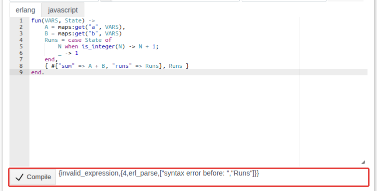

Исправьте код и нажмите **Compile** снова. Когда рядом с кнопкой появится `OK`, нажмите **save**.

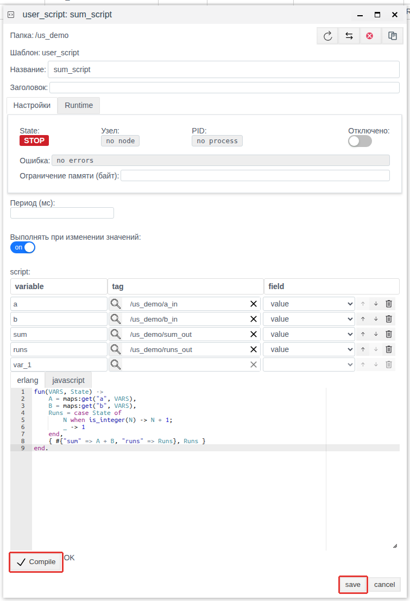

Сохраняйте только после `OK`.

## Работающий скрипт

Сохранённый скрипт сразу запускается. В **Общем виде** у `sum_script` **Runtime** `ВКЛ`, в **Run Nodes** — узел, на котором он работает. Скрипт с автозапуском один раз выполнился после запуска: в `sum_out` — `5` (при `a_in` = 2 и `b_in` = 3), в `runs_out` — `1`.

Откройте `sum_script` снова: панель состояния заполнена.

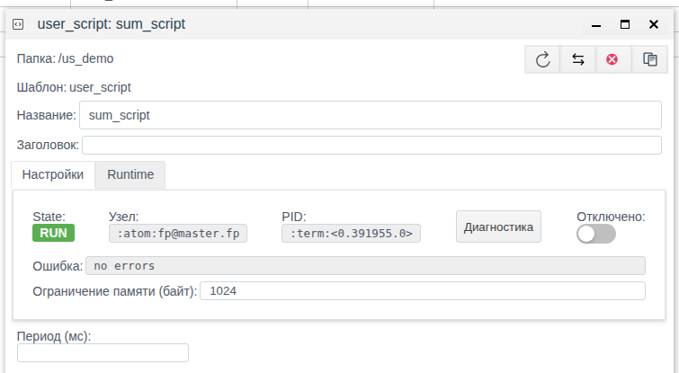

| Поле | Значение |
|---|---|
| **State** | `RUN` — скрипт работает, `STOP` — не запущен |
| **Узел**, **PID** | Узел кластера и процесс, в котором выполняется скрипт |
| **Диагностика** | Окно диагностики процесса скрипта. Кнопка есть только у сохранённого скрипта |
| **Отключено** | Остановить скрипт без удаления. У отключённого скрипта **State** `STOP`, а в **Общем виде** **Runtime** `ВЫКЛ` и **State** `Stop` |
| **Ошибка** | Текст последней ошибки выполнения. `no errors` — ошибок нет |
| **Ограничение памяти (байт)** | Лимит памяти процесса скрипта. При сохранении подставляется `1024` |

Каждое сохранение вкладки **Настройки** — даже если изменён только **Заголовок** — перезапускает скрипт: код перечитывается, `State` сбрасывается, и счётчик `runs_out` снова начинается с `1`. Так же скрипт перезапускается, когда **Отключено** выключают.

## Ручной запуск

Скрипт примера выполняется сам при изменении входов. Чтобы выполнить его ещё раз, не меняя входы, запустите его вручную:

1. Откройте вкладку **Runtime** в форме скрипта.
2. Включите **trigger_execute** и нажмите **save**.

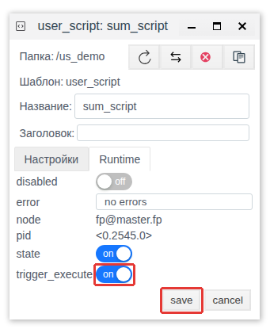

Скрипт выполнится один раз, переключатель выключится сам. В примере `runs_out` станет `2`. Сохранение на вкладке **Runtime** не перезапускает скрипт: `State` сохраняется. Остальные строки вкладки повторяют сведения панели состояния.

Скрипт, у которого выключены оба условия запуска, сам не выполняется — даже при изменении входов. Его запускают только так, вручную.

## Раздел «Скрипт»

В **Общем виде** скрипт виден только в своей папке. Все пользовательские скрипты проекта сразу собраны в разделе **Скрипт** главного меню.

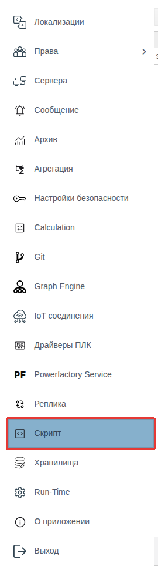

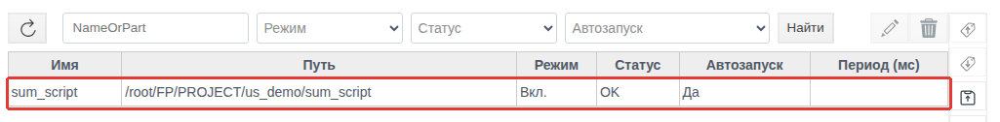

| Колонка | Значение |
|---|---|
| **Имя**, **Путь** | Имя и полный путь объекта скрипта |
| **Режим** | `Вкл.` или `Откл.` (переключатель **Отключено**) |
| **Статус** | `OK` или **ОШИБКА** |
| **Автозапуск** | `Да`, если включено **Выполнять при изменении значений** |
| **Период (мс)** | Значение периода или пусто |

Над таблицей — фильтры: часть имени, **Режим**, **Статус** (`Error` / `OK`) и **Автозапуск**. Выберите условия и нажмите **Найти**; крестик справа от **Найти** снимает фильтры.

Создать скрипт в разделе нельзя, только в **Общем виде**. Открыть скрипт — двойным щелчком по строке или кнопкой карандаша справа над таблицей, удалить — кнопкой корзины рядом. Кнопки становятся доступны, когда выделена строка.

## Ошибки выполнения

`sum_script` работает без ошибок: в колонке **Статус** — `OK`. Посмотрим, как выглядит ошибка, которая возникает уже при выполнении, а не при **Compile**. Замените в коде `maps:get("b", VARS)` на `maps:get("c", VARS)`: переменной `c` в таблице нет. **Compile** вернёт `OK` — синтаксис верный, — но скрипт завершится с ошибкой, как только выполнится.

Ошибка видна в трёх местах. В форме скрипта — в поле **Ошибка**:

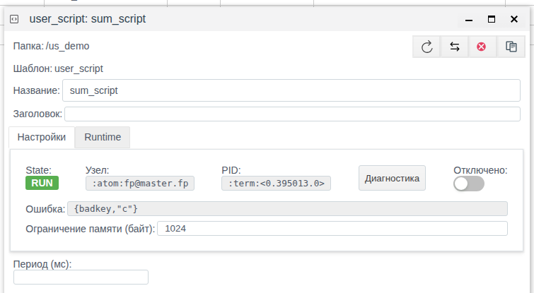

В **Общем виде** — в колонке **Errors** строки скрипта. В разделе **Скрипт** — строка с красным фоном и статусом **ОШИБКА**; текст ошибки появляется во всплывающей подсказке, если навести указатель на **ОШИБКА**. Чтобы в большом проекте увидеть только такие скрипты, выберите в фильтре **Статус** значение `Error` и нажмите **Найти**:

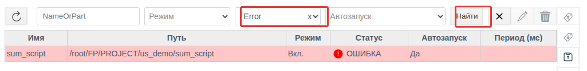

| Текст | Причина |
|---|---|
| `badarith` | Арифметика над нечисловым значением, например над строковым полем |
| `{badkey,"c"}` | В коде читается переменная `c`, которой нет в таблице переменных |
| `badarg` | Например, путь в `fp.api.set_value` (JavaScript) указан без префикса `/root/FP/PROJECT` |

Когда скрипт выполняется с ошибкой, значения переменных не записываются: `sum_out` и `runs_out` сохраняют прежние значения. Верните в коде `maps:get("b", VARS)`, нажмите **Compile** и **save**: после первого успешного выполнения ошибка исчезает из формы, из **Общего вида** и из раздела **Скрипт**.

## Код на JavaScript

Тот же расчёт можно написать на JavaScript. Чтобы сравнить, создайте в `us_demo` второй скрипт `sum_js`, как в разделе [«Создание скрипта»](#создание-скрипта), откройте вкладку **javascript** и вставьте код:

```javascript
async function(VARS, State) {
    const runs = Number.isInteger(State) ? State + 1 : 1;
    await fp.api.set_value('/root/FP/PROJECT/us_demo/sum_out', 'value', VARS.a + VARS.b);
    await fp.api.set_value('/root/FP/PROJECT/us_demo/runs_out', 'value', runs);
    return { state: runs };
}
```

Скрипту нужны только входные переменные `a` и `b`: значения он записывает не через переменные, а вызовом `fp.api.set_value`. Включите **Выполнять при изменении значений**, нажмите **Compile** и после `OK` — **save**.

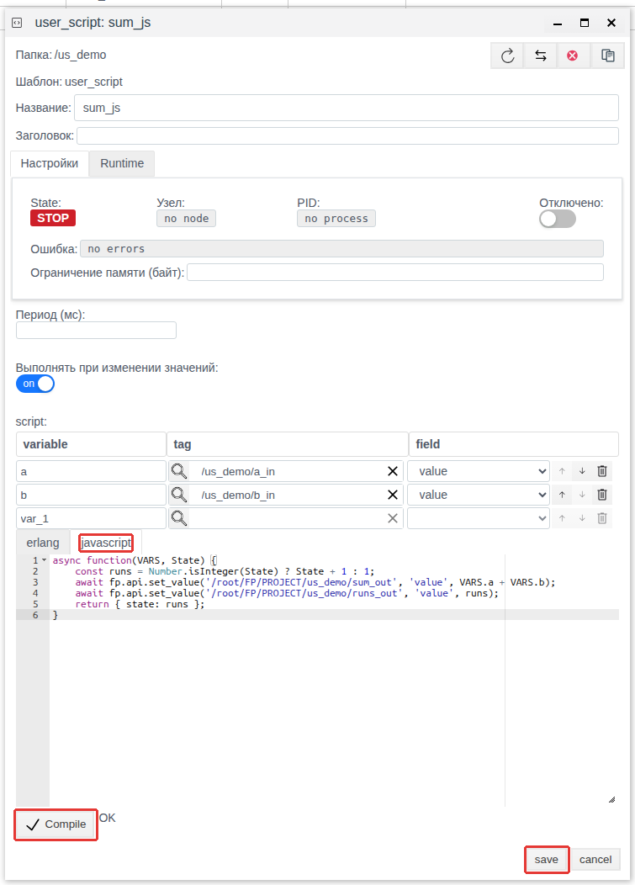

Отличия от Erlang:

| | Erlang | JavaScript |
|---|---|---|
| Функция | `fun(VARS, State) -> … end.` | `async function(VARS, State) { … }` |
| Чтение переменной | `maps:get("a", VARS)` | `VARS.a` |
| Запись значения | Map в результате функции; только в поля, объявленные переменными | `await fp.api.set_value(путь, поле, значение)`; в любое поле, путь полный — с префиксом `/root/FP/PROJECT` |
| Новый `State` | Второй элемент кортежа | `return { state: … }` |

Код проверяется и выполняется на языке той вкладки, которая открыта при **Compile**: код Erlang на вкладке **javascript** не пройдёт проверку.

## Удаление скрипта

Скрипт выполняется, пока он есть в проекте. Если расчёт больше не нужен или перенесён в другой скрипт, удалите старый скрипт, иначе он продолжит писать в те же поля. Чтобы остановить скрипт на время и сохранить его настройки, его не удаляют, а включают **Отключено** (см. [«Работающий скрипт»](#работающий-скрипт)).

В примере `sum_js` написан для сравнения, и теперь в `sum_out` и `runs_out` пишут два скрипта сразу. Оставим `sum_script`, а `sum_js` удалим: в разделе **Скрипт** выделите его строку, нажмите кнопку корзины и подтвердите кнопкой **yes**.

Окно подтверждения показывает число выделенных скриптов, но не их имена. Чтобы удалить несколько скриптов сразу, выделите их щелчком с нажатой Ctrl. Удалённый скрипт пропадает из раздела **Скрипт** и из своей папки в **Общем виде**.

# Заключение

Порядок работы:

1. В **Общем виде** создайте `user_script` (группа `system`).
2. Объявите переменные для полей, которые скрипт читает и пишет.
3. Выберите запуск: **Период (мс)**, **Выполнять при изменении значений** или оба.
4. Напишите функцию на вкладке **erlang** или **javascript**.
5. Нажмите **Compile**, дождитесь `OK`, сохраните.
6. Проверьте **Статус** в разделе **Скрипт**; при **ОШИБКА** прочитайте текст в поле **Ошибка** формы.
