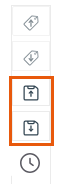
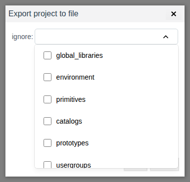
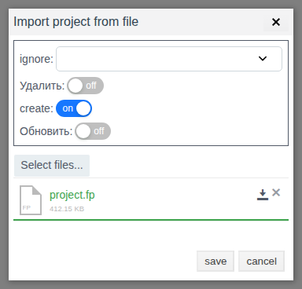
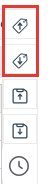
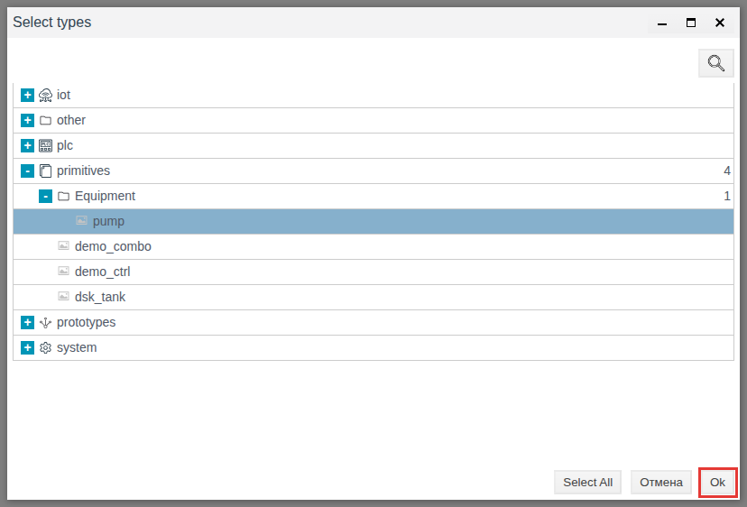
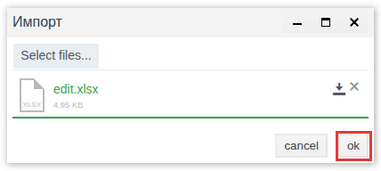
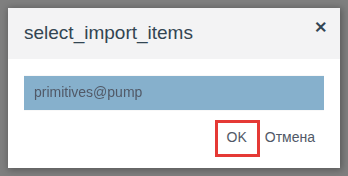
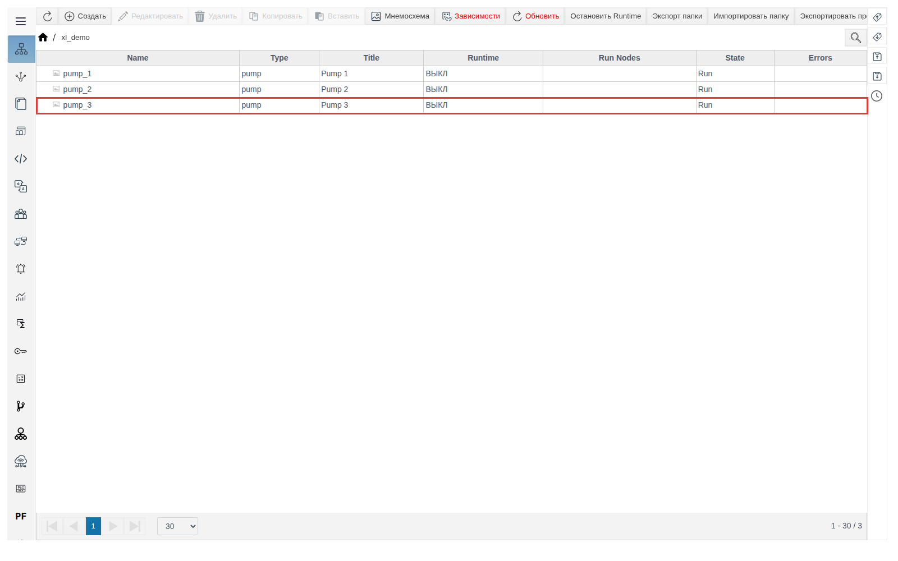
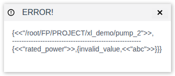

# Импорт и экспорт проекта

Документ для инженера-интегратора, который переносит проект между серверами, сохраняет его резервную копию или массово правит объекты: как сохранить проект в файл `project.fp` и загрузить этот файл в проект, как выгрузить объекты в таблицу Excel и загрузить таблицу обратно.

# Содержание

- [Глоссарий](#глоссарий)
- [Введение](#введение)
- [Основная часть](#основная-часть)
    - [Экспорт](#экспорт)
    - [Что не входит в файл](#что-не-входит-в-файл)
    - [Импорт файла экспорта](#импорт-файла-экспорта)
    - [Обмен через Excel](#обмен-через-excel)
- [Заключение](#заключение)

# Глоссарий

| Термин | Значение |
|---|---|
| Файл экспорта | Файл `project.fp` с объектами проекта по разделам |
| Раздел | Часть проекта в файле экспорта: дерево проекта, примитивы, пользователи и другие. Список — в разделе [«Экспорт»](#экспорт) |
| Тип объекта | Встроенный тип Studio (папка, архив, соединение и другие), примитив или прототип, из которого создан объект. Указан в колонке **Type** Общего вида |
| Флажок **export** | Свойство поля типа: значение поля записывается в файл экспорта |
| Флажок **excel** | Свойство поля типа: поле выгружается в таблицу Excel и загружается из неё |
| Путь объекта | Положение объекта в дереве проекта от корня `/PROJECT`, например `/PROJECT/<папка>/<объект>` |

# Введение

Файл экспорта `project.fp` хранит объекты проекта. По нему переносят проект целиком или отдельные разделы на другой сервер и хранят резервную копию проекта перед крупными правками. Файл также используют при обновлении FACEPLATE, см. [«Версия и обновление FACEPLATE»](../../administration/update/update.md).

Таблица Excel решает другую задачу: заполнить или поправить поля многих однотипных объектов и создать объекты по списку. В таблицу попадают только поля с флажком **excel**, а загрузка таблицы объекты не удаляет.

Понадобится доступ к Studio (`http://<сервер>:9000/fp/studio`) под учётной записью с правом изменять проект.

# Основная часть

## Экспорт

Кнопки **Экспорт проекта в файл** и **Импорт проекта из файла** — третий и четвёртый значки сверху на правой вертикальной панели Studio: верхний из отмеченных — экспорт, нижний — импорт.

Нажмите **Экспорт проекта в файл**. Проект записывается в файл по разделам. В списке **ignore** отметьте разделы, которые сохранять не нужно: отмеченные разделы экспорт пропустит, а все неотмеченные сохранит в файл. Чтобы сохранить проект целиком, оставьте список пустым. Нажмите **save**. Браузер сохранит `project.fp`.

Разделы в списке **ignore**:

| Раздел | Что в нём |
|---|---|
| `global_libraries` | [Библиотечные модули](../../project_logic/library_modules/library_modules.md) и [JS-библиотеки](../../project_logic/js_library/js_library.md) |
| `environment` | [Библиотека изображений](../../mnemo/images.md), [словарь локализации](../localization/localization.md) и системные настройки проекта: [тревоги](../../alarms/alarm/alarm.md), авторизация, [графический редактор](../../mnemo/editor.md) и другие |
| `primitives` | [Примитивы](../primitives/primitives.md) |
| `catalogs` | [Каталоги](../catalogs/catalogs.md) |
| `prototypes` | [Прототипы](../prototypes/prototypes.md) |
| `usergroups` | [Роли](../../access/roles.md) |
| `users` | [Пользователи](../../access/users.md): учётные записи без паролей. После импорта пароли задают заново, см. [«Пользователи», раздел «Пароль»](../../access/users.md#пароль) |
| `project` | Дерево проекта: папки, объекты, экраны |
| `user_rights` | [Права ролей на мнемосхемы](../../access/roles.md#права-на-мнемосхемы): просмотр и изменение |

## Что не входит в файл

Накопленные значения архивов и записи журнала событий хранятся в базе узла и в файл не входят. После импорта в пустую базу архивы проекта пустые и пополняются заново.

Значение собственного поля примитива или прототипа попадает в файл, только если у поля стоит флажок **export**, см. [«Примитивы», раздел «Поля»](../primitives/primitives.md#поля) и [«Прототипы», раздел «Поля»](../prototypes/prototypes.md#поля). Значения полей без флажка в файл не записываются, и после импорта в другую базу их задают заново. Чтобы перенести такие значения, поставьте полю флажок **export** до экспорта или перенесите значения через Excel: для этого у поля должен стоять флажок **excel**, см. [«Обмен через Excel»](#обмен-через-excel). У встроенных типов Studio (папок, архивов, тревог и других) набор полей в файле задан заранее.

## Импорт файла экспорта

1. Нажмите **Импорт проекта из файла** и выберите `project.fp` кнопкой **Select files...**.
2. Включите переключатели **Удалить**, **create**, **Обновить** в нужном сочетании, см. таблицу сочетаний ниже. В **ignore** отметьте те же разделы, что при экспорте; для файла всего проекта оставьте список пустым. Нажмите **save**.

    

3. Дождитесь сообщения `The project was imported successfully` и обновите страницу. Папки и объекты проекта появятся в дереве.

Окно импорта сопоставляет объекты файла и проекта по пути. Переключатели определяют, что делать с расхождениями:

| Переключатель | Что делает |
|---|---|
| **Удалить** | Удаляет из проекта объекты, которых нет в файле |
| **create** | Создаёт объекты из файла, которых нет в проекте. Объекты, которые уже есть, не меняет |
| **Обновить** | Записывает в объекты, которые есть и в файле, и в проекте, значения полей из файла. Включается вместе с **create** |

Сочетания переключателей:

| Включены | Объект только в файле | Объект в файле и в проекте | Объект только в проекте | Когда применять |
|---|---|---|---|---|
| **create** | Создаётся | Не меняется | Остаётся | Перенос проекта в пустую базу; добавить недостающее, не затирая правок в проекте |
| **create** и **Обновить** | Создаётся | Получает поля из файла | Остаётся | Принести изменения из файла и сохранить объекты, созданные только в этом проекте |
| **Удалить** и **create** | Создаётся | Не меняется | Удаляется | Убрать лишнее и добавить недостающее, не затирая правок в общих объектах |
| **Удалить**, **create** и **Обновить** | Создаётся | Получает поля из файла | Удаляется | Сделать проект точной копией файла |
| **Удалить** | Не создаётся | Не меняется | Удаляется | Только убрать из проекта то, чего нет в файле |

Импорт с **Удалить** удаляет и объекты, созданные в проекте после того, как сделан файл. Перед таким импортом сохраните файл экспорта текущего проекта: из него удалённое можно вернуть импортом с **create**.

Список **ignore** при импорте должен совпадать со списком, с которым файл экспортировали. Разделов, отмеченных при экспорте, в файле нет, и импорт с **Удалить** удаляет их содержимое из проекта. Например, если при экспорте отмечены `users` и `usergroups`, а при импорте нет, импорт удалит пользователей и роли проекта, в том числе встроенные.

Если неизвестно, какие разделы отмечены при экспорте, импорт без **Удалить** проекту не навредит: **create** и **Обновить** не трогают разделы, которых нет в файле. Чтобы включить **Удалить**, отметьте в **ignore** разделы, которые должны остаться в проекте как есть: отмеченные разделы импорт не меняет и не удаляет.

## Обмен через Excel

Через таблицу Excel заполняют поля многих объектов разом: вписывают заводские номера, правят уставки, заводят объекты по списку оборудования. В отличие от файла экспорта, таблицу открывают и правят в Excel или другом редакторе таблиц, а затем загружают обратно. Через таблицу также переносят значения полей, у которых стоит флажок **excel**, но нет флажка **export**: в файл экспорта такие значения не попадают.

| | Файл экспорта `project.fp` | Таблица `faceplate_project.xlsx` |
|---|---|---|
| Что содержит | Разделы проекта целиком: объекты с полями, у которых стоит флажок **export**, экраны, пользователи и другое | Объекты выбранных типов из одной папки, только поля с флажком **excel** |
| Где правят | Не правят, только загружают в Studio | В Excel или другом редакторе таблиц |
| Схемы объекта (`screen`, `view1`–`view15`, `settings`) | Переносятся | Не переносятся; при загрузке таблицы остаются как были |
| Удаляет ли объекты при загрузке | Да, с переключателем **Удалить** | Нет |
| Когда применять | Перенос проекта, резервная копия | Массовая правка полей, создание объектов по списку |

Кнопки **Экспорт .xlsx** и **Импорт .xlsx** — первый и второй значки сверху на правой панели Studio. Они работают в **Общем виде**, а также в разделах **Каталоги** и **Локализации**; в остальных разделах неактивны. Здесь описан Общий вид. Обмен записями каталогов описан в документе [«Каталоги», раздел «Обмен через Excel»](../catalogs/catalogs.md#обмен-через-excel), обмен словарём — в документе [«Локализация», раздел «Обмен через Excel»](../localization/localization.md#обмен-через-excel).

### Выгрузка в Excel

1. В **Общем виде** откройте двойным щелчком папку с объектами. В таблицу попадут все объекты внутри папки на любой глубине вложенности, сама папка в неё не входит. Чтобы выгрузить весь проект, оставайтесь в корне.
2. Нажмите **Экспорт .xlsx**. В окне **Select types** типы сгруппированы: `iot`, `other`, `plc`, `primitives`, `prototypes`, `system`. Выделите нужные типы (несколько — с Ctrl) и нажмите **Ok**. Кнопка **Select All** сразу выгружает объекты всех типов.

    

3. Браузер сохранит файл `faceplate_project.xlsx`.

### Таблица .xlsx

Каждый тип — отдельный лист. Имя листа и заголовок первой колонки — тип:

| Тип | Лист |
|---|---|
| Встроенный тип Studio: папка, архив, скрипт, соединение IoT или PLC и другие | Имя типа, например `FOLDER` или `plc_modbus_connection` |
| Примитив | `primitives@<примитив>` |
| Прототип | `prototype@<прототип>` |

Первая колонка — путь объекта, одна строка — один объект. Остальные колонки — поля с флажком **excel** в алфавитном порядке. У встроенных типов набор полей задан заранее (`title`, `disabled` и другие). У примитивов и прототипов к системным полям добавляются собственные поля, у которых в разделе **Поля** стоит флажок **excel**, Где ставится флажок: [«Примитивы», раздел «Поля»](../primitives/primitives.md#поля), [«Прототипы», раздел «Поля»](../prototypes/prototypes.md#поля). У полей каталога флажок **excel** задаётся так же, см. [«Каталоги», раздел «Поля»](../catalogs/catalogs.md#поля).

В примере выгружена папка `xl_demo` с двумя экземплярами примитива `pump`. У полей `rated_power` и `serial_no` флажок **excel** стоит, у `in_service` — нет, поэтому `in_service` в таблицу не попало:

| primitives@pump | comment | icon | prototype | rated_power | serial_no | title |
|---|---|---|---|---|---|---|
| /PROJECT/xl_demo/pump_2 | :atom:null | :atom:null | :atom:null | 30 | SN-1002 | Pump 2 |
| /PROJECT/xl_demo/pump_1 | :atom:null | :atom:null | :atom:null | 22 | SN-1001 | Pump 1 |

Как записаны значения:

| В ячейке | Значение |
|---|---|
| Число или текст | Значение поля как есть: `30`, `SN-1002` |
| `:atom:null` | Поле не задано |
| `:atom:true`, `:atom:false` | Логическое значение. При загрузке подходят и логические значения Excel `ИСТИНА` и `ЛОЖЬ` |
| `fp://PROJECT/...` | Ссылка на объект проекта, например на прототип в колонке `prototype` у экземпляра прототипа |
| Текст в фигурных скобках `{ ... }` | Составное значение, например иконка или настройки объекта |
| Значения с префиксами `:string:` и `:term:` | Служебная запись. Оставляйте её без изменений |

### Загрузка из Excel

1. Внесите изменения в таблицу и сохраните её. В примере у `pump_2` изменено значение `rated_power` (30 → 37) и добавлена строка `pump_3`, изменения выделены:

    | primitives@pump | comment | icon | prototype | rated_power | serial_no | title |
    |---|---|---|---|---|---|---|
    | /PROJECT/xl_demo/pump_2 | :atom:null | :atom:null | :atom:null | **37** | SN-1002 | Pump 2 |
    | /PROJECT/xl_demo/pump_1 | :atom:null | :atom:null | :atom:null | 22 | SN-1001 | Pump 1 |
    | **/PROJECT/xl_demo/pump_3** | **:atom:null** | **:atom:null** | **:atom:null** | **18.5** | **SN-1003** | **Pump 3** |

2. Нажмите **Импорт .xlsx**. Объекты находятся по путям из таблицы, поэтому открытая папка не важна. Кнопкой **Select files...** выберите файл и нажмите **ok**.

    

3. В окне `select_import_items` перечислены листы файла. Выделите нужные (несколько — с Ctrl) и нажмите **OK**.

    

4. Дождитесь сообщения `Импорт выполнен успешно` и закройте его. Список объектов обновится.

В примере после загрузки у `pump_2` новое значение, а в папке появился `pump_3`:

Как загрузка обрабатывает строки и ячейки:

| В таблице | Результат |
|---|---|
| Путь есть в проекте | Поля из колонок листа получают значения из таблицы |
| Пути нет в проекте | Создаётся объект типа листа с именем из последней части пути. Недостающие папки на пути создаются |
| Новый объект без заполненных обязательных полей | Не создаётся; в **ERROR!** указано незаполненное поле |
| Колонки поля нет на листе | Поле не меняется. Для правки достаточно колонки пути и колонок нужных полей |
| Ячейка пустая | Поле очищается |
| Колонка поля без флажка **excel** | Не загружается |
| Объект есть в проекте, но его нет в таблице | Не меняется: загрузка из Excel объекты не удаляет |

Если значение не подходит полю, например текст в поле типа `float`, строка не загружается целиком, а остальные строки загружаются. В окне **ERROR!** перечислены пути объектов, которые не загрузились, имена полей и неверные значения:

# Заключение

Файл экспорта сохраняют кнопкой **Экспорт проекта в файл**: с пустым списком **ignore** — весь проект, с отмеченными разделами — без них. Импортируют кнопкой **Импорт проекта из файла** с тем же списком **ignore**, что при экспорте. Переключатели **Удалить**, **create** и **Обновить** выбирают по таблице сочетаний. Значения архивов и журнал событий в файл не входят.

Поля объектов массово правят через Excel: **Экспорт .xlsx** в папке Общего вида выгружает объекты выбранных типов, **Импорт .xlsx** загружает изменённую таблицу. Загрузка переписывает поля из колонок листа и создаёт объекты по новым путям, но ничего не удаляет.
