# Прототипы

Документ для инженера-интегратора, который собирает проект в Studio.

# Глоссарий

| Термин | Значение |
|---|---|
| Прототип | Шаблон из раздела **Прототипы**: Контент, Поля и Поведение. Из него создаются экземпляры |
| Экземпляр | Объект проекта, созданный из прототипа. Хранит ссылку на прототип и копию его контента. В колонке **Type** у него указано имя прототипа |
| Контент | Дерево объектов прототипа, которое копируется в каждый экземпляр |
| Поля прототипа | Собственные поля экземпляров, заданные на вкладке **Поля** |
| Поведение | Модуль на Erlang с функциями `on_create/1`, `on_edit/1`, `on_delete/1`. Сервер вызывает их при операциях с экземплярами |
| Синхронизация (Sync) | Перенос текущего состояния прототипа на его экземпляры в выбранных режимах |
| Вложенный прототип | Прототип, экземпляр которого лежит в контенте другого прототипа |
| Группа прототипа | Папка прототипа в окне выбора типа (`prototypes / <группа>`) |
| Общий вид | Раздел Studio с деревом объектов проекта (см. [«Структура проекта»](../Project_strucure/FACEPLATE-start.md)) |
| Run-time поле | Поле с флажком **Run-time**. Выводится на вкладке **Runtime** формы экземпляра |
| Хранилище `disc` / `ramdisc` / `ram` | Где хранится значение поля: на диске; в памяти с копией на диске; только в памяти |
| Индекс `simple` / `3gram` / `datetime` | Индекс поля для поиска: по точному значению; по фрагменту строки; по дате и времени |
| Файл `.prt` | Файл экспорта прототипа |

# Введение

**Прототип** — шаблон для любой повторяющейся части проекта. Это может быть единица оборудования, участок, узел учёта, набор соединений или [расчётов](../calculation/calculation.md): всё, что собирается из объектов проекта и встречается больше одного раза. Структура описывается в прототипе один раз, после чего из него создаётся любое число **экземпляров**. Каждый экземпляр получает копию структуры. Изменения прототипа переносятся на все экземпляры командой **Sync**.

Раздел находится в главном меню Studio: **Прототипы**. У каждого прототипа три части, каждая открывается своей кнопкой:

| Часть | Кнопка | Что содержит |
|---|---|---|
| Контент | **Контент** | Дерево объектов, которое копируется в каждый экземпляр |
| Поля | **Поля** | Собственные поля экземпляра: имя, тип, хранилище, значение по умолчанию |
| Поведение | **Поведение** | Код на Erlang, который сервер выполняет при создании, изменении и удалении экземпляра |

Сквозной пример документа построен на насосной станции:

| Объект | Роль |
|---|---|
| Прототип `Pump` (группа «Насосы») | Насос: папка `motor` в контенте, поля `rated_power`, `location`, `running` |
| Экземпляр `P_201` | Насос Н-201 в корне проекта |
| Прототип `Station` | Станция, в контенте которой лежит экземпляр насоса `P1` |
| Экземпляр `ST_1` | Станция в корне проекта |

Понадобится доступ к Studio (`http://<сервер>:9000/fp/studio`) под учётной записью с правом изменять проект.

# Основная часть

## Создание прототипа

Откройте **Прототипы** в главном меню Studio. В списке показаны иконка, имя, группы и комментарий каждого прототипа.

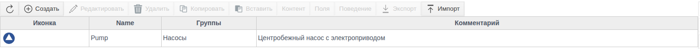

Нажмите **Создать** и заполните форму:

| Поле | Назначение |
|---|---|
| **Name** | Имя прототипа, обязательное поле. Под этим именем прототип появится в окне выбора типа |
| **Иконка** | Файл `.svg`, `.png`, `.jpg` или `.jpeg`. Иконку наследуют экземпляры |
| **Группы** | Папка прототипа в окне выбора типа. Каждая следующая строка задаёт вложенную папку |
| **Комментарий** | Свободный текст |

Кнопки **Sync** и **Show fields** работают только у сохранённого прототипа, они описаны в разделах [«Синхронизация прототипа с экземплярами»](#синхронизация-прототипа-с-экземплярами) и [«Поля»](#поля).

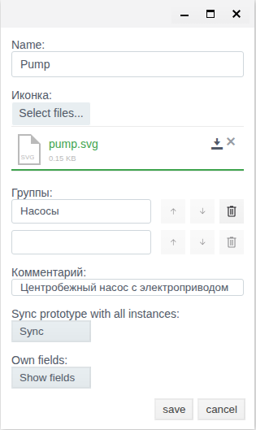

Сохраните. Вместе с прототипом создаются пустые Контент и Поля, а Поведение получает готовый шаблон.

Двойной щелчок по прототипу открывает его Контент. Хлебные крошки над таблицей (**Прототипы / Pump / Content**) возвращают к списку.

## Контент

Выделите прототип и нажмите **Контент**. Это то же дерево объектов, что и в Общем виде, с теми же кнопками: **Создать**, **Редактировать**, **Удалить**, **Копировать**, **Вставить**, **Мнемосхема**, **Зависимости**.

Добавьте в контент `Pump` папку `motor`:

1. Нажмите **Создать**.
2. Раскройте группу **system**, выберите **FOLDER** и нажмите **Ok**.

   

3. Укажите **Название** `motor` и **Заголовок** «Электродвигатель». Сохраните.

   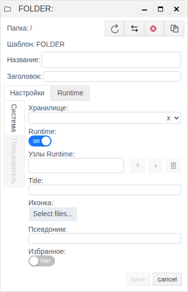

Объекты других типов добавляются так же, из своих групп окна выбора типа: `iot` ([IoT](../IoT/IoT.md)), `plc` ([PLC-соединения](../plc_connections/general_ru.md)), `primitives` ([«Примитивы»](../primitives/Primitives.md)), `prototypes`, `system` (например, [расчёты](../calculation/calculation.md) и [User Script](../user_script/user_script.md)).

Поле **Папка** в форме показывает путь от корня контента: `/` — это сам корень. В экземпляре `P_201` папка `/motor` окажется по пути `P_201/motor`.

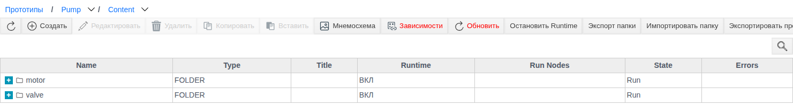

Кнопка **Мнемосхема** в корне контента открывает схемы прототипа: `screen` и `view1`–`view6`. Эти схемы вставляются на мнемосхемы проекта как графический элемент «Прототип». Его настройка описана в документации редактора мнемосхем.

## Поля

Нажмите **Поля**. В таблице перечислены собственные поля прототипа. Кнопка **Показать системные поля** добавляет к ним унаследованные (`.name`, `.folder`, `.pattern` и другие). Имя унаследованного поля изменить нельзя.

Нажмите **Создать** и заполните форму поля.

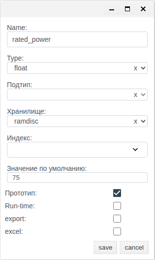

| Поле | Значения | Правила |
|---|---|---|
| **Name** | — | Обязательное |
| **Type** | `string`, `integer`, `float`, `bool`, `link`, `atom`, `term`, `list` | Обязательное |
| **Подтип** | Те же типы, кроме `list` | Обязательно только при типе `list`: это тип элементов списка |
| **Хранилище** | `disc`, `ramdisc`, `ram` | Обязательное, по умолчанию `ramdisc` |
| **Индекс** | `simple`, `3gram`, `datetime` | Необязательное. Для `string` доступны `simple` и `3gram`, для `integer` — `simple` и `datetime`, для `float` список пуст |
| **Значение по умолчанию** | — | Значение, которое поле принимает, пока оно не задано |
| **Прототип** | флажок | Значение поля переносится из прототипа в экземпляры при синхронизации в режиме `update`. Поле без флажка `update` не меняет |
| **Run-time** | флажок | Поле выводится на вкладке **Runtime** формы экземпляра и в окне **Show fields** |
| **export** | флажок | Поле попадает в экспорт проекта |
| **excel** | флажок | Поле участвует в обмене через Excel |

В примере у `Pump` три поля:

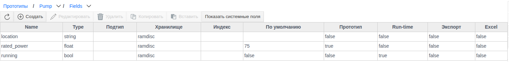

На вкладке **Runtime** формы экземпляра видны только поля с флажком **Run-time** и системное поле `disabled`. Поля без этого флажка (`rated_power`, `location`) в форме экземпляра не выводятся.

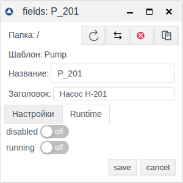

**Значения Run-time полей самого прототипа.** Откройте прототип через **Редактировать** и нажмите **Show fields**. Откроется окно «Pump default field values» с Run-time полями прототипа. Окно доступно только у сохранённого прототипа, иначе появится сообщение «Прототип не найден».

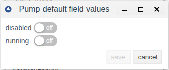

> [!NOTE]
> Значения из этого окна не копируются в новый экземпляр при создании. В примере у `Pump` включено поле `running`, а у созданного после этого экземпляра `P_202` оно выключено. В существующие экземпляры значение переносит синхронизация `update`, если у поля стоит флажок **Прототип**.

## Поведение

Нажмите **Поведение**. Откроется редактор кода на Erlang с готовым шаблоном из трёх функций:

| Функция | Когда вызывается |
|---|---|
| `on_create/1` | Создан новый экземпляр прототипа |
| `on_edit/1` | Изменены собственные поля экземпляра |
| `on_delete/1` | Экземпляр удалён |

Каждая функция получает объект экземпляра и должна вернуть `ok`. Если функция выбросит исключение, вся транзакция откатится. Некритичные ошибки пишите в журнал макросами `?LOGWARNING` и `?LOGERROR`.

Проверьте код кнопкой **Compile** и сохраните.

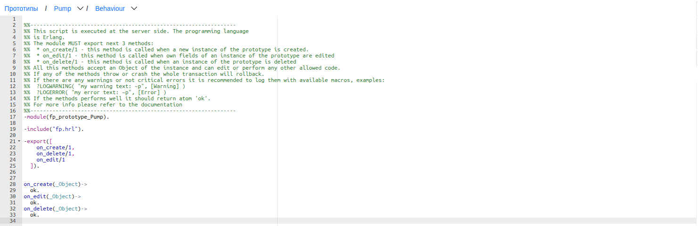

## Создание экземпляра

1. В Общем виде откройте папку, где будет экземпляр, и нажмите **Создать**.
2. Раскройте **prototypes**, затем группу прототипа («Насосы»). Выберите `Pump` и нажмите **Ok**.

   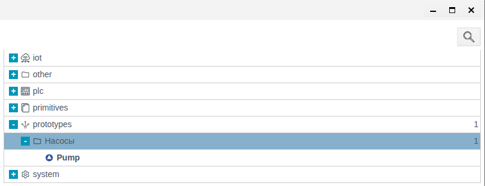

3. Укажите **Название** `P_201` и **Заголовок** «Насос Н-201». Сохраните.

   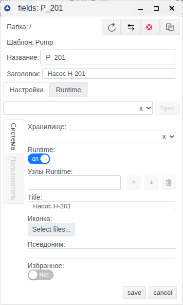

В дереве появится `P_201` с иконкой прототипа и именем `Pump` в колонке **Type**. Внутри лежит копия контента.

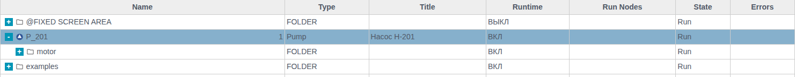

В форме экземпляра над вкладками указан его прототип: `Pump/content`.

## Синхронизация прототипа с экземплярами

Синхронизация переносит текущее состояние прототипа на все его экземпляры. Выделите прототип, нажмите **Редактировать**, затем **Sync**. Отметьте режимы и нажмите **OK**.

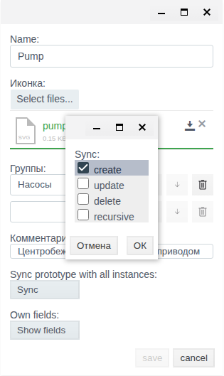

| Режим | Что делает |
|---|---|
| `create` | Добавляет в экземпляры объекты контента, которых в них ещё нет. Существующие объекты не меняет |
| `update` | Переписывает поля с флажком **Прототип** у объектов экземпляра значениями из прототипа, включая корень экземпляра |
| `delete` | Удаляет из экземпляров объекты, которые удалены из прототипа. Объекты, добавленные в экземпляр вручную, остаются |
| `recursive` | Распространяет синхронизацию на экземпляры внешних прототипов, в контенте которых лежит экземпляр этого прототипа (раздел [«Вложенные прототипы»](#вложенные-прототипы)) |

Режимы можно сочетать. Для `update`, `delete` и `recursive` система запрашивает подтверждение, ответ — **yes**. Если не выбран ни один режим, появится сообщение «Опции для синхронизации не выбраны». После успешной синхронизации — «Синхронизация завершена».

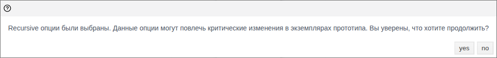

> [!WARNING]
> Режим `update` переписывает и поля корня экземпляра. В примере после `update` экземпляр `P_201` потерял заголовок «Насос Н-201», потому что в корне контента `Pump` заголовок пустой. После `update` проверьте заголовки и собственные поля экземпляров.

Пример из проекта:

| Изменение в прототипе `Pump` | Режим | Результат в `P_201` |
|---|---|---|
| Добавлена папка `valve` | `create` | Появилась `valve` |
| Заголовок `motor` → «Электродвигатель» | `update` | Заголовок `motor` = «Электродвигатель», заголовок `P_201` очищен |
| Удалена папка `valve` | `delete` | `valve` удалена, добавленная вручную `local_notes` осталась |
| В прототипе включено `running`, флажок **Прототип** снят | `update` | `running` не изменилось |
| У поля `running` установлен флажок **Прототип** | `update` | `running` включено |

## Вложенные прототипы

Экземпляр одного прототипа можно положить в контент другого. В примере в контенте `Station` создан экземпляр `P1` прототипа `Pump` (**Контент** → **Создать** → **prototypes** → «Насосы» → `Pump`).

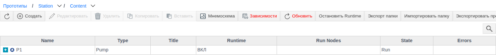

Экземпляр станции `ST_1` получает копию `P1`. Прямые экземпляры `Pump` — это `P_201` и `P1` в контенте `Station`, их обновляет любая синхронизация `Pump`. `ST_1/P1` — экземпляр второго уровня, и до него изменения доходят по-разному:

| Синхронизация | `P_201` | `ST_1/P1` |
|---|---|---|
| `Pump`: `create` + `recursive`, добавлена папка `seal` | Появилась `seal` | Появилась `seal` |
| `Pump`: `create`, добавлена папка `bearing` | Появилась `bearing` | Без изменений |
| `Pump`: `update` + `recursive`, заголовок `motor` изменён | Заголовок обновлён | Без изменений |
| `Station`: `update` | — | Заголовок `motor` обновлён |

> [!NOTE]
> `recursive` переносит на второй уровень новые объекты (`create`), но не изменения полей (`update`). Чтобы обновить поля в экземплярах внешнего прототипа, после синхронизации `Pump` выполните **Sync** с `update` у `Station`.

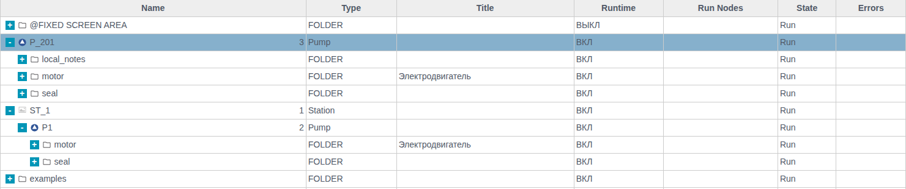

## Экспорт и импорт прототипа

**Экспорт.** Выделите прототип и нажмите **Экспорт**. Браузер сохранит файл `prototype.prt`. Пока прототип не выделен, кнопка неактивна.

**Импорт.** Нажмите **Импорт**, включите нужные режимы, выберите файл `.prt` и сохраните. При успехе появится сообщение «The prototype was imported successfully».

| Переключатель | Что делает |
|---|---|
| **create** | Создаёт объекты из файла, которых нет в проекте |
| **Обновить** | Обновляет существующие объекты значениями из файла |
| **Удалить** | Удаляет объекты прототипа, которых нет в файле |

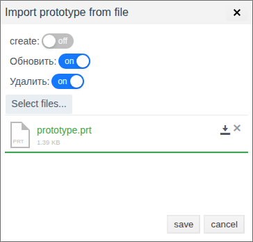

Если изменения нужны в экземплярах, после импорта выполните **Sync**.

# Заключение

Типовой порядок работы с прототипом:

1. Создайте прототип, задайте иконку и группу.
2. Соберите Контент из объектов проекта.
3. Опишите Поля. Отметьте **Run-time** у полей, которые нужно видеть в форме экземпляра, и **Прототип** у полей, которые должны синхронизироваться. Значения Run-time полей переносите в экземпляры синхронизацией `update`.
4. При необходимости допишите Поведение и проверьте его кнопкой **Compile**.
5. Создайте экземпляры в Общем виде.
6. После изменения прототипа выполните **Sync**: `create` для новых объектов, `update` для изменённых полей, `delete` для удалённых объектов, `recursive` для вложенных прототипов. Поля во вложенных экземплярах обновляйте синхронизацией `update` у внешнего прототипа. После `update` проверьте поля корня экземпляров.
7. Для переноса прототипа между проектами используйте **Экспорт** и **Импорт**.
