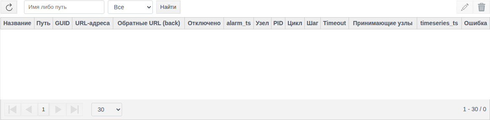
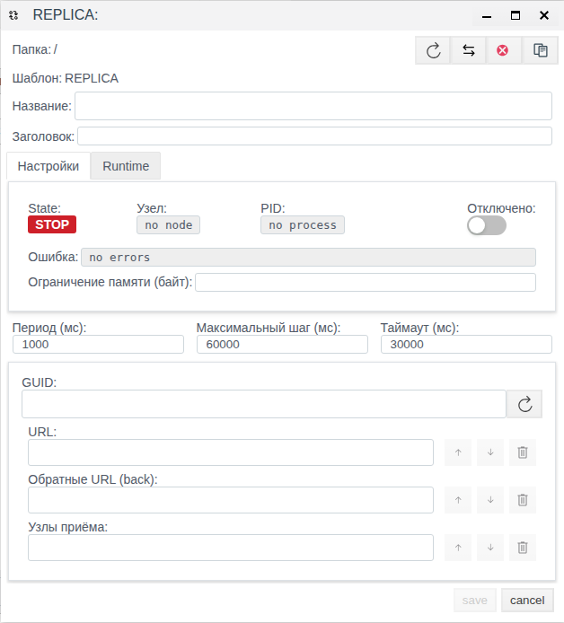

# Репликация в Faceplate: настройка обмена и проверка передачи данных

Руководство для интеграторов, которые настраивают передачу данных между площадкой и диспетчерским центром. Настройки и поведение описаны по исследованной реализации Faceplate 4.0.7.

**Содержание**

- [Назначение репликации](#назначение-репликации)
- [Что подготовить](#что-подготовить)
- [Настройка обмена](#настройка-обмена)
- [Управление каналом репликации](#управление-каналом-репликации)
- [Передать данные насосной станции в диспетчерский центр](#передать-данные-насосной-станции-в-диспетчерский-центр)
- [Краткий справочник параметров и состояний](#краткий-справочник-параметров-и-состояний)
- [Диагностика](#диагностика)
- [Ограничения репликации](#ограничения-репликации)

## Назначение репликации

Репликация передаёт данные объектов одной площадки в другой экземпляр или кластер Faceplate. Например, диспетчерский центр получает давление насосной станции, его историю и сообщения о превышении порога.

Для обмена создают пару объектов **Replica** с одинаковым **GUID**. Один объект работает на стороне площадки, второй — на стороне центра. Родительская папка объекта задаёт область обмена; в неё входят и подпапки.

| Данные | Направление | Что проверять |
|---|---|---|
| Текущие поля объектов | Площадка → центр | Значение соответствующего объекта в центре |
| Изменения текущих полей в центре | Центр → площадка | Изменённое значение на площадке |
| История архивов | Площадка → центр | Сохранённые точки за выбранный интервал |
| Сообщения группы папки | Площадка → центр | Записи с нужным источником, текстом и временем |

Теги и архивы на принимающей стороне должны существовать заранее. Репликация сопоставляет их по пути относительно папки обмена. Например, объект **Process/Pressure** на площадке должен иметь соответствие **Process/Pressure** в центре. Названия внешних родительских папок могут различаться: для сопоставления важен относительный путь.

Набор текущих полей определяется типом объекта. Настройки проекта целиком не переносятся. Архивы и шаблоны сообщений подготовьте до настройки репликации; переданные записи проверяются в трендах и журнале сообщений.

Общий порядок работы: подготовить соответствующие объекты на обеих сторонах → создать пару → согласовать идентификатор, узлы и адреса → сохранить настройки → проверить каждый поток на принимающей стороне.

## Что подготовить

Для примера нужны два доступных экземпляра или кластера Faceplate с модулем репликации. У пользователя должны быть права изменять учебные папки, создавать объекты и просматривать значения, архивы и сообщения. Папки обмена должны быть включены и иметь назначенные узлы выполнения.

Подготовьте связь в обе стороны: центр принимает данные площадки, а обратный адрес нужен для начального получения текущих данных и обратных изменений. Имена узлов возьмите из действующей конфигурации Faceplate; имя узла и HTTP-адрес — разные настройки.

### Условные реквизиты двух сторон

| Параметр | Площадка | Диспетчерский центр |
|---|---|---|
| Имя узла в примере | `site@site.example` | `center@center.example` |
| Базовый адрес службы в примере | `http://site.example:9000` | `http://center.example:9000` |
| Папка обмена | PumpStation | PumpStation |
| Объект репликации, который создаёт читатель | StationLink | StationLink |

Домены с окончанием **.example**, имена узлов и порт **9000** здесь условные. Они показывают форму записи и не задают адреса или стандартный порт вашей установки. Введите фактические адреса служб и полные имена узлов своей системы.

### Учебные объекты

Подготовьте следующие объекты внутри **PumpStation** на каждой стороне. Они не создаются автоматически при создании репликации.

| Относительный путь или назначение | Площадка | Центр |
|---|---|---|
| Process/Pressure — текущее давление | 2 бар | 0 бар до обмена |
| Setpoint — учебная уставка | 3 бар | 3 бар |
| PressureArchive | Архив значения Pressure, запись раз в 1 с | Соответствующий архив по тому же относительному пути |
| Сообщение о высоком давлении | Условие Pressure выше 4 бар, группа папки обмена | Возможность просмотреть переданное сообщение |

Используйте учебные значения без связи с исполнительными механизмами. Поля давления и уставки должны допускать ввод дробных чисел через форму и относиться к текущим данным объекта. Если ваш тип объекта использует другие поля, выберите соответствующие поля на обеих сторонах.

Для этапа обслуживания подготовьте на площадке отдельные папки **MaintenanceA** и **MaintenanceB** вне **PumpStation**. Обе папки должны быть отключены до копирования. Учебные данные и рабочую пару очищать для примера не требуется.

## Настройка обмена

### Идентификатор, роли и область

**GUID** связывает две стороны одной пары. Сгенерируйте его на одной стороне и скопируйте на другую. Для другой независимой пары используйте другой идентификатор. Копирование объекта сохраняет его GUID, поэтому копию нельзя считать новой независимой парой без изменения этого поля.

**Receive Nodes** задаёт узлы принимающей стороны. Если среди перечисленных узлов есть локальный узел, объект работает как приёмник. На стороне, где пересечения нет, он работает как отправитель на узлах своей папки. Отдельного переключателя «отправитель/приёмник» для этой настройки не требуется.

Для примера укажите узел центра в **Receive Nodes** обоих объектов. При этом папка площадки выполняется на узле площадки, а папка центра — на узле центра.

Размещение объекта влияет на состав передаваемых данных. Перенос в другую папку меняет область обмена. На обеих сторонах проверьте относительные пути тегов и архивов; одинакового имени конечного объекта без совпадающих подпапок недостаточно.

### Прямые и обратные адреса

В **URL** указывают адреса принимающей службы центра, в **URLS back** — адреса службы площадки. Адрес канала заканчивается на **/REPLICA**. Дополнительные служебные части пути Faceplate добавляет самостоятельно.

Списки адресов обеспечивают последовательные попытки: после успешного ответа используется первый сработавший адрес. Список не включает одновременную отправку всем указанным получателям. Резервный адрес должен вести к соответствующей принимающей стороне с нужной конфигурацией.

### Период, максимальный шаг и таймаут

**Период (мс)** задаёт цикл обработки обмена. Он не гарантирует, что данные будут видны у получателя точно через этот интервал: влияют связь, объём накопленной истории и обработка на обеих сторонах.

**Максимальный шаг (мс)** ограничивает временной интервал одной порции истории и сообщений. Это не ограничение числа тегов или записей. **Таймаут (мс)** задаёт время ожидания запроса; ожидание подключения использует одну десятую этого значения.

При первом запуске незаданные границы истории и сообщений устанавливаются в текущее время. История за предшествующий период автоматически не выбирается. После остановки передача продолжается от сохранённых границ. Сама граница может продвигаться и на пустом интервале, где записей не было.

## Управление каналом репликации

### Изменение и отключение

Откройте объект из списка репликаций или через его папку в дереве проекта. Для поиска используйте имя или путь; строка фильтра должна быть пустой либо содержать не менее трёх символов. Фильтры включения помогают найти включённые и отключённые объекты.

*Рисунок 1 — Список репликаций и фильтры. Доступный стенд: Faceplate Studio 4.0.6.subs.*

Сохранение изменённых настроек может перезапустить выполняемый объект. После изменения проверяйте не только состояние, но и передачу данных. Отмена редактирования позволяет закрыть изменения без сохранения.

Флажок **Disabled** исключает объект из запуска. Отключение родительской папки также влияет на выполнение. Отключение репликации не заменяет управление архивированием исходных объектов: для проверки накопления истории архив площадки должен продолжать работать.

### Копирование, перенос и удаление

Копируйте объект только в заранее отключённую папку. После **Copy/Paste** копия сохраняет GUID и обычные настройки, а границы обработанной истории и сообщений не копируются. Перед запуском новой пары задайте новый общий GUID и проверьте все адреса и роли.

Для переноса используется **Paste** с операцией **move**. Сначала проверьте папку назначения: перенос меняет область обмена. При удалении одного или нескольких объектов требуется подтверждение. Удаление объекта репликации не удаляет связанные теги и архивы.

В общих формах предусмотрены **Copy Path**, **Cross Reference** и **Broken Dependencies** — копирование пути, просмотр ссылок и нарушенных зависимостей. Их наличие и подписи в конкретной форме требуют проверки в вашей поставке.

### Границы обработки и память

Границы истории и сообщений заполняются автоматически. В числовых полях текущих параметров предусмотрено их изменение, но сохранение через формы и влияние изменения на действующий обмен в этом примере не проверены. Проверку редактирования выполняйте только на отключённой учебной копии.

В поле **Memory limit (bytes)** обнаружено несоответствие единиц: подпись указывает байты, а в исследованной реализации число обрабатывается как количество МиБ. Значение **1024** соответствует 1024 МиБ. Уточните единицы своей поставки перед изменением; пример ниже не задаёт новое числовое значение этого лимита.

## Передать данные насосной станции в диспетчерский центр

Это единственный сквозной сценарий руководства. Он использует учебные объекты из раздела «Что подготовить». Все адреса и имена узлов в таблицах замените своими. Следующие результаты ожидаются по исследованному поведению; их необходимо подтвердить на вашей паре экземпляров.

### Связать площадку и центр

Сначала настройте объект центра, затем объект площадки. Такой порядок позволяет подготовить принимающую сторону до начала отправки.

| Поле | Объект площадки | Объект центра |
|---|---|---|
| Имя | StationLink | StationLink |
| GUID | Идентификатор, полученный на центре | Сгенерированный идентификатор пары |
| URL, одна строка списка | `http://center.example:9000/REPLICA` | `http://center.example:9000/REPLICA` |
| URLS back, одна строка списка | `http://site.example:9000/REPLICA` | `http://site.example:9000/REPLICA` |
| Receive Nodes, одна строка списка | `center@center.example` | `center@center.example` |
| Период (мс) | 1000 | 1000 |
| Максимальный шаг (мс) | 60000 | 60000 |
| Таймаут (мс) | 30000 | 30000 |
| Disabled | Снят | Снят |

*Рисунок 2 — Шаг 2 — Пустая форма REPLICA до заполнения. На снимке открыта папка-корень; в сценарии выберите PumpStation. Доступный стенд: Faceplate Studio 4.0.6.subs.*

Одинаковые значения адресов и узлов в таблице задают общие направления пары. Роль каждого объекта определяется его локальными узлами, а не отличающимся значением адреса в форме.

1. В центре откройте папку **PumpStation** в дереве проекта.
2. В **Общем виде** выберите создание объекта типа **Replica**.
3. Задайте имя **StationLink**.
4. Сгенерируйте **GUID** кнопкой рядом с полем.
5. Заполните остальные поля по столбцу центра в таблице.
6. Сохраните объект центра.
7. На площадке откройте папку **PumpStation**.
8. Создайте в ней объект **Replica** с именем **StationLink**.
9. Заполните поля по столбцу площадки, включая GUID объекта центра.
10. Сохраните объект площадки.
11. Откройте список репликаций.
12. Проверьте состояние, узел и процесс обоих объектов.
13. На площадке измените текущее значение **Process/Pressure** на **3 бар**.
14. В центре откройте соответствующий объект **Process/Pressure**.
15. Проверьте, что его текущее значение стало **3 бар**.

При работающих объектах ожидается **RUN** и назначенные узел и процесс. Оставьте несколько периодов на обмен; при отсутствии результата перейдите к диагностике. Положительный результат этого этапа — совпадение изменённого значения на центре. Он ещё не подтверждает передачу сохранённой истории и сообщений.

### Проверить историю, сообщения и обратную запись

1. В объекте площадки задайте **Период (мс)** равным **2000**.
2. Задайте **Максимальный шаг (мс)** равным **30000**.
3. Задайте **Таймаут (мс)** равным **10000**.
4. Сохраните изменения.
5. Задайте те же три значения в объекте центра.
6. Сохраните изменения центра.
7. Зафиксируйте время начала проверки по часам площадки.
8. На площадке установите **Pressure = 3 бар**.
9. После сохранения этого значения в архиве измените **Pressure** на **5 бар**.
10. После следующей записи архива верните **Pressure** к **3 бар**.
11. В центре откройте тренд архива **PressureArchive** за интервал проверки.
12. Найдите точки со значениями **3, 5 и 3 бар**.
13. Сравните время этих точек с записями архива площадки.
14. В журнале сообщений центра найдите сообщение о превышении **4 бар**.
15. Сравните источник, время появления и исчезновения с сообщением площадки.
16. На площадке добавьте учебный комментарий к этому сообщению.
17. Проверьте изменение комментария в журнале центра.
18. В центре измените текущее значение **Setpoint** с **3** на **3,5 бар**.
19. На площадке проверьте **Setpoint = 3,5 бар**.
20. В центре верните **Setpoint** к **3 бар**.
21. На площадке проверьте возврат к **3 бар**.

При периоде архивирования 1 с удерживайте каждое контрольное значение дольше одного архивного интервала. Сравнивайте фактические точки источника и получателя; отсутствие точки у источника нельзя считать ошибкой репликации. Учитывайте часовые пояса при выборе интервала и сравнении отображаемого времени.

Этот этап проверяет четыре разных результата: текущие значения, сохранённую историю, сообщения и обратные изменения. Передача квитирования отдельно здесь не проверяется.

### Проверить восстановление обмена

Начните с работающей пары, для которой уже подтверждён приём истории. Архивирование на площадке должно продолжаться независимо от отключённого канала репликации.

1. Найдите **StationLink** в списке по имени или пути.
2. Проверьте фильтры включённых и отключённых объектов.
3. Сбросьте фильтры.
4. Обновите список.
5. Откройте диагностику объекта площадки.
6. Выберите уровень сообщений и лимит вывода.
7. Запустите сбор диагностических сообщений.
8. Откройте сведения о процессе.
9. Скопируйте нужную строку или весь диагностический вывод.
10. Очистите отображаемый вывод диагностики.
11. В объекте площадки установите **Disabled**.
12. Сохраните изменение.
13. Зафиксируйте время отключения.
14. Измените **Pressure** на площадке так, чтобы в её архиве появились отличимые записи.
15. Проверьте наличие этих записей в архиве площадки.
16. Снимите **Disabled** объекта площадки.
17. Сохраните изменение.
18. В центре проверьте записи за интервал отключения.
19. Остановите сбор диагностических сообщений.

Ожидается продолжение обработки от сохранённой границы. Проверьте конкретные значения и время в центре: переход в RUN или продвижение границы не заменяет эту проверку. Время обработки накопленного интервала зависит от его размера и настроек обмена.

Для проверки списка резервных адресов используйте тот же учебный канал. Подготовьте действующий адрес центра и контролируемо недоступный учебный адрес; порядок списка должен быть известен.

1. В **URL** первым укажите недоступный учебный адрес, вторым — действующий адрес центра.
2. Сохраните настройки.
3. Измените учебное давление на площадке.
4. Проверьте это значение в центре и записи диагностики.
5. Восстановите рабочий список адресов.
6. Сохраните настройки.

Так проверяется переход к следующему адресу после неудачной попытки. Условный домен из текста не является готовой резервной службой; для проверки нужен ваш действующий получатель.

### Обслужить отключённую учебную копию

Этот этап выполняется на площадке с помощью операций из раздела «Управление каналом репликации». Рабочую пару **PumpStation/StationLink** сохраняют. Папки **MaintenanceA** и **MaintenanceB** должны быть отключены и находиться вне области рабочей пары.

1. Проверьте отключение **MaintenanceA**.
2. Скопируйте **StationLink** через **Copy**.
3. Вставьте одну копию в **MaintenanceA** через **Paste**.
4. Откройте параметры копии.
5. Проверьте, что её GUID совпадает с GUID исходного объекта.
6. Сгенерируйте для копии новый GUID.
7. Установите **Disabled** самой копии.
8. Сохраните копию.
9. Откройте её текущие параметры.
10. В поле границы обработки истории введите учебное число **1700000000000** миллисекунд.
11. Сохраните изменение.
12. Повторно откройте форму.
13. Проверьте сохранённое число **1700000000000**.
14. Проверьте назначение поля **Memory limit (bytes)** по справочнику ниже.
15. Скопируйте путь копии через **Copy Path**, если действие доступно в форме.
16. Откройте **Cross Reference** для просмотра ссылок.
17. Откройте **Broken Dependencies** для просмотра нарушенных зависимостей.
18. Проверьте отключение **MaintenanceB**.
19. Перенесите копию в **MaintenanceB** через **Paste** с операцией **move**.
20. Проверьте новый путь копии.
21. Удалите учебную копию с подтверждением.
22. Обновите список и проверьте отсутствие копии.
23. Проверьте, что рабочая пара и учебные теги с архивами остались на месте.

Редактирование границы на отключённой копии проверяет только сохранение поля. Оно не подтверждает повторную передачу истории. Если форма не предоставляет нужное поле или изменение не сохраняется, остановите эту часть проверки; успешное сохранение через обе формы в данной рабочей версии не подтверждено. Лимит памяти в этом этапе не изменяется из-за несоответствия единиц.

## Краткий справочник параметров и состояний

Подписи ниже соответствуют исследованным формам; перевод и расположение в работающем интерфейсе требуют проверки. Для обычной настройки заполняют идентификатор, адреса и узлы, затем проверяют числовые параметры и включение.

| Поле | Назначение и обязательность | Начальное значение или ограничения |
|---|---|---|
| Имя | Обязательное имя объекта в папке | При создании вводится пользователем |
| Заголовок | Необязательное описание | Может оставаться пустым |
| Folder / Pattern | Папка и тип объекта | Отображаемые сведения |
| GUID | Обязательный идентификатор пары | Ввод или генерация кнопкой; одинаковый у сторон одной пары |
| URL | Список прямых адресов | Заполняется пользователем; несколько строк — последовательные попытки |
| URLS back | Список обратных адресов | Заполняется пользователем; адрес службы площадки |
| Receive Nodes | Список узлов приёма | Заполняется пользователем; определяет роль объекта |
| Период (мс) | Цикл обработки обмена | Целое число; 1000 по умолчанию; минимум 1000 |
| Максимальный шаг (мс) | Интервал одной порции истории и сообщений | Целое число; 60000 по умолчанию; минимум 1000 |
| Таймаут (мс) | Ожидание запроса | Целое число; 30000 по умолчанию; минимум 10 |
| Disabled | Исключение объекта из запуска | Для работы флажок должен быть снят |
| Memory limit (bytes) | Унаследованный лимит памяти | Значение 1024; минимум 10; подпись bytes противоречит обработке в МиБ |

Валидация списков не подтверждает правильность адресов и существование узлов. Успешное сохранение пустых списков на стенде не проверено; в рабочей конфигурации примера заполните все три списка.

| Состояние или поле | Кто заполняет | Как трактовать |
|---|---|---|
| State | Faceplate | RUN — процесс работает; STOP — остановлен; успешный обмен проверяется отдельно |
| Node | Faceplate | Узел выполнения; no node указывает отсутствие назначенного узла |
| PID | Faceplate | Выполняемый процесс; no process указывает отсутствие процесса |
| Error | Faceplate | Общий текст последней ошибки истории или сообщений; не полный журнал всех потоков |
| Граница обработки истории | Faceplate | Числовое время последнего обработанного интервала; при первом запуске — текущее время |
| Граница обработки сообщений | Faceplate | Аналогичная граница для сообщений |
| Уровень диагностики | Пользователь | info по умолчанию; доступны info, warning, error, debug |
| Лимит вывода диагностики | Пользователь | 1000 по умолчанию; диапазон 1–100000 |

Границы представлены миллисекундами от 1 января 1970 года, UTC. Они описывают обработанный интервал, а не число принятых точек. Общий текст Error может очиститься после успешной обработки другого потока. Ошибки передачи текущих значений ищите также в диагностике.

## Диагностика

Сначала определите, какой результат отсутствует: текущее значение, история, сообщение или обратное изменение. Проверяйте данные и настройки на обеих сторонах.

| Симптом или сообщение | Где проверить и возможная причина | Действие | Проверка восстановления |
|---|---|---|---|
| STOP, no node, no process | Disabled объекта/папки, узлы папки и Receive Nodes | Включите нужный объект/папку и исправьте назначение узлов | Появился процесс, затем передалось контрольное значение |
| invalid_replica_guid | GUID пары, роль и запуск второй стороны | Согласуйте GUID и убедитесь, что нужная сторона запущена | Повторная отправка дошла до соответствующего объекта |
| all_endpoints_failed, no_endpoint, timeout | Списки адресов, связь, путь /REPLICA | Исправьте адреса или доступность службы | Контрольное значение и новые записи появились в центре |
| HTTP 400 или 404 | Адрес службы, путь канала, GUID и роль | Проверьте реквизиты обеих сторон; прочитайте полный текст ошибки | Запросы проходят и данные сохранены у получателя |
| invalid archive in replica packet | Относительный путь и наличие архива центра | Подготовьте соответствующий архив | В нём появились точки нового проверочного интервала |
| skip update for undefined item | Соответствие объекта и подпапок в центре | Подготовьте соответствующий объект по тому же относительному пути | Новое значение появилось в нём |
| unable to send real-time batch | Диагностика площадки, прямые адреса и процесс центра | Исправьте связь или принимающую сторону | Новое текущее значение дошло до центра |
| unable to initialize data | Диагностика центра, обратные адреса и доступность площадки | Исправьте обратный адрес или работу площадки | Центр получил текущие данные, обратная запись проверена отдельно |
| unable to save changes: … | Форма сохранения; причина после двоеточия | Исправьте указанную причину | Повторное открытие показывает сохранённые поля |

Если RUN есть, а нужных данных нет, сопоставьте относительные пути и конкретный поток. При пустом Error проверьте диагностику: успешная обработка истории может очистить ошибку другого потока. Продвигающаяся граница сама по себе не доказывает запись на получателе.

Очистка диагностики очищает отображаемый вывод. Остановка сбора или закрытие формы прекращает текущий сбор. До очистки скопируйте нужные сообщения. Фиксируйте время проверки, объект, значение источника и ожидаемый результат на получателе — это поможет отличить ошибку репликации от отсутствия исходной записи.

## Ограничения репликации

- Конфигурация проектов не переносится целиком. Отсутствующие теги и архивы не создаются автоматически; такие данные могут быть пропущены.
- История и сообщения передаются от площадки к центру. Обратный обмен описан для текущих полей.
- В исследованной форме нет отдельных режимов «только история» или «только сообщения».
- Несколько URL обеспечивают последовательные попытки, а не рассылку во все адреса.
- До первого запуска автоматически не выбирается предшествующая история. После остановки продолжение зависит от сохранённых границ и доступных исходных данных.
- Сообщения выбираются по группе родительской папки и времени появления, исчезновения или комментария. Время квитирования отдельно не используется для такого отбора.
- Успешное состояние процесса или ответ на приём не гарантирует сохранение истории и сообщений. Завершённость подтверждают данными принимающей стороны.
