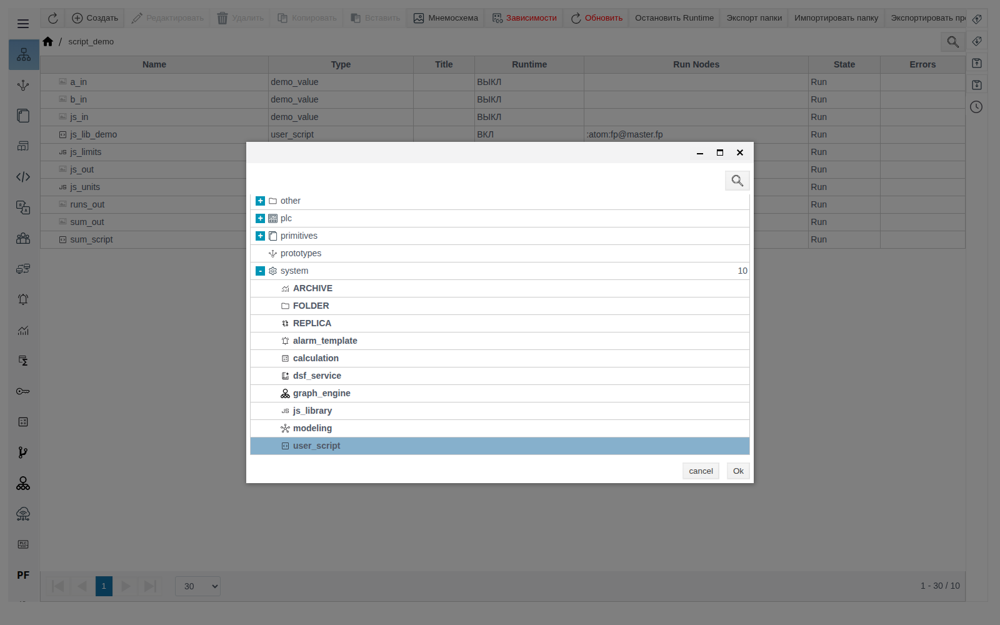
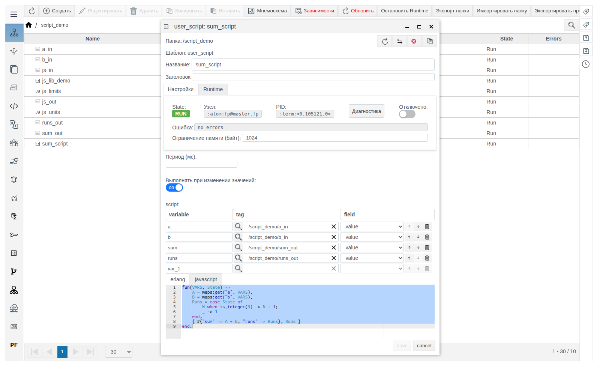
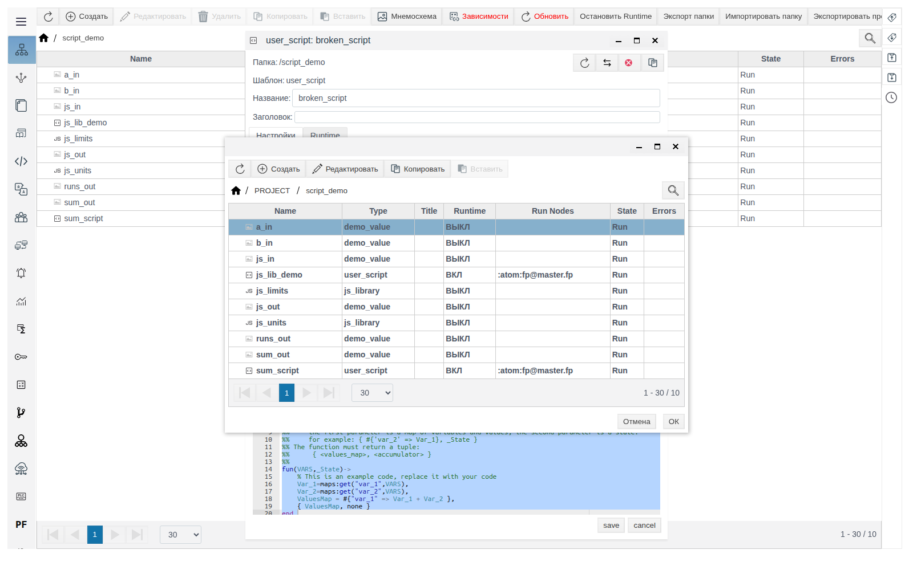
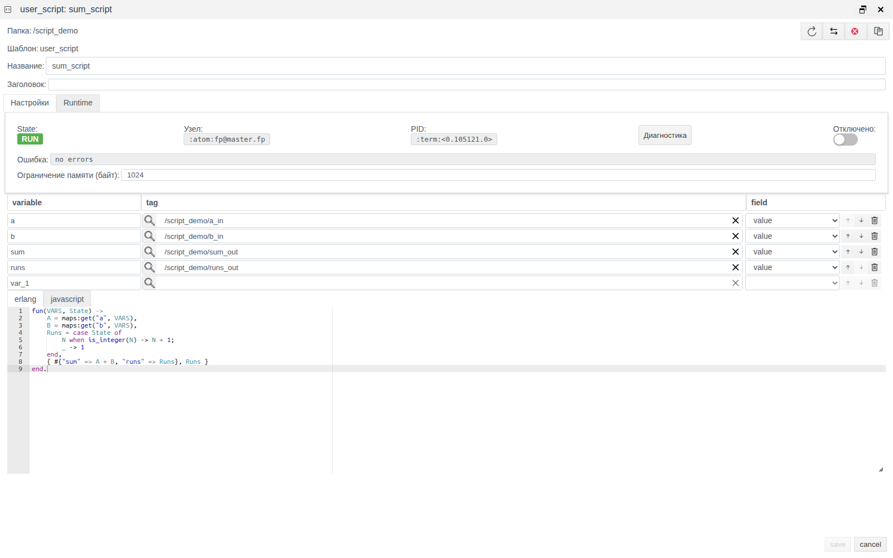
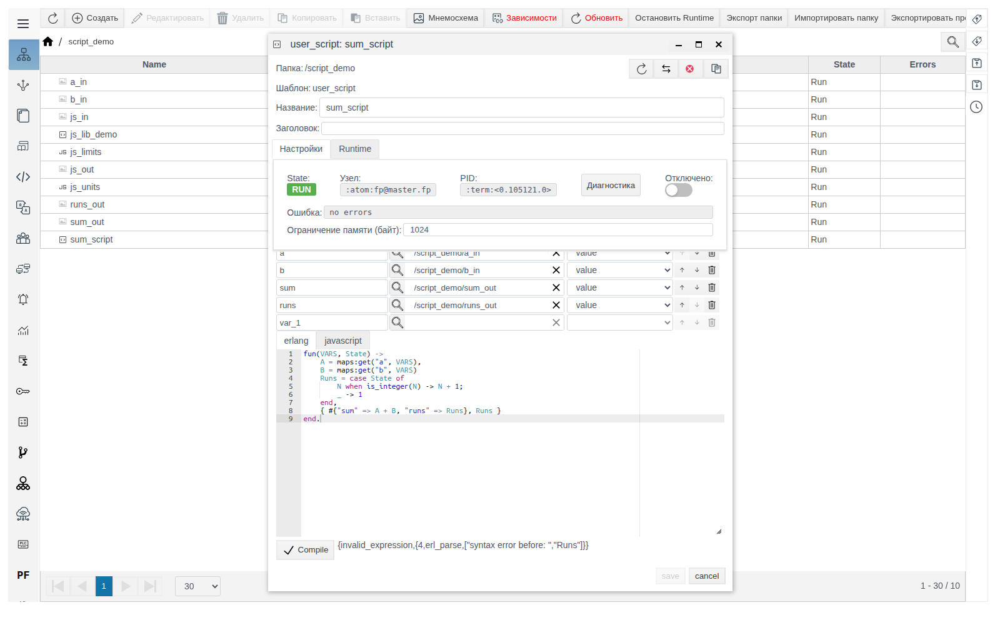
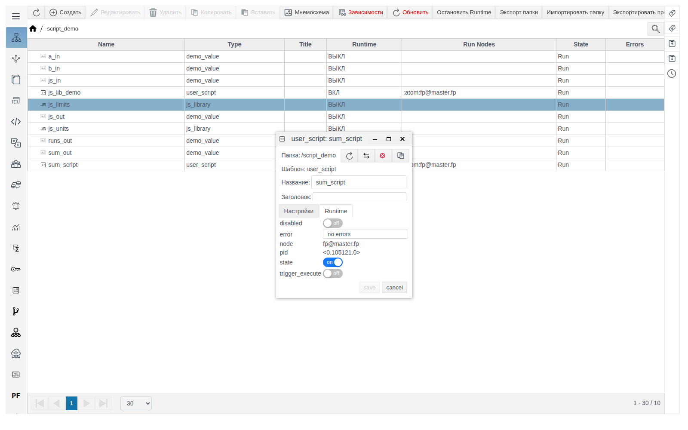
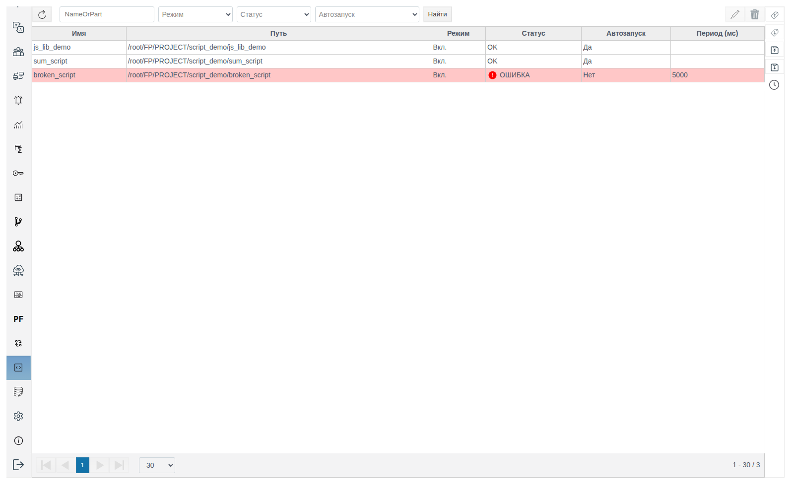
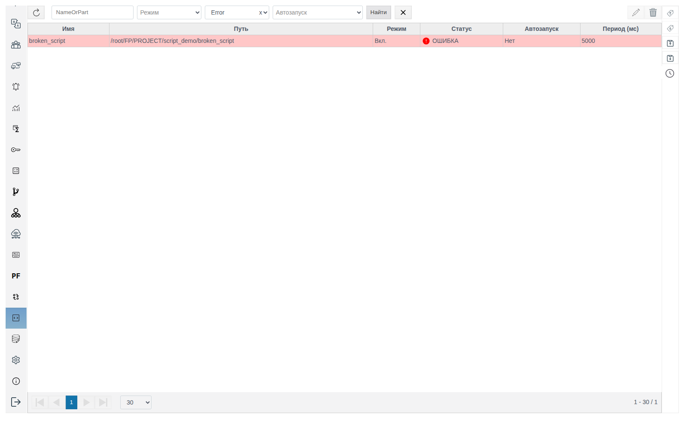
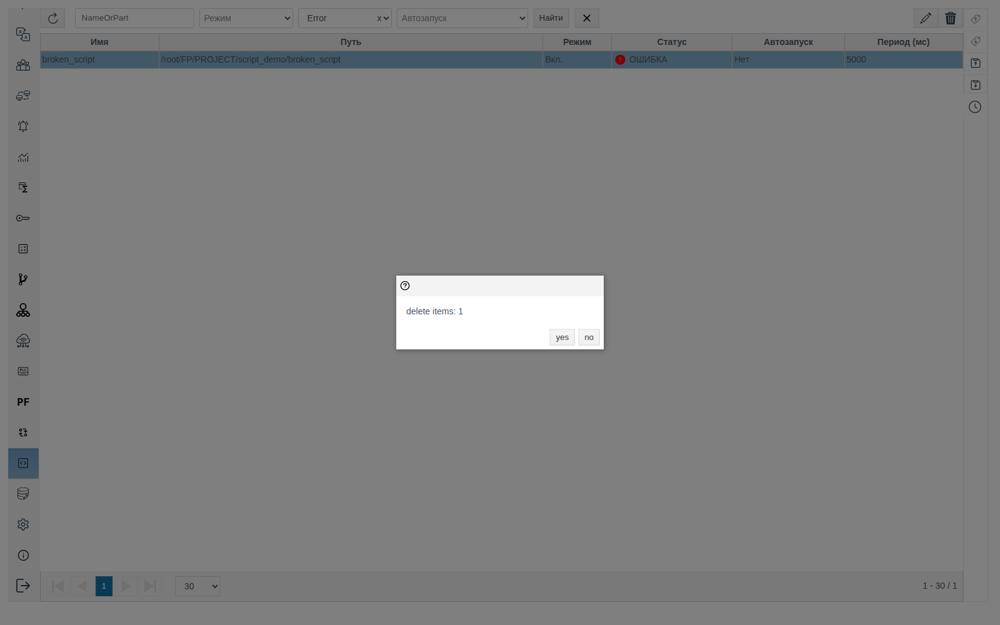

# Пользовательские скрипты (User Script)

Документ для инженера-интегратора, который пишет серверную логику проекта на Erlang или JavaScript: расчёт значений, счётчики, перенос данных между объектами.

# Глоссарий

| Термин | Значение |
|---|---|
| Пользовательский скрипт | Объект проекта типа `user_script`. Хранит функцию на Erlang или JavaScript и условия её запуска. Выполняется на сервере |
| Переменная | Имя, под которым функция видит поле объекта проекта. Задаётся тройкой «имя — объект (tag) — поле (field)» |
| `VARS` | Первый аргумент функции: значения всех переменных на момент запуска |
| `State` | Второй аргумент функции: значение, которое функция вернула в прошлый раз. Сбрасывается при перезапуске скрипта |
| Автозапуск | Режим **Выполнять при изменении значений**: скрипт запускается при изменении любой из своих переменных |
| Раздел **Скрипт** | Пункт главного меню Studio: сводная таблица всех пользовательских скриптов проекта |

# Введение

Пользовательский скрипт читает поля объектов проекта, вычисляет новые значения и записывает их в поля объектов. Скрипт создаётся как объект в **Общем виде** и запускается:

| Условие | Где задаётся |
|---|---|
| По таймеру | **Период (мс)** |
| При изменении значения любой переменной | **Выполнять при изменении значений** |
| Вручную, один раз | Вкладка **Runtime**, переключатель **trigger_execute** |

Когда брать [Calculation](../calculation/calculation.md), а когда User Script:

| Подходит для Calculation | Реализуйте в User Script |
|---|---|
| Пересчёт единиц, масштабирование | Расчёты по истории и за окно времени, скорость изменения |
| Формулы от нескольких входов: сумма, разность, отношение, процент, мощность, КПД | Накопление и сумматоры, состояние между запусками |
| Пороговые признаки и статусы | Алармы, SQL, работа с интерфейсом |
| Простые условия: ограничение диапазона, запасное значение, защита от деления на ноль | Сложная логика и управление ходом выполнения |
| Выделение бита из слова, сопоставление целых кодов состояний | Разбор протоколов, библиотеки формул |

Сквозной пример: скрипт `sum_script` в папке `script_demo` складывает значения двух объектов `a_in` и `b_in`, пишет сумму в `sum_out`, а число запусков — в `runs_out`. У всех четырёх объектов есть числовое поле `value` типа `float`. Как завести такие объекты, описано в документе [«Примитивы»](../primitives/Primitives.md).

Понадобится доступ к Studio (`http://<сервер>:9000/fp/studio`) под учётной записью с правом изменять проект.

# Основная часть

## Создание скрипта

1. В **Общем виде** откройте папку, в которой будет лежать скрипт.
2. Нажмите **Создать**, раскройте группу `system`, выберите `user_script` и нажмите **Ok**.



3. Заполните **Название**, условия запуска, переменные и код (разделы ниже).
4. Нажмите **Compile**, дождитесь `OK`, сохраните.

После сохранения скрипт сразу запускается: в **Общем виде** у него **Runtime** `ВКЛ`, в **Run Nodes** — узел, на котором он работает.



## Форма скрипта

### Панель состояния

| Поле | Значение |
|---|---|
| **State** | `RUN` — процесс скрипта работает, `STOP` — не запущен |
| **Узел**, **PID** | Узел кластера и процесс, в котором выполняется скрипт |
| **Диагностика** | Окно диагностики процесса. Доступна у сохранённого скрипта |
| **Отключено** | Остановить скрипт без удаления. В **Общем виде** у отключённого скрипта **Runtime** `ВЫКЛ` и **State** `Stop` |
| **Ошибка** | Текст последней ошибки компиляции или выполнения. `no errors` — ошибок нет |
| **Ограничение памяти (байт)** | Лимит памяти процесса скрипта. После сохранения подставляется `1024` |

### Условия запуска

| Поле | Поведение |
|---|---|
| **Период (мс)** | Скрипт запускается сразу после старта и далее с этим периодом. Пусто — таймер не используется |
| **Выполнять при изменении значений** | Скрипт запускается один раз после старта и затем при каждом изменении значения любой переменной |

Режимы можно включить вместе. Если оба выключены, скрипт стоит в `RUN`, но не выполняется, пока его не запустят вручную.

Запись скрипта в собственные переменные не запускает его повторно: зацикливания при автозапуске нет.

### Переменные

Таблица под заголовком **script**: **variable** — имя переменной в коде, **tag** — объект проекта, **field** — его поле.

1. Введите имя в **variable**.
2. Нажмите лупу в **tag**, откройте папку объекта, выберите объект, нажмите **ОК**. Выбираются только объекты из дерева проекта.
3. В **field** выберите поле. Список содержит все поля объекта, включая системные.



После заполнения строки ниже появляется пустая строка `var_1`; незаполненную строку можно не удалять. Стрелками меняется порядок, корзиной строка удаляется.

Для примера:

| variable | tag | field |
|---|---|---|
| `a` | `/script_demo/a_in` | `value` |
| `b` | `/script_demo/b_in` | `value` |
| `sum` | `/script_demo/sum_out` | `value` |
| `runs` | `/script_demo/runs_out` | `value` |

Одна и та же переменная служит и для чтения, и для записи. Записать можно только в поле, объявленное переменной.

## Код на Erlang

Вкладка **erlang**. Функция арности 2: принимает `VARS` и `State`, возвращает кортеж `{ ЗначенияДляЗаписи, НовыйState }`.

```erlang
fun(VARS, State) ->
    A = maps:get("a", VARS),
    B = maps:get("b", VARS),
    Runs = case State of
        N when is_integer(N) -> N + 1;
        _ -> 1
    end,
    { #{"sum" => A + B, "runs" => Runs}, Runs }
end.
```

| Элемент | Правило |
|---|---|
| `VARS` | Map, ключи — имена переменных строками: `"a"`, не `a` |
| Значения для записи | Map «имя переменной — значение». Ключи, которых нет в таблице переменных, игнорируются. Пустой map `#{}` — ничего не записывать |
| `State` | Второй элемент результата прошлого вызова. Пример считает целое число счётчиком, а любое другое значение — первым запуском |
| Точка в конце | Код заканчивается `end.` |

Тип значения определяется типом поля: из поля `float` придёт число, из поля `string` — строка. Сложение строковых полей даёт `badarith`.



## Код на JavaScript

Вкладка **javascript**. Асинхронная функция с теми же аргументами. Значения записываются вызовом `fp.api.set_value(путь, поле, значение)`, новое состояние возвращается в `{ state }`:

```javascript
async function(VARS, State) {
    const runs = Number.isInteger(State) ? State + 1 : 1;
    await fp.api.set_value('/root/FP/PROJECT/script_demo/sum_out', 'value', VARS.a + VARS.b);
    await fp.api.set_value('/root/FP/PROJECT/script_demo/runs_out', 'value', runs);
    return { state: runs };
}
```

- Обращение к переменным — по имени: `VARS.a`.
- Путь в `fp.api.set_value` полный, с префиксом `/root/FP/PROJECT`.
- Счётчик устроен так же, как в Erlang: целое число в `State` увеличивается, любое другое значение даёт `1`.

При смене вкладки **erlang** ↔ **javascript** текст в редакторе не меняется. Замените код целиком и нажмите **Compile**.

## Compile и сохранение

**Compile** проверяет код и передаёт его в форму. Рядом с кнопкой выводится `OK` или текст ошибки, например:

`{invalid_expression,{4,erl_parse,["syntax error before: ","Runs"]}}`



Порядок всегда один: **Compile** → `OK` → **save**.

При каждом сохранении скрипт перезапускается: код перечитывается, `State` сбрасывается.

## Ошибки выполнения

Ошибка, возникшая при запуске функции, видна в трёх местах:

- поле **Ошибка** в форме скрипта;
- колонка **Errors** в **Общем виде**;
- строка с красным фоном и статусом **ОШИБКА** в разделе **Скрипт**. Текст ошибки — во всплывающей подсказке над **ОШИБКА**.

| Текст | Причина |
|---|---|
| `badarith` | Арифметика над нечисловым значением, например над строковым полем |
| `{badkey,"c"}` | В коде читается переменная `c`, которой нет в таблице переменных |

После первого успешного запуска ошибка очищается. Значения переменных при ошибке не записываются.

## Ручной запуск

Откройте вкладку **Runtime**, включите **trigger_execute**, сохраните. Скрипт выполнится один раз; переключатель сбрасывается сам.



## Раздел «Скрипт»

Пункт **Скрипт** главного меню показывает все пользовательские скрипты проекта.



| Колонка | Значение |
|---|---|
| **Имя**, **Путь** | Имя и полный путь объекта скрипта |
| **Режим** | `Вкл.` или `Откл.` (переключатель **Отключено**) |
| **Статус** | `OK` или **ОШИБКА** |
| **Автозапуск** | `Да`, если включено **Выполнять при изменении значений** |
| **Период (мс)** | Значение периода или пусто |

Фильтры над таблицей: часть имени, **Режим**, **Статус** (`Error` / `OK`), **Автозапуск**. Выберите условия и нажмите **Найти**; крестик рядом сбрасывает фильтры.



Создать скрипт в разделе нельзя, только в **Общем виде**. Открыть скрипт — двойным щелчком или кнопкой карандаша справа, удалить — кнопкой корзины. Окно подтверждения показывает только число скриптов (`delete items: 1`); подтвердите кнопкой **yes**.



# Заключение

Порядок работы:

1. Подготовьте объекты с полями нужных типов: числа — в полях `integer` или `float`.
2. В **Общем виде** создайте `user_script` (группа `system`).
3. Объявите переменные для всех полей, которые скрипт читает и пишет.
4. Выберите запуск: **Период (мс)**, **Выполнять при изменении значений** или оба.
5. Напишите функцию. В Erlang ключи `VARS` — строки. В JavaScript значения записывайте через `fp.api.set_value`.
6. Нажмите **Compile**, дождитесь `OK`, сохраните.
7. Проверьте **Статус** в разделе **Скрипт**. При **ОШИБКА** прочитайте текст в подсказке или в поле **Ошибка** формы.
